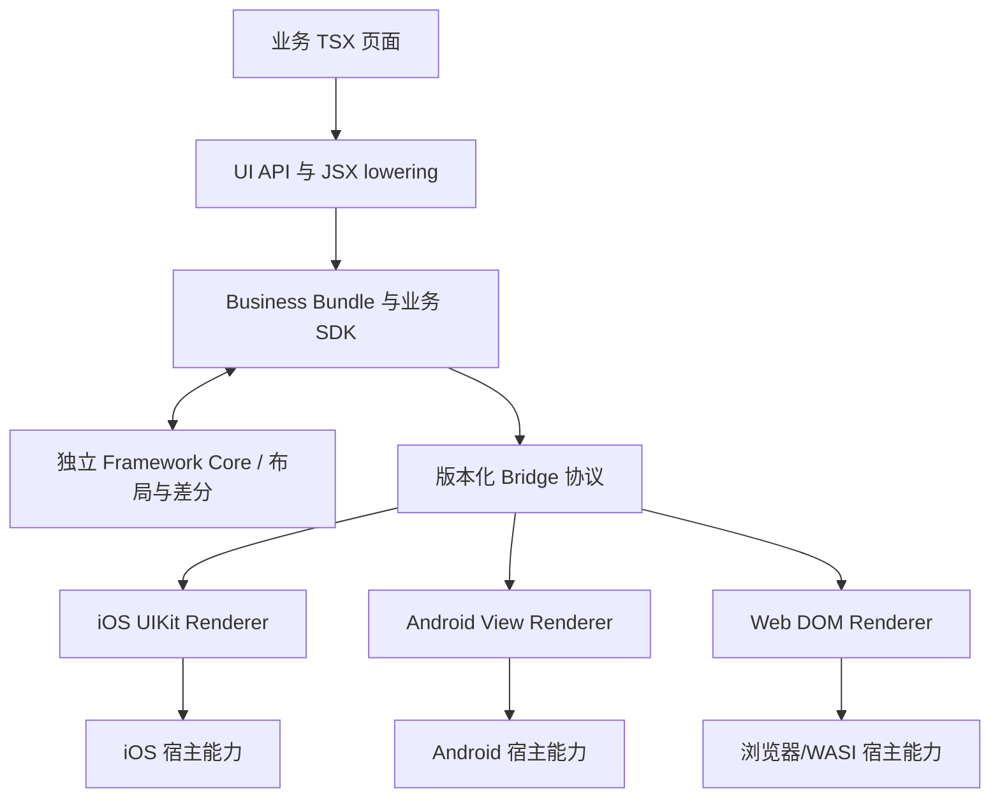

# AnseronUI 架构、运行原理与仓库规范

本文解释 AnseronUI 为什么能让同一份 TSX 运行在 iOS、Android、Web 和 macOS，以及开源仓库中各目录和 `.gitignore` 规则的含义。

## 设计目标

AnseronUI 的目标是把“业务和 UI 描述”放在共享 TypeScript/TSX Core，把“系统视图和平台能力”留在宿主：

1. 业务只写一次页面、状态、布局描述和事件逻辑；
2. Core 不依赖移动端 JavaScript 引擎，使用 scriptc AOT 编译为原生静态库或 Wasm reactor；
3. iOS、Android、Web 各自用最适合平台的渲染器创建真实控件；
4. 布局、事件、页面生命周期和协议语义保持跨端一致；
5. 网络、计时器、文本测量、系统返回键和原生组件通过宿主能力注入。

这里的“不嵌入 JavaScript 引擎”是指移动端不运行 V8、JavaScriptCore、Hermes 或 QuickJS，也不下载 JS 再解释执行；Core 仍然包含 scriptc 的内存、Promise 和调度运行时。

## 技术基础与职责

AnseronUI 的原生产物构建基于 **scriptc**，共享布局计算基于 **Flexily**；这两部分是明确的上游技术依赖。

| 层 | 实现与范围 |
| --- | --- |
| 编译器与原生运行时 | scriptc 0.4.8，固定提交 `3d1888ae5e82a01434edd49f59bff5fab7c5a9c7`；编译 TS、生成原生/Wasm 代码并提供内存和基础语言运行时。框架增加定向 async embedding 补丁，最终平台链接/打包由 SDK 工具完成 |
| 布局算法 | Flexily 0.8.5，固定提交 `4850f1fb475f8147458059b45fb4f148d14a6ab4`；使用静态入口和已适配源码计算 Flex frame。`@anseronui/layout` 负责 surface 内节点所有权，平台负责字体测量 |
| 框架与宿主 | AnseronUI 实现组件 API、TSX lowering、Hooks、协调、协议、跨端事件/服务、Renderer、路由和生命周期管理 |

来源与适配见 [编译器准备脚本](../scripts/prepare-compiler.mjs)、[async 补丁](../internal/toolchain/async-embedding.patch)、[Flexily 来源清单](../packages/flexily/UPSTREAM-scriptc-adaptation.json)和[布局包](../packages/layout/README.md)。上游完整 API 和性能描述不自动成为本框架承诺；共享 TSX 应遵循 [TS/TSX 编写限制](typescript-limitations.md)。

## 独立 Core、业务包与实例

Framework Core 独立编译布局、测量规划和渲染差分；Business Bundle 编译配置中的全部页面和业务 SDK（组件求值、Hooks、事件闭包、effect/ref、服务与生命周期）。业务变化只使业务包失效，内核变化只使内核失效；共享协议、UI 类型和编译模式变化按各自输入指纹失效。

两侧只交换版本化 JSON，Framework Core 不引用业务页面或跨库闭包。原生两个 archive 使用独立 symbol/runtime 状态，组合 C facade 保留 `anseronui_core_*` 接口；Web 使用两份 Wasm/memory。Host / surface 是运行时状态隔离，不是页面级二进制。具体产物、指纹和 ABI 见[独立 Core 与业务包](core-bundles.md)。

## 总体分层



一次渲染可以理解为：TSX 产生描述树，业务 SDK 协调组件和状态，独立 Core 计算 frame 与差分，业务 SDK 输出 Commit，宿主把 Commit 应用到真实节点；用户交互再通过协议回到 Core。

## 代码目录

| 目录 | 责任 |
| --- | --- |
| `packages/ui` | 组件、props、Hooks、Router、ref、服务类型和 JSX runtime |
| `packages/ui-compiler` | TSX lowering，把 JSX/函数组件转换成 Core 可执行的静态 TypeScript |
| `packages/core` | `kernel.ts` 为独立布局/测量/差分内核，`business-runtime.ts` 为业务执行 SDK，`contracts.ts` 为内部 ABI；`runtime.ts` 为参考组合 |
| `packages/protocol` | 输入/输出 envelope、序列号、ACK、Commit、事件和 ModuleResult 校验 |
| `packages/flexily` | 锁定的 Flexily 0.8.5 源码和 scriptc 适配副本 |
| `packages/layout` | AnseronUI 的 LayoutEngine，按 surface 管理 Flexily 节点和资源释放 |
| `packages/render-ios` | UIKit 节点、Core worker、文本测量、媒体、触摸和扩展宿主 |
| `packages/render-android` | Android View 节点、HandlerThread、JNI transport、文本测量、媒体和扩展宿主 |
| `packages/render-web` | DOM Renderer、浏览器扩展、Wasm runtime adapter 和 WebHost |
| `examples` | Counter、异步表单、基础组件、扩展、计时器和原生宿主示例 |
| `scripts` | Core staging、编译、应用生成/接入、iOS 工程生成和验证脚本 |
| `internal/design` | 设计方案、调研、适配记录和实施状态，不作为稳定 API 合同 |
| `.feature_memo` | 面向后续开发会话的功能记忆，不是发布包内容 |
| `.verification` | 编译产物、临时 staging、测试报告和模拟器产物，不应提交 |

## TSX 到原生视图的完整链路

### 1. 页面注册

`anseronui.config.json` 声明 `buildId`、源码目录、页面名称和导出符号：

```json
{
  "buildId": "shop-app",
  "sourceDirs": ["apps/shop/src/pages"],
  "pages": [
    { "name": "home", "source": "apps/shop/src/pages/home.tsx", "export": "homePage" }
  ]
}
```

### 2. Core staging 和 lowering

`scripts/stage-core.mjs` 会：

- 按目标为框架和业务分别准备 `.verification/source-<target>/framework` 与 `business`，每次 staging 清理旧副本；
- 把 TSX lowering 为静态 TypeScript，并把无本地遮蔽的全局计时器绑定到框架计时器；
- 把 `@anseronui/*` 别名改为 staged 相对路径；
- 分别生成纯内核入口和包含页面表的业务入口；
- 写出 `manifest.json` 和内容指纹。

页面表和指纹让 native/Wasm 构建知道当前 bundle 包含哪些页面，也让 Xcode 构建脚本能够发现过期 Core。

### 3. scriptc AOT 编译

`scripts/build-core.mjs` 根据目标选择编译三元组：

- `native`：macOS/本地探针；
- `ios-simulator`：iOS Simulator arm64；
- `ios-device`：iOS arm64；
- `android`：Android arm64；
- `wasm`：Wasm32 WASI reactor。

原生目标分别产出独立 Framework Core 与 Business Bundle archive，再合并组合适配器供现有 transport 链接；Android 最终生成 `libanseronui.so`，iOS 通过 Swift/C binding 调用。Web 产出两个 Wasm reactor，由组合 adapter 串行调用。默认应用构建目前固定 iOS arm64 / Android arm64-v8a，并非任意 CPU 架构通用构建。

### 4. 启动与握手

宿主先分配页面身份，发送带有 `bundleBuildId`、`runtimeEpoch`、`surfaceId`、`surfaceGeneration` 和 sequence 的 `Handshake`。Core 回复 `Ready` 和支持的节点类型；宿主发送 `CreateSurface` 后 Core 才创建页面状态。

Core 每次输出都带 sequence 和 `ackSequence`。宿主按顺序校验 bundle、runtime、surface、generation 和序号，防止旧页面、旧线程或迟到消息污染当前页面。

### 5. Commit 和 ACK

Core 生成批量命令：

- `CreateNode`、`RemoveNode`；
- `InsertChild`、`MoveChild`；
- `SetProps`；
- `SetFrame`；
- `BindEvent`。

宿主在主线程创建/更新原生节点，完成后发送 `CommitAck`。只有提交得到 ACK 后，节点 ref 和依赖提交完成的 effect 才被视为可用。提交失败会让 Core 清理相关 surface 并发出诊断。

## Core 内部原理

### 描述树和 surface

每个页面被挂载为一个独立 surface。Core 保存页面组件、Hook frame、当前描述树、节点 ID、ref、未完成服务请求和待提交 revision。页面切换会销毁旧 surface，再创建新页面；旧 surface 的异步回调和事件会被 owner/lifecycle 检查丢弃。

### 状态和 Hook

函数组件在 Core 中执行，Hook 按组件位置保存 frame。状态更新进入 Core 的更新队列；Core 重新执行受影响的组件，生成新描述树并协调节点。effect 在提交确认后执行，清理函数在依赖变化、节点卸载或 surface 销毁时执行。

### 布局和文本测量

Framework Core 的 `LayoutKernel` 按 surface 持有 Flexily 布局树，用稳定 node ID 复用布局节点。每次渲染对齐当前描述树，只创建新增节点、释放删除节点、调整变化的父子关系；布局样式变化时更新有效值，删除的样式恢复 CSS preset 默认值。未变化节点保留 Flexily 的脏状态与布局缓存；容器尺寸变化仍会重新计算受影响布局。

Flexily 计算出逻辑单位下的 frame；文本、按钮、输入框和富文本的尺寸通过 `MeasureRequest` 交给平台真实文本引擎，结果通过 `MeasureResult` 返回并进入缓存。持久化测量回调读取当前轮数据；占位尺寸、文本/字体/约束变化和已使用测量结果变化会使相关节点变脏，避免复用旧测量。多轮测量复用同一棵布局树。

内部 `ReleaseSurface` 消息释放对应 generation 的布局状态，迟到的旧 generation 释放不影响新 surface。实例关闭时显式释放剩余全部布局树。Business 与 Framework 之间仍传递完整 JSON 描述树、已提交树和测量缓存，本阶段的增量更新发生在布局树内部；宿主 Commit 差分和 ACK 语义沿用现有实现。

Framework Core 只拥有布局计算语义；平台负责字体、字形、系统控件内边距和最终单位转换。这样可以避免 iOS、Android、Web 各自维护一套近似布局算法。

### 事件分发

原生触摸、点击、输入、滚动、媒体和自定义组件事件先被宿主转换为协议输入，再由 Core 根据节点 ID、revision 和事件绑定调用 TSX 回调。触摸事件在 Core 内执行捕获、目标和冒泡阶段；`stopPropagation()` 只影响当前事件遍历。

系统返回键使用同步 `BackPress` / `BackPressResult` 协议。Core 从渲染树后序遍历 `onBackPress`，最内层优先；宿主收到 `consumed=false` 后再处理页面栈或系统默认导航。

### Module 和原生组件

`useServices().invoke()` 产生一个带 requestId 的 `InvokeModule`。宿主把 JSON 参数交给已注册 Module，异步完成后发送 `ModuleResult`。组件卸载时 Core 取消等待并丢弃迟到结果。

`NativeComponent` 使用同一套 Commit/BindEvent/InvokeModule 通道：Core 创建一个带名字的原生节点，宿主按名字查找工厂，属性用 JSON 更新，事件用 `NativeEvent` 回传，`NodeHandle.invoke()` 调用原生方法。

### 动画

声明式动画只把目标值和动画选项送到宿主；iOS 使用 `CADisplayLink`，Android 使用 `Choreographer`，Web 使用 `requestAnimationFrame`。宿主在本地插值，不逐帧穿过 Bridge、不逐帧执行 TSX、不逐帧重新布局。ref 动画是节点上的视觉覆盖，不直接修改 TSX state。

## 路由和页面返回

Router 是 Core 保留 Module。TSX 调用 `push/replace/pop/back/current`，宿主容器维护页面栈并按请求完成顺序切换 surface。页面名称必须来自 manifest；当前没有路由参数、深链、嵌套路由和页面缓存。

Android generic host 在系统返回事件中依次调用 `handleBackPress()`、路由 `pop()`、系统默认返回。Web 监听 `Escape`/`BrowserBack`。iOS 没有统一物理返回键，导航控制器或宿主返回按钮需要主动调用 `handleBackPress()`。

## 线程和并发模型

- Core 只能在自己的 owner thread 执行；平台 UI 更新只能在主线程执行；
- iOS 使用 Core worker，Android 使用 HandlerThread，Web 在浏览器事件循环运行；
- 宿主把网络、计时器、测量和交互结果排队送回 Core，不允许从宿主回调重入 Core；动画帧在宿主本地推进；
- 每个 surface 有独立 generation/revision/requestId，旧页面结果不会写入新页面；
- `dispose()` 是终止边界，宿主必须释放 worker、播放器、观察者、计时器和原生组件。

## 安全与边界

跨端协议只接受有限长度的 JSON 字符串、有限数值、布尔值、null、数组和普通对象；不传函数、循环引用、BigInt、原生对象或任意指针。平台输入/输出 envelope 仍有 1 MiB 上限，业务 Module 参数应控制在 64 KiB 内。内部 Core/业务消息是独立边界，不复用外部 envelope；Web 适配器对内部字符串使用 16 MiB 上限。

这不是安全沙箱。业务 Module 和原生组件拥有宿主权限，应用应自行校验 URL、文件、网络和敏感数据。Core 的 AOT 编译减少了移动端 JS 解释层，但不会自动消除原生代码和业务代码的安全风险。

## `.gitignore` 规则

根目录 [`.gitignore`](../.gitignore) 按依赖、生成产物和本地状态分组。它只影响未跟踪文件，不会自动移除已经进入 Git 索引的文件。

| 规则 | 忽略内容与理由 |
| --- | --- |
| `node_modules/`、`.pnpm-store/` | 可重建的依赖与包管理器缓存 |
| `.verification/` | Core staging、AOT archive、Wasm、模拟器产物与验证报告 |
| `dist/`、`**/build/` | Web、包级构建和 Gradle 产物，匹配任意层级 |
| `**/.gradle/`、`.build/`、`DerivedData/` | Gradle、SwiftPM 和 Xcode 本地缓存 |
| `*.log` | 开发与构建日志；测试基线需要单独用明确的 fixture 文件管理 |
| `/internal/toolchain/scriptc/` | 主仓库管理的 scriptc 上游源码副本，包含 AnseronUI async embedding 适配 |
| `/packages/render-android/src/main/jniLibs/*/libanseronui.so` | 构建脚本复制到 Renderer 源码目录的 JNI/Core 动态库 |
| `core.wasm`、`framework.wasm`、`core.manifest.json` | 构建脚本生成并复制到各端资源目录的 Core 与清单 |
| `/examples/native/web/public/assets/showcase.png`、`…/showcase.mp4` | Web 示例的媒体副本；源资产 `examples/components/assets/` 保留 |
| `/examples/native/ios/AnseronUIDemo.xcodeproj/` | `generate-ios-project.py` 完整生成的示例工程；不忽略业务自行维护的其他 Xcode 工程 |
| `.env`、`.env.*` | 本地环境值；`!.env.example`、`!.env.*.example` 保留不含凭据的配置样例 |
| `local.properties` | Android 本机 SDK 路径 |
| `*.jks`、`*.keystore`、`*.p12`、`*.mobileprovision` | 本地签名材料 |
| `xcuserdata/`、`*.xcuserstate` | Xcode 用户界面与个人状态 |
| `.idea/workspace.xml`、`.idea/tasks.xml` | JetBrains 个人工作区状态；保留其他可共享 IDE 配置 |
| `.DS_Store`、`*.swp`、`*.swo` | 系统与编辑器临时文件 |

没有整体忽略 `.vscode/` 或 `.idea/`，团队可以选择提交经过检查的共享配置。生成应用还有自己的 `.gitignore`，其基础规则为 `.verification/`、`dist/`、`node_modules/`；留在框架工作区中的应用同时受根规则保护。

### 应当保留的源码

- `package-lock.json`、`package.json`、`anseronui.config.json` 和构建脚本；
- TSX 页面、原生宿主源码、测试、Gradle wrapper 和可重建工程的生成脚本；
- `internal/toolchain/scriptc/` 编译器源码、`async-embedding.patch`、固定提交和 `scriptc.vendor.json` 来源清单；
- 小型图片、视频、文本 fixture 等测试输入；
- Flexily 的适配源码、测试、`LICENSE` 与 `UPSTREAM-scriptc-adaptation.json`。

Flexily 和 scriptc 都是主仓库直接管理的普通源码目录，不含嵌套 Git 元数据。Flexily 的上游提交对象仅由布局验证脚本在忽略的 `.verification/` 目录中获取，用于差分对照；不要 checkout/reset 覆盖适配源码。

### 发布边界

`.verification`、缓存、构建副本和本机签名材料不属于源码交付。需要发布 APK、`.app` 或其他二进制时使用独立制品发布流程。历史设计和 `.feature_memo` 是开发记录，不是公共 API 合同；分享前检查其中的机器路径和记录内容。

当前根目录没有项目级 `LICENSE`，需要由项目所有者在正式发布前选择并添加。本次没有把上游 Flexily 的 MIT LICENSE 复制成项目许可；第三方源码中的原始声明继续保留。框架各包当前为源码工作区使用，npm 包发布、签名和商店流程也不在现有 CLI 自动化范围内。

## 构建和验证入口

```sh
npm ci --ignore-scripts
npm run prepare:tools
npm run prepare:compiler
npm run typecheck:framework
npm run test:framework
npm run test:build
npm run test:tooling
npm run test:layout
npm run build:web
npm run build:ios
npm run build:android
```

`prepare:compiler` 会准备并 patch 锁定的 scriptc 0.4.8；升级 compiler、runtime、Flexily 或协议 minor 后，需要重新跑对应平台和布局验证。Android 需要 SDK/NDK/JDK 17，iOS 需要 Xcode 和 iOS SDK，Web/Wasm 构建需要项目锁定的 scriptc/WASI 工具链。

布局差分的上游 Git 对象、平台 SDK、Zig、模拟器和 HTTP fixture 是对应验证的前置条件；文档调整不等于重跑所有平台。Native/Wasm 探针执行前应先构建对应 Core。完整安装和运行步骤见[根 README](../README.md)。

## 架构边界

当前实现强调可运行的跨端基础和清晰的宿主协议，暂不承诺：热更新、React 兼容、深链/路由参数、页面缓存、完整无障碍实现、通用插件市场、应用签名发布自动化、任意 async fiber 强制取消和所有设备/IME 行为一致。
