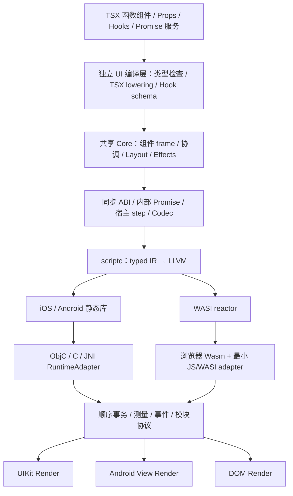

# AnseronUI：基于 scriptc 的跨端 UI 框架技术方案

> 本文保留设计演进和调研依据，提案中的 API 不代表当前已实现接口。当前实现请阅读[架构与原理](../../docs/architecture.md)和[能力清单](../../docs/capabilities.md)。

日期：2026-11-06。修订：v5（2026-11-07），在 v4 的 Promise/async-await、无 JS 引擎、热更新扩展接口和 React 风格开发模型基础上，正式引入项目内适配的 Flexily 布局引擎。状态：本文是目标方案；布局包、基础 SDK/Core、Web 参考渲染器和 Android/iOS 渲染模块已开始实施，该阶段的实际验证以[实施状态快照](./framework-implementation-status.md)为准，后续已实现的 async embedding 和三端宿主见当前[公开文档](../../docs/README.md)。框架于 2026-11-08 正式命名为 **AnseronUI**，本地包名统一使用 `@anseronui/*`，尚未发布。

迁移记录：2026-11-07 按用户要求迁至 AnseronUI 工作区，本文仍保留 v3 的设计结论与原调研日期。本文未单独注明归属的源码/测试/公共文档路径（如 `packages/`、`tests/`、`docs/`、`internal/compatibility/`）均相对于调研时独立的 scriptc 源码仓库；本方案、需求记录及后续框架工作的根目录为 AnseronUI。

调研基线：scriptc `294bb360`；本地 KuiklyUI 源码仓库，提交 `3dfc24e8`。结论来自这两个工作区的源码与已有测试定义，本次没有重跑其全平台测试。

布局实施基线：AnseronUI 的 `packages/flexily/` 与 `packages/layout/` 使用项目锁定的 scriptc/helper/runtime 0.4.8。下文第 6 节的本地包路径相对于 AnseronUI；其他未重新验证的 compiler/runtime 结论仍保留原调研边界。

## 1. 目标与核心决策

构建一套共享 TypeScript UI 与业务逻辑、通过 scriptc AOT 编译、由各端原生控件或 DOM 渲染的框架。首批交付 Android arm64、iOS arm64 真机与模拟器、Web Wasm 三端；macOS、Windows、Linux 后续按独立渲染器接入。

借鉴 KuiklyUI 的 Core/Render 分层、声明式与响应式组合、独立布局树、View/Shadow/Module 扩展协议，以及逻辑执行与 UI 提交分离的设计。采用 scriptc 现有静态库和 Wasm reactor 路线，并针对同步库 ABI、禁止回调重入和运行时实例边界重新设计桥接协议。

- 应用层：函数组件、TSX、类型化 props/children、Hooks、页面与 Promise 平台服务；独立 SDK，不依赖 React。
- 共享 Core：组件实例与 Hook frame、状态更新队列、类型化描述树/协调、布局树、Effect 生命周期、事件路由和命令生成。
- Bridge：版本化字节协议、批量提交、能力协商、请求与事件调度。
- Render：Android View、UIKit、DOM 三套独立原生适配。
- 编译与工具：生成库入口、library profile、框架协议元数据与宿主绑定，调用现有 scriptc 编译接口。

首版必须支持共享业务代码中的 Promise 与 async/await，不能以自定义 Task 替代。保持同步 C/bytes ABI，在 Runtime 内执行异步 continuation 和微任务；宿主负责网络、计时器、帧与原生 SDK，完成结果排队进入 Runtime 后兑现 Promise。必须新增宿主驱动、非阻塞的 async embedding，而不是把可执行程序的阻塞事件循环塞进 UI 宿主。

"不引入 JS 运行时"具体解释为：移动端不嵌入 V8、JavaScriptCore、QuickJS、Hermes，不下发或解释 JS，不启用 scriptc dynamic island；仍有 scriptc 的内存管理、Promise 与调度运行时。移动端下载代码及解释执行方式尚未决定；不预设 Wasm 解释器或其他 VM。Web 仍需要浏览器内置环境和最小 JS/Wasm/DOM glue，“不引入 JS 引擎”不等于浏览器中零 JS。

RuntimeAdapter 抽象执行环境及其 create/dispatch/step/dispose 生命周期，具体后端按目标平台选定。预留不透明制品输入、运行时身份/代际和能力协商边界，便于以后接入更新能力；首版不设计下载、代码替换、状态迁移或回滚流程。自绘、DEX 后端、完整 React/CSS、鸿蒙和小程序仍不在首版范围。

## 2. 从 KuiklyUI 借鉴什么

| 已查看的 KuiklyUI 实现 | 设计价值 | AnseronUI 对应设计 |
| --- | --- | --- |
| `core/.../pager/Pager.kt` | 页面拥有树、生命周期、任务与布局更新 | Surface/Page scope，显式销毁其观察者、请求与节点 |
| `core/.../reactive/ReactiveObserver.kt` | 读取收集依赖，写入触发绑定，观察者有 owner | 组件状态与 owner scope，组件实例拥有 Hook 状态与 Effect，卸载统一清理资源 |
| `core/.../layout/FlexNode.kt`、`LayoutImpl.kt` | 跨端共享布局与脏节点处理 | 共享有限 Flex 布局，独立 LayoutNode 与测量缓存 |
| `core/.../manager/BridgeManager.kt` | create/remove/insert/setProp/setFrame 等操作协议 | 类型化命令协议与按事务批量提交 |
| Android `context/IKuiklyRenderContextHandler.kt` | 执行环境和渲染层解耦 | RuntimeAdapter 接口承载 native 或 Wasm |
| Android `export/IKuiklyRenderViewExport.kt` | 原生组件注册、属性、方法与复用 | ComponentAdapter 与明确的 reset/dispose 规则 |
| Android `export/IKuiklyRenderShadowExport.kt` | 测量与真实 UI View 分离 | MeasureAdapter，支持线程限制和异步测量结果 |
| Android `export/IKuiklyRenderModuleExport.kt` | UI 之外的平台能力扩展 | ModuleAdapter 与 schema 生成的 request/result |
| Android Context/UI scheduler | 逻辑任务与主线程视图操作分离，合并 UI 任务 | 固定运行时线程 + UI 主线程，顺序化批次与回执 |
| `core-render-web` | 平台渲染器可独立演进 | DOM renderer 复用同一协议和 Core |

KuiklyUI 的多执行模式、Kotlin 委托属性、Compose 编译变换和六端生态属于它自己的技术条件。不能由此推导 scriptc 已经拥有对应能力。它的 Android JVM 执行路径也不构成增加 scriptc DEX 后端的必要条件。

布局、命令、状态等模块应按本文定义重新实现。若后续决定移植源码，需要保留来源和适用许可；本地 KuiklyUI LICENSE 对添加或启用动态加载/live update 的衍生修改有单独约束，未来若采用相关源码，需先满足该许可中的书面授权条件。

## 3. scriptc 当前基础与真实缺口

| 能力 | 源码依据 | 本方案如何使用或补齐 |
| --- | --- | --- |
| iOS/Android arm64 静态库 | `packages/compiler/src/backend/targets.ts`、`target-platform.ts` | 直接作为宿主链接产物；iOS 15+、Android API 26+ |
| 移动端库执行探针 | `packages/compiler/test/mobile-runtime-pack.test.ts`、`tests/harness/library-multi.test.ts` | 复用产物/链接验证思路，新增真实 UI 集成测试；存在测试不代表本次已执行 |
| 导出参数与结果封送 | `packages/compiler/src/library/library-profile.ts` | 用 bytes 参数/结果承载事务；由工具生成原始 C ABI 声明 |
| 同步宿主回调 | `tests/library-mode/callbacks` | 可用于受控通知；MVP 正常渲染路径优先用导出结果，减少回调重入风险 |
| Wasm reactor 与宿主 imports | `docs/content/docs/wasm.mdx`、`tests/library-mode/wasm` | Web loader 提供 WASI 适配，DOM/网络由宿主实现 |
| runtime localization | `library-profile.ts` 的 `localize_runtime` | 多个编译 bundle 使用不同前缀和私有运行时，防止符号碰撞 |
| thread instance | `library-profile.ts` 的 `instance_per_thread` | 不是任意 runtime handle；显式 context/teardown 升为 P0 前置，不能以线程退出代替销毁 |
| contract sidecar | `packages/compiler/src/library/sidecar.ts` | 编译产物身份与导出契约；框架 schema 单独生成，避免套用 reducer 专用字段 |
| 原生 Promise / async-await | `packages/runtime/src/scr_async.c`、`scr_runtime.h`、`backend/llvm/expr-async.ts` | 可执行程序已有静态实现，不需要 JS 引擎；复用语义与差分用例，不把它等同于移动端库已支持 |
| async-free library | `library/prepare.ts`、`backend/native-toolchain.ts` | 当前 SC4004/SC4005 与库链接源集仍限制 async；新增版本化 async embedding 模式、调度单元与准入规则 |
| Wasm async 降低 | `backend/llvm/expr-async.ts`、`scr_async.c` | 已有 LLVM switched coroutine 路线；库 reactor 的宿主 step 与销毁仍需新增和验证 |
| Native FFI 与库模式边界 | `docs/content/docs/limitations.mdx` | 当前 FFI 不支持库模式；不能直接在 TS Core 中调用 Yoga/Skia/平台 C 库 |
| 原生 trap 与 poisoned 状态 | `packages/runtime/src/scr_library.c`、`tests/library-mode/callbacks/probe.c` | 必须有独立错误分级；原生 trap 不是自动可恢复的页面异常 |

还需要新增：UI SDK、布局实现、渲染协议、async embedding、显式运行时生命周期、JNI/ObjC 绑定、WASI loader、原生控件适配、文本与输入处理、应用模板、打包工具和 UI 验证体系。Promise 与 context/teardown 是前置能力；热更新仅预留后续扩展接口，不属于首版交付。

## 4. 整体架构



每个逻辑 surface 对应一个可嵌入的宿主根视图，包含页面树与其资源。一个 Runtime 可管理多个 surface；路由可以是 surface 内页面栈，也可以由宿主控制多个根视图。Core 不持有 UIView、jobject、DOM 引用或原生指针，只有协议 ID。Runtime 身份与 epoch 用于隔离异步结果和生命周期；未来更新能力可在该边界上扩展，但代际切换语义暂不定义。

Android 的 Kotlin/Java 宿主仍经标准 Android 工具链生成 DEX；TypeScript Core 经 LLVM 生成机器码，静态库与 JNI shim 链接为 `.so`。iOS 以静态库和 module map 封装 XCFramework。Web 使用 `.wasm` 加 JS loader。三个端共享 Core 和协议定义，各自拥有渲染与平台服务实现。移动端执行后端由 RuntimeAdapter 抽象，首版按随包代码启动；不预设移动端 Wasm 解释执行、代码下载或在线生成机器码。

## 5. 开发模型：函数组件、TSX 与 Hooks

### 5.1 对外编程体验

用户要求组件/页面写法接近 React，同时不直接使用 React。本方案选择函数组件、TSX、props/children、单向数据流和 Hooks，全部从自有 `@anseronui/ui` 导入。TSX 与基础 Hooks 提升为首版交付，取代前两版“先公开 State/Binding 命令式 DSL、TSX 后置”的建议。显式节点/绑定可作为内部实现工具，不再要求业务手动 `bindText`、创建原生节点或管理 scope。

组件函数在初次挂载及其 props/state/context 更新时执行，返回类型化 UI 描述树；框架协调后产生原生命令。`useState` 返回本次 render 的值快照，不做“组件只执行一次、局部变量自动变成信号”的隐式改写。React 包、React DOM、react-reconciler、Fiber 与 React Native 均不纳入运行依赖，不宣称 React 生态库可直接运行。

以下是目标 API 示意，尚未实现或编译验证；`UIElement`、Hooks、属性和页面注册名均为提案：

```tsx
import {
  View, Text, Button, definePage,
  useState, useServices,
} from "@anseronui/ui";
import type { UIElement } from "@anseronui/ui";

interface CounterProps {
  title: string;
  initialCount: number;
}

function Counter(props: CounterProps): UIElement {
  const [count, setCount] = useState(props.initialCount);

  return (
    <View style={{ flexDirection: "row", gap: 12 }}>
      <Text>{props.title}: {count}</Text>
      <Button title="+1" onClick={() => setCount(value => value + 1)} />
    </View>
  );
}

function HomePage(): UIElement {
  const [message, setMessage] = useState("准备加载");
  const { http } = useServices();

  async function loadMessage(): Promise<void> {
    const text = await http.getText("/api/message");
    setMessage(text);
  }

  return (
    <View style={{ padding: 16, gap: 12 }}>
      <Counter title="计数" initialCount={0} />
      <Text>{message}</Text>
      <Button title="加载" onClick={loadMessage} />
    </View>
  );
}

export default definePage("home", HomePage);
```

`useServices()` 返回当前组件 owner 的稳定服务 facade，HTTP 等操作自动登记在 owner scope，卸载/旧代退休时取消。组件卸载后的 setter 被忽略且开发模式诊断；scope/generation 校验仍然保留，不能仅靠业务在每个 await 后手工检查。重复点击的请求顺序由业务选择串行、禁用、取消前一次或 request revision/latest 策略，框架不默认把每个 Promise 变成 latest-wins。

页面也是函数组件；`definePage` 增加静态路由身份、参数 schema 和宿主生命周期接入，不引入另一套页面基类。自定义组件通过 props 与 children 组合，事件回调为具体函数类型。View/Text/Button/TextInput/ScrollView 等是跨端宿主组件；`onClick` 表达统一激活，触摸、键盘和无障碍由 renderer 映射。style 是闭合类型的跨端布局/外观子集，不承诺 CSS 和 DOM 属性全集。TextInput 初版使用明确的 `value/onChangeText`，不用伪造完整 DOM Event。

### 5.2 组件实例、更新与协调

- 实例身份由父组件实例、组件类型、显式 key 或非 keyed 位置决定；同位置/type/key 保留状态，换 type/key、移除再插入则卸载/重挂载。组件应定义在模块顶层；每次 render 新定义组件函数产生不稳定身份，开发诊断不将其静默视为同一个组件。
- setter 接受新值或 `(previous) => next`，按队列顺序应用。当前事件/微任务 checkpoint 内合并脏组件与重复更新，不承诺跨 await、timer 和原生回执属于同一批。连续两个 `setCount(value => value + 1)` 累加两次；事件闭包中的 count 仍是该次 render 快照。
- 按明确定义的 `Object.is` 等价规则比较 state/deps，引用类型用身份比较，不做深比较/JSON stringify。对象状态按不可变替换约定更新；编译器检查当前 scriptc 对数值边界、引用身份和 record 复制的支持，尤其不能在跨 native/Wasm 路线上悄悄改变比较语义。
- 首版重算脏组件和必要后代，进行类型化树协调；不实现可中断 concurrent render、Suspense、transition 或 render 中抛 Promise。render 和 updater/memo 计算必须纯，render 中 setState 或发起网络等副作用报框架诊断。相同 props 的 memo 优化在正确性与实测后增加。
- 描述树只记录组件、类型化 props、children、key 与事件表引用，保留实际布局树和 native render node。组件 render 不直接变动原生视图；所有结构/属性更新仍通过批次/ACK 提交。组件重执行不等于销毁整棵 native 树，也不要求整页每次更新。
- 列表支持熟悉的 `items.map(item => <Row key={item.id} ... />)`；同级 key 必须唯一，稳定业务 key 重排保留组件状态。可变列表缺 key 或重复 key 给开发诊断；不能拿数组索引冒充稳定业务身份。首版有界列表，虚拟列表另行扩展。

准备中的 render 使用草稿 frame/tree，状态队列以 watermark 标记本次消费范围；布局测量的重复推进不能重复应用 updater 或提前执行 Effect。提交 ACK 后推进 committed revision、确认消费与发布对应的事件表；期间到达的事件先入队，按 revision 验证后交付，避免新 native 视图触发旧闭包。未提交即失败的草稿丢弃，不回滚已确认的业务状态；renderer 中途失败按第 12 节重建。首版限制每个 surface 同时一个待确认提交，先保证这套语义正确，再增加流水线。

第一版先采用小型类型化树与协调器，保留将静态 TSX 子树编译成模板、直接属性 patch 的优化空间；优化必须保持函数重执行、快照闭包与实例身份等已公开语义。不能用 `createElement(type: any, props: any)` 和任意反射来绕过静态编译边界。

### 5.3 Hooks 的首版契约

| API | 首版语义 | 生命周期与限制 |
| --- | --- | --- |
| `useState<T>` | 初始值/惰性初始化、稳定 setter、函数式更新 | 初始值只在挂载时使用，props 变化不自动重置；泛型在 UI 编译层具体化 |
| `useReducer<S, A>` | 类型化 reducer 与稳定 dispatch | reducer 纯，Action 使用闭合类型，按更新队列执行 |
| `useRef<T>` | 每实例稳定的可变容器，写入不触发 render | 首版用于运行时数据；native view ref 用生成的受控 handle，不暴露平台指针 |
| `useEffect` | 提交成功后运行 setup，可返回同步 cleanup | 依赖变化先清理上次 setup，再运行新 setup；卸载清理；见下文时机 |
| `useMemo` / `useCallback` | 按依赖保留计算值/函数 | 纯优化，不承诺跨卸载或 Runtime 重建保留缓存/闭包 |
| `createContext` / `useContext` | 类型化 Provider 和最近祖先读取 | Provider 更新传播给消费者；上下文声明在模块级并生成静态 ID |
| 自定义 `useXxx` | 组合以上 Hooks 与服务 | 静态解析依赖，遵循相同调用规则，不接受任意动态 hook 工厂 |
| `usePageLifecycle` | 订阅 show/hide 等宿主页面状态 | 与挂载/卸载分开，隐藏不自动销毁组件或重跑全部 Effect |

Hooks 只能在组件/自定义 Hook 顶层、固定顺序调用；条件、循环、普通事件和 async 函数中调用会诊断。编译器分析自定义 Hook 调用链，对无法静态证明的形态拒绝而不是猜测。每组件生成具体 Hook frame 和展开后的 slot schema；运行时只存具体类型，避免 `any[]`。泛型 Hook、tuple destructuring、`T | updater` 等需要原型验证/特化，不能由 TS 类型检查通过推断 scriptc 已可编译。

`useEffect(setup, deps)` 中省略 deps 表示每次成功提交后重跑，`[]` 表示当前挂载一次，固定长度依赖数组逐项比较；开发工具检查缺失依赖并提示 stale closure。setup 不接受 async 函数，因为 Promise 不是 cleanup。异步请求可放在事件中，或在同步 setup 内启动带 AbortSignal/错误处理的 async 函数并同步返回取消函数。事件入口接受 `void | Promise<void>`，自动观察 rejection；Effect 内自行启动的 Promise 仍必须被显式处理，不能承诺自动捕获任意浮动异步错误。

Effect 在相关 UI 提交 ACK 后回到 owner 线程调度，不能在 render、测量等待或隐藏候选版本准备阶段执行。为每次成功 setup 记录唯一 cleanup；新 render 淘汰尚未运行的 setup 时可跳过它，已运行 setup 必须在依赖替换/卸载清理。组件树统一按规定的子节点先于父节点顺序执行被动 setup/卸载 cleanup，同一组件按 slot 次序；cleanup 抛错记录诊断并继续清理其他资源。无 native 命令的提交也有逻辑 commit 边界。首版在被动 Effect 排空前不处理下一次普通 UI 事件，防止多版提交队列造成 setup/cleanup 混乱。

该 Effect 时机不保证发生在屏幕绘制之后，也不提供同步阻塞主线程的 `useLayoutEffect`。跨端布局读取使用异步 `measure` 能力，不能假设 hook 返回时可以读取 DOM/UIView。首版不模拟开发模式的双执行探测；严格运行时规则由自己的检查实现。普通 render/Effect 业务错误进入框架 ErrorBoundary 或页面错误页，协议/native trap 仍遵守第 12 节边界。

### 5.4 TSX 编译链与支持范围

编译链为“原始 TSX + 自有 JSX 类型 → UI 类型检查/约束诊断 → UI lowering 与 Hook/schema 生成 → 具体 TypeScript/工厂调用 → scriptc typed IR → LLVM native/Wasm”。构建期间使用 TypeScript AST/类型能力不意味着移动端带 TypeScript 或 JS 引擎。Node 参考执行运行同一份生成的框架代码，用于框架语义差分，不把 Node 当作 React 行为 oracle。

提供自有 JSX namespace/Element/children 类型，编辑器补全来源是框架组件定义；不导入 React 类型或 `react/jsx-runtime`。可以提供自有 JSX factory/runtime 协议，但首选 UI 编译器直接生成每个组件专用的 props/frame/element 创建代码，避免通用联合 props 动态调用；若暴露 `jsxImportSource`，须指向自己的包并验证其与专用 lowering 一致。

首版支持命名函数组件、类型化 props/children、Fragment、文本表达式、条件/三元分支、keyed map 和静态可解析组件引用；children 数组规范化有明确规则，null/undefined/boolean 为空，数字/字符串只在 Text 内容中合法，View 内裸文本给诊断。Fragment 在 native 无对应 View，但保留协调身份。props spread 只接受可静态展开的闭合 shape，保证求值一次、从左至右和后写覆盖；首版不开放任意 runtime tag/string component、未约束 HOC、动态组件注册与反射。

scriptc 当前源码可解析/保留 TSX AST（`frontend/ts7/source-parser.ts` 和相关 AST 测试），模块解析也识别 `.tsx`，这些证据并不证明已经有可用的 UI/JSX lowering。UI 编译层与 JSX 类型、组件/Hook 运行时都要新增；输出必须通过现有 typed IR 验证，不能修改兼容性声明来掩盖不支持的生成形态。

### 5.5 组件状态与未来重载

组件 ID、实例 key/path 和 Hook signature 可作为未来开发重载能力的诊断或兼容性输入，但首版不承诺状态保留、snapshot adapter 或组件原位替换。useRef 中的句柄、memo/callback、Promise 与 Effect closure 的跨运行时恢复语义均未定义。若后续需要状态迁移，应另行设计显式 schema 与兼容规则，不依据 Hook 顺序或源码行号推断状态兼容；也不承诺 React Fast Refresh 行为。

## 6. 树与布局

维护三类对象：Component instance/Hook frame 负责状态与行为；LayoutNode 负责尺寸约束和脏标记；宿主 RenderNode 负责真实原生视图。首版一个可渲染节点对应一个 RenderNode，保留未来无视图节点和 flattening 优化空间。

布局在共享 TypeScript Core 中完成，采用项目内克隆并适配的 **Flexily 0.8.5**，来源提交 `4850f1fb475f8147458059b45fb4f148d14a6ab4`，保留 MIT 许可。实现位于 AnseronUI 的 `packages/flexily/`，框架通过 `packages/layout/` 的 `@anseronui/layout` 入口使用，静态低层入口不加载 composable/终端文本插件。用户于 2026-11-07 授权在适配编译通过后将其作为项目布局引擎，取代此前从零自研有限 Flex 的建议。

沿用 Flexily 的 row/column、grow/shrink/basis、wrap、gap/padding/margin、min/max、absolute、aspect-ratio、RTL 和数值测量/baseline 等能力；这些不等同完整 CSS 或 Yoga 兼容。框架组件 style 合同仍须逐项定义，不能自动把 Flexily 全部低层能力暴露为公共 API。`LayoutEngine` 默认显式使用 CSS preset，保存每个 surface 的节点所有权，支持释放子树与幂等 dispose，并在清理时解除测量/baseline/CQ 回调；这不代表 scriptc runtime 已具备完整实例销毁或无泄漏证明。

逻辑单位由各端映射为 iOS point、Android dp、Web CSS pixel。需注意当前 Flexily 内部按整数网格取整，尚不支持按设备像素比例选择连续布局模式；此前“只在渲染边界取整”的目标尚未由该引擎满足。高 DPI/小数坐标政策是后续明确的适配事项，不能让各端独立重排结构布局来掩盖差异。

选择共享 TS 布局可共用 scriptc 静态编译与 Node 差分验证，且避免当前 library 模式 Native FFI 对直接接 Yoga 的限制。最新验证以 scriptc 0.4.8 编译实际引入的源码：两组共 1017 行布局输出在原版 Node、适配版 Node、native 间逐字节一致；额外 engine 用例通过 native executable、C 宿主调用静态库与 Node WASI 执行 Wasm reactor。上游 Node 行为回归 2648 项通过、1 项跳过。详细范围、来源和复现命令见[适配报告](./flexily-scriptc-adaptation.md)与[布局包说明](../../packages/layout/README.md)。Android/iOS library、浏览器 WASI/DOM adapter、异步文本缓存、长期内存和端上性能仍是 P0 验收项；不能以当前结果声称完整跨端框架已经可用。

### 6.1 文本与固有尺寸

文本测量必须由各平台文本引擎执行，不能用字符数估算宽度。借鉴 Kuikly Shadow 的测量职责，重新定义异步批量测量协议，避免 Core 线程同步等待 UI 线程。

1. Core 根据当前约束查询测量缓存；缓存缺失时返回 `MeasureRequest`，暂不提交依赖该测量结果的视图事务。
2. 宿主在允许的线程测量：UIKit 文本实现、Android StaticLayout/等价实现、Web 测量元素；返回尺寸、baseline、实际约束与内容版本。
3. 结果作为新的输入进入 Core，完成布局，返回可提交的 UI batch。
4. 字体、字号缩放、locale、direction、文本、最大宽度、截断方式等进入缓存键；过期结果按测量版本丢弃。

同一逻辑更新最多进行三轮测量布局，超出时输出 `LAYOUT_NOT_CONVERGED` 并保留上一个完整画面，不能持续循环。对依赖父尺寸的嵌套文本约束单独建立收敛用例。首帧先等待必要测量，不把占位尺寸误报为最终布局。

文本使用相同语义但允许系统字体与栅格化差异；以换行、溢出、基线与布局容差验收，不承诺三端像素一致。富文本、字体 fallback、复杂 bidi 在基础文本后逐步开放。

## 7. ABI 与版本化命令协议

复用 library profile 的 `bytes → bytes` 导出作为事务通道。raw C 函数签名由 profile 中参数/结果封送规则生成；bytes 结果通常需要输出指针与长度槽，不手写成 C 的“返回数组”。概念层入口如下：

```ts
// 拟新增的应用层导出，经过 profile 映射后得到实际 ABI。
export function dispatch(input: Uint8Array): Uint8Array;
```

编译器生成的 runtime init 每个新 context/实例只执行一次；业务 `CreateSurface` 是消息，不会再次调用 init。`dispatch` 负责投递协议事件，不承诺把整个 async handler 执行到结束。宿主通过拟新增的 `step` 推进就绪 continuation/微任务并提取命令、测量与 effect；外部结果通过队列进入，空闲时返回控制权，不能阻塞等待网络。字节结果复制后再做下一次可能使 arena 失效的调用。

Promise 对象、闭包、coroutine frame 和异常只存在于自己的 Runtime；原始 C 导出仍为同步函数，不能返回原生 Promise 指针给 Swift/Kotlin，也不跨 ABI 挂起宿主栈。宿主通过 requestId/result 消息完成异步互操作。拟新增的 context/step API 见第 8 节，现有 bytes profile 不会自动提供这些能力。

### 7.1 帧格式

P0/P1 使用 UTF-8 JSON 字节作为可观测协议，schema 驱动生成具体 codec，不使用 `Record<string, any>` 或不受控递归对象。受支持的属性由闭合联合类型表示。热路径优化基于实测，再引入带版本号的二进制编码；不在没有数据前承诺零拷贝或固定性能收益。

Envelope 包含 `protocolMajor`、`protocolMinor`、`bundleBuildId`、`runtimeEpoch`、`surfaceId`、`surfaceGeneration`、`sequence`、`ackSequence` 和 payload。surface/node/request ID、epoch/generation 与序列计数采用跨 native/Wasm 可精确表示的 u32 语义，预留 0 为无效；build 身份使用长度受限的字符串/hash，类型由 schema 固定。运行时身份字段用于隔离异步结果，不代表已定义更新协议。数值在进入 ABI 前校验，计数溢出须切换 epoch 或受控重建，不能静默复用。节点 ID 在 surface generation 内不复用。

| 输入族 | 例子 |
| --- | --- |
| 运行时/页面 | Handshake、CreateSurface、Show、Hide、Resize、DestroySurface |
| 交互 | Tap、InputChange、CompositionStart/Update/End、Focus、Scroll |
| 平台结果 | ModuleResult、TimerFired、FrameTick、MeasureResult |
| 提交反馈 | CommitAck、CommitFailed、RendererLost |

| 输出族 | 例子 |
| --- | --- |
| 视图树 | CreateNode、InsertChild、MoveChild、RemoveNode |
| 视图属性 | SetProps、SetFrame、BindEvent、SetAccessibility |
| 平台操作 | InvokeModule、CancelRequest、ScheduleTimer、CancelTimer、RequestFrame |
| 测量与诊断 | MeasureRequest、Diagnostic、SurfaceDisposed |

### 7.2 顺序与提交语义

- 每个 surface 按 sequence 顺序处理，generation/epoch 不匹配的事件和结果直接丢弃。命令可携带 transaction ID；依赖测量的事务只有布局完成后才能进入 render commit。
- 主线程在一个调度单元中应用完整 batch，先检查协议、组件与节点引用，再按合法顺序创建、插入、更新和删除。它提供有序提交，不承诺原生 View 操作异常时能完整回滚。
- 发生中途 renderer 错误时停止该 surface，清空原生树，通过明确的重建流程恢复。对未确认提交的 command batch 不做盲目重放，防止重复网络请求等副作用。
- UI `CommitAck` 只表示视图操作已应用；首帧可见时间通过平台绘制/帧回调单独记录，不能用 ACK 冒充。
- 不丢弃 create/remove/module 等结构命令；只合并同一提交前可覆盖的属性写入。高频 scroll/move 按帧合并，tap、IME、请求结果保持顺序。
- 队列有界；超出高水位暂停新的 Core 渲染计算，先消费 ACK。交互与销毁有独立优先级，过载时给出诊断；每入口限制消息数和字节数。

UI commit 与平台 effect 使用不同的确认序列：布局等待测量时，已明确发出的请求仍可按 effect 序列执行。宿主按 epoch/requestId 记录已接受的 effect，重复传输只重发接受回执，不重复执行。进程崩溃后的业务“恰好一次”不在桥协议保证内，支付等业务需服务端幂等键。握手声明所需模块与权限；宿主负责用户权限申请和拒绝结果，Core 不绕过宿主调用原生能力。

### 7.3 内存所有权

native 输入按现有 ABI 进入库；宿主复制 bytes 结果后才能调用 result reset/collect 或下一次会使结果失效的导出。回调参数若被使用，只在回调期间借用，跨线程前复制。Wasm 宿主输入使用 `scriptc_alloc/free`，返回数据属于结果 arena，不可交给 free；每次可能分配的调用后重新读取 `memory.buffer`。

任何宿主 callback 执行期间都不得进入 dispatch/init/collect/reset/注册函数，也不得让 Swift、ObjC、C++ 或 JNI 异常穿过库调用帧。同步产生的原生事件先放入宿主队列，在外层导出返回后再进入 Core。

框架自己的 `ui.manifest.json` 描述协议版本、组件/模块 schema hash、目标与 bundle 身份。现有 compiler sidecar 面向特定 model/msg contract，不保证直接适配 UI dispatch；P0 验证后决定复用其兼容字段还是从同一 schema 生成独立元数据，不能篡改已有 sidecar 格式。

## 8. 调度、实例与页面生命周期

### 8.1 线程与可推进的调度

一个 bundle 的原生运行时固定在一条长期存在的 OS 线程上串行执行。Android 使用 HandlerThread；iOS 使用 NSThread 加自有任务队列或等价固定线程调度。UIKit/Android View 的所有操作在主线程。Web 首版可在主线程执行 Core step，测量/提交仍经过事件队列；持续超预算时将 Wasm 移至 Worker，DOM 留在主线程。step 预算只能限制任务边界，不会抢占任意 native 同步死循环；Wasm 指令预算/中断能力必须在选型与原型中单独验证。

iOS 的普通 serial DispatchQueue 只保证串行，不保证始终使用同一条 OS 线程；若启用 `instance_per_thread`，不能直接把 serial queue 当固定线程。首版不以该选项模拟 runtime handle；新 context API 仍限定同一 context 只在其 owner 线程进入，跨线程仅投递宿主已复制的消息。

### 8.2 三层实例身份

- Bundle：一份编译代码与静态链接身份。多个独立 bundle 使用不同 symbol prefix，并开启 `localize_runtime`；不能把同一 `.a` 重复链接当作动态实例化。
- Runtime：一个库状态与运行时状态集合。现有 native 库没有任意 `createRuntime()/destroyRuntime(handle)`；线程实例也不提供完整 teardown。
- Surface：框架在一个 Runtime 内管理的逻辑页面/根视图，可多开、可销毁，用 surfaceId 与 generation 隔离业务资源。

Runtime 管理多个 Surface，不为每页面创建线程，不在关闭一个页面时销毁其他页面的 runtime。未来若实现运行时代际替换，可复用 Runtime 的身份/epoch 与显式 dispose 边界，但并存、切换和回收策略尚未设计。DestroySurface 必须断开状态/闭包引用、移除原生事件、取消平台请求和计时器、清理测量缓存与结果队列，并在安全边界执行 collect；之后通过内存曲线验证没有随开关次数线性增长。

`instance_per_thread` 当前在线程结束时没有完整 teardown，不能声称线程退出就回收运行时全部内存。显式 context/teardown 是 P0 前置，需盘点并迁移 allocator/RC roots、Promise/continuation、微任务、异常状态、结果 arena、timer、宿主请求注册和诊断状态等可变状态，不能只给现有全局状态外套一个 handle。该生命周期边界也为未来替换 Runtime 提供基础，但不规定代码从何处加载、如何校验或何时切换。

### 8.3 拟新增的 embedding 契约与扩展点

以下是运行时能力清单，不是现有 C 头文件声明；参数所有权、返回错误码、ABI/version 和线程规则需单独 RFC 冻结：

- `create(config)`：创建隔离的 Runtime context；Wasm adapter 对应独立 module instance/linear memory。
- `post(handle, eventBytes)`：由 owner 线程接收已复制事件；宿主线程安全邮箱和 wake 机制在 adapter 层，不直接跨线程改 Promise。
- `step(handle, budget)`：执行可运行工作，不 sleep、不等 I/O，返回 ready/idle/pending-dispose、命令与下一 deadline；预算在任务边界检查。
- `nextDeadline / hasPendingWork`：宿主安排计时器和 wake，避免忙轮询。优先完成当前微任务 checkpoint，预算用尽时可让出 OS 线程，但不能提前消费 timer/下一个 UI 事件破坏顺序。
- `beginDispose / destroy`：停止新请求、取消可取消 I/O、隔离旧回调、受控清理 roots/frames/arena，确认没有执行中宿主栈后释放。允许未完成 Promise，但必须验证释放路径和资源稳定性。

为未来替换执行内容保留 adapter 扩展点：宿主通过统一 RuntimeAdapter 创建并销毁 context；创建输入可接受不透明的 artifact/source 描述，adapter 声明支持的能力并返回运行时身份。artifact 格式、取得方式、信任校验、版本兼容、状态迁移、激活/回滚均不属于当前接口承诺，待需要热更新时另行设计。首版仍可只接受随应用交付的静态代码。

不能直接导出 `scr_loop_run()` 作为 step：当前它运行完整的可执行程序事件循环，可能等待或 sleep；`scr_loop_set_io()` 也不等于一个已完成的 UI embedding API。销毁不承诺把每个被废弃 continuation 的用户 `finally` 都运行完；网络/文件等外部资源由宿主注册表关闭，业务必须另有显式 dispose。

生命周期状态为 `Created → Mounted → Visible/Hidden → Disposing → Disposed`；宿主后台状态和 surface 可见性分开表达。Destroy 开始后拒绝新请求，晚到事件按 generation 失效，完成原生资源销毁后 ACK。支持旋转、窗口 resize、safe area、字体缩放、键盘遮挡和宿主根视图脱离。

## 9. Promise、async/await 与平台服务

### 9.1 不依赖 JS 引擎的实现

Promise 需要状态机、reaction 队列和异常传播，不要求存在 JS 解析器、字节码 VM 或 eval。scriptc 的 `scr_async.c` 已有 Promise、微任务、timer heap、await/异常处理；native 可执行程序主要使用栈式 fiber，Wasm 使用 LLVM switched coroutine。新增工作是把这些能力安全接入 library embedding，并使状态可归属、可推进、可销毁。

不能仅删除 SC4005：新模式应由 library profile 显式 opt-in 和版本化，允许库内部 async，原始导出仍同步；保留旧同步库模式的限制。初始化入口保持同步，以显式 `start()`/Ready 消息表达异步启动；首版不将任意 top-level await 自动纳入库支持。更新 IR 验证、运行时源集与链接、runtime pack、cache identity、产物特性声明、宿主绑定和测试，不把 executable 依赖的 child/process/系统 I/O 一并带入移动端。

移动端 native 不预设桌面 `ucontext`/栈切换可直接复用。优先评估将已有 Wasm 栈无关 coroutine lowering 推广为 native continuation；需要审查 target 限制、异常/RC 与 suspend frame 销毁，这属于编译器工程。若先使用 fiber 原型，则 iOS/Android 真机、sanitizer、栈占用、取消和销毁必须单独通过；原型不自动成为生产方案。Wasm 模式已有 coroutine 路线可借鉴，但 reactor async embedding 仍未实现。

依赖审计明确排除 dynamic island、JS parser/eval 与 V8/JSC/QuickJS/Hermes 引擎；不能仅因文件名含 `_dyn` 就认定它是 JS 引擎。正则可能使用独立 libregexp，其来源与整套 JS VM 不同，仍应出现在依赖清单中。必须用链接 map、导入/符号和包依赖验证最终产物；不能只靠构建开关声明“无 JS 引擎”。

### 9.2 对外语义与范围

首版目标包含 Promise 构造/resolve/reject、then/catch/finally、async/await，以及 all/race/allSettled/any；每项以源码与差分用例确认当前已实现范围，缺项补齐后才能宣称支持，不以这份清单扩大现有 scriptc 兼容性声明。thenable assimilation、链式返回值/抛错、组合器顺序与空输入、reject 的错误形状也需覆盖。

Promise executor 同步执行，async 函数在首次挂起前执行同步前缀；then/await continuation 进入微任务，包括 await 已兑现 Promise。微任务 checkpoint 在普通事件/timer 前完成；不通过直接调用回调伪造兑现。框架根据 checkpoint 报告未处理 rejection，支持后续补 handler 的状态变化，避免把“每次 step 暂时没有 handler”误报为最终错误。

高频纯微任务链可能长期占用逻辑执行，需诊断与调度预算；预算不会让任意业务代码自动可抢占，也不能为了平滑 UI 改成 timer 优先。标准 Promise 自身不可取消；HTTP/sleep/存储 API 通过 AbortSignal/Scope 取消底层操作，并按已定义语义 reject 或停止交付。页面销毁后仍须检查 owner/generation，不能让迟到 continuation 修改新页面。

### 9.3 平台异步桥与动画

平台模块使用生成的 schema：`moduleId + methodId + requestId + runtimeEpoch + surfaceGeneration + payload`。SDK 创建 Promise 并登记 resolver，发出 InvokeModule；宿主完成后仅复制 ModuleResult 入队并 wake owner 线程；step 校验身份后兑现 Promise，后续微任务推进业务。resolver 不暴露为原生函数指针，不跨 runtime generation 保存或转移。

网络由 URLSession、Android 网络适配器和浏览器 fetch 实现；sleep/timer 使用宿主计时器；存储由宿主存储适配器实现。先统一 HTTP 状态、错误分类、超时/取消、UTF-8/bytes 与大小限制。Cookie、代理、重定向、后台请求等按能力声明，未经测试不声称三端完全一致。标准 Promise 调度与平台 timer 的 tick/精度语义分别定义。

动画分两种：opacity/transform 等交给宿主动画系统，Core 收完成/取消事件；需要业务参与的动画由宿主 VSync 发 FrameTick，Core 批量计算。原生滚动和输入反馈尽量留在 UI 线程，不为每个触摸采样跨 JNI。Surface 销毁时停止动画并清理原生 completion closure。

## 10. 热更新能力预留

当前只预留可扩展边界，不设计热更新方案，也不把任何可下发中间码或执行引擎列为已选路线。首版按随应用交付的代码启动 Runtime；下载、签名、制品存储、兼容性策略、状态迁移、双实例切换、回滚和渠道规则均留待后续需求明确后另行设计。

预留的接口边界限于：RuntimeAdapter 负责创建、推进和销毁 Runtime；创建入口接受不透明的 artifact/source 描述，具体后端可声明能力；Runtime 与消息保留身份/epoch，使销毁后的异步结果可以被拒绝；宿主通过版本化协议进行能力协商。首版 artifact 仅代表随包产物，不要求它可下载或可替换。接口名字、字段和 ABI 仍需在实现 RFC 中冻结。

资源或受限配置的更新也不在本次设计范围内。将来若确定要下发可执行逻辑，需针对目标平台和分发渠道重新评估政策，并独立决定代码格式、信任校验、生命周期、状态兼容、失败恢复与内存峰值；本方案不预先承诺 Wasm、JS 字节码、Lua 或其他 VM。

## 11. 三端渲染器

| 端 | 宿主实现 | 原生 UI | 产物 | 重点 |
| --- | --- | --- | --- | --- |
| Android | Kotlin + C/JNI shim | ViewGroup、TextView、EditText、ScrollView 等 | AAR，内含 arm64-v8a `.so`、Kotlin facade 与 metadata | 主线程批量更新；JNI 全局引用释放；R8 keep 规则；IME 与 Activity 销毁 |
| iOS | ObjC/C shim + Swift facade | UIView、UILabel、UITextField/UITextView、UIScrollView 等 | XCFramework，区分 device arm64 与 simulator arm64 | ARC 与借用指针隔离；主线程 UIKit；模块异步回调与页面 generation |
| Web | TypeScript/JS loader | DOM elements + 有限 CSS | `.wasm`、loader、metadata、资源清单 | WASI imports 实际满足；字体 ready；DOM 测量；内存增长与实例重建 |

Button 首版是框架统一交互语义，宿主可由容器和文本组合；无障碍 role/action 要显式映射。TextInput 必须明确受控值、selection、composition 与 event revision；更新 value 时不能覆盖较新的输入或破坏中文输入法组合状态。ScrollView 的原生偏移与布局坐标需要统一单位，视图复用前清除事件与旧属性。

共享布局计算出 frame 后，各端按 frame 布置，Web 不再用独立 CSS Flex 重算一套结构布局。浏览器文本仍使用自身排版引擎。首版 Web 用于应用型界面与嵌入，不承诺 SSR/SEO；后续可以另设静态 HTML 或 JS backend，但不影响本方案的 Wasm 基线。

桌面原生 binary target 已存在，桌面 UI renderer 仍需 AppKit/WinUI/GTK 等适配与选择。鸿蒙目前缺少 scriptc 的正式目标、runtime pack 与 renderer，小程序缺少已验证的加载和宿主能力；它们均不列入本阶段支持矩阵。

## 12. 异常、故障与恢复边界

将业务错误、协议/renderer 错误、原生运行时 trap 分开处理。业务错误只在 scriptc 可捕获异常范围内由框架入口处理；错误组件可显示替代内容。协议与组件能力不匹配在握手或提交前拒绝，不能继续执行半兼容布局。

原生库 panic sink 负责诊断，不意味着返回错误码后继续执行：当前 `scr_library.c` 会 poison runtime，panic sink 返回会进入 abort 路径；已有 C 探针使用纯 C setjmp/longjmp 证明特定宿主路径存活，但它不能直接推广到任意 Swift/ObjC/C++/JNI 调用栈。第一版不以这种探针机制承诺安全的页面级崩溃恢复。

生产门槛是在任何“原生 runtime trap 不影响宿主”的承诺前，设计并验证受控 C ABI trap boundary、poison 后实例退休与资源清理，或采用明确的进程隔离。两者都不是本次已存在的能力。若 P0 无法形成可靠方案，则试验版本明确接受 fatal trap 可能终止宿主，并限制为受控程序；不能把它包装为可运行不可信 UI bundle 的容器。

Wasm trap/宿主 import 异常后丢弃实例，可以新建 Wasm 实例并重放允许恢复的应用状态；这是实例隔离特性，移动端解释器 adapter 验证后也可采用；它不自动适用于直接 native AOT，更不保证宿主 import 或解释器自身崩溃可恢复。普通 DestroySurface 不修复 poisoned native runtime，init 也不作为恢复 API。

## 13. 代码组织与编译集成

方案与需求记录现由 AnseronUI 工作区管理；以下 `framework/` 是原提案中的待建实验子目录，尚未创建或实施。先用独立 `framework/` 工作区做实验，稳定后再决定是否升格为主产品。下面是建议目录，尚未创建实现包：

```text
framework/
  packages/
    ui/                    # 函数组件、Hooks、JSX 类型、宿主组件与 scope
    ui-compiler/           # TSX lowering、组件/Hook frame 与约束诊断
    core/                  # 组件实例、更新队列、协调、Effect、事务与页面
    layout/                # 可在 Node 执行的共享布局
    protocol/              # schema、codec 与版本
    codegen/               # profile、绑定与 manifest 生成
    cli/                   # 构建/预览/打包编排，最终名称待定
    render-web/            # DOM + WASI loader
    runtime-adapters/      # native/Wasm 的 context、post、step、dispose
    artifact-source/       # 未来扩展点；当前只接收随包产物，不实现更新器
  native/
    android/               # Kotlin renderer、JNI、Gradle/AAR
    ios/                   # UIKit renderer、C/ObjC、XCFramework
  runtime/                 # 移动端解释器裁剪、WASI/capability 适配
  examples/
    counter/
    form-list/
  tests/
    contracts/
    integration/
```

编译输入为页面注册表、受支持的 TS/TSX 源码、组件/模块 schema 和资源清单。ui-compiler 检查 props/JSX/Hook 规则，生成具体组件代码、Hook frame 与 source map；codegen 生成单一 library entry，包含页面注册和 dispatch；每端生成匹配目标的 profile 与绑定。组件身份可用于诊断，但不承诺开发重载状态恢复。compiler 继续保持通用编译器职责，不加入“TextView”或“UILabel”等 UI 特判。

构建输出记录 scriptc/runtime pack 版本、target triple、protocol/schema hash、bundle build ID 与宿主 SDK 版本。产物加载前握手校验 major、required features 和组件能力，不把 missing component 降级为静默空白。跨目标需要同版本 runtime pack；iOS 在 macOS/Xcode 上打包，Android 由 NDK/Gradle 完成最终链接，Web 提供经过 import 检查的 WASI adapter。

调试版输出 command trace、逻辑树/布局树、surface/request/Promise 生命周期和耗时分段，关联业务 source location；source map、原生符号化与事件追踪是工具链工作，不假设 LLVM 自动生成可直接调试的完整 TS UI 体验。首版代码变更随应用重新构建启动；开发重载/热更新机制待后续设计。

## 14. 验证与性能方案

### 14.1 可复用逻辑的差分证据

状态更新、组件/Hook frame、keyed tree 协调、布局、codec 和取消逻辑以同一组可重放输入在 Node 与 scriptc 编译 binary 上运行，逐字节比较规范化输出及 stdout/stderr/exit status。异步由测试宿主注入明确时间和响应，保证可复现。验证 native/Wasm dispatch 的协议一致性；只检查导出存在不能证明行为一致。

新增组件合同：TSX 求值次数/顺序、props/children/Fragment 规范化、初始值与函数式更新、批处理/快照闭包、Object.is 边界、reducer、context 传播、Hook 规则诊断、自定义 Hook 展开、组件/key 重排与状态隔离、受控输入、Effect ACK/依赖/取消/cleanup/异常、卸载后 setter 和异步事件错误。Node 与编译目标运行相同框架语义，不通过导入 React 作为测试期隐含依赖。

新增 Promise 差分证据：executor/同步前缀、已兑现/待定/拒绝 await、then 链/thenable、finally、组合器边界、异常隔离、unhandled/late-handled rejection、timer 与微任务顺序、跨 step 预算耗尽后的 checkpoint、取消竞态与 dispose。Node oracle 验证标准语义；宿主 fake clock 验证框架自定 timer/取消契约，不能混用。Native 与 Wasm 两种 adapter 都要通过。

新增 embedding 合同：多 context 状态不串扰、Promise frame/roots 的析构、跨线程投递、重复/迟到结果、能力协商与 dispose 后消息隔离。反复创建/销毁后内存须稳定。未来热更新实现需另补下载校验、状态迁移、切换/回滚、渠道合规和峰值内存测试；当前不作为验收项。

### 14.2 宿主集成

- Android arm64 模拟器与 iOS arm64 模拟器执行真实 UI 操作；设备架构链接之外，再以真机验证输入、触摸、字体和生命周期。
- 浏览器测试实际加载 Wasm、满足 imports、点击/输入/resize/字体加载，并验证内存增长后的数据视图有效。
- ABI 测试覆盖长度校验、结果 arena、借用回调、重入拒绝、sequence/generation、取消后晚到、Destroy 后事件、版本不匹配和批次中途失败。
- 多 surface 独立性、不同 bundle 符号隔离、反复打开/关闭页面、宿主前后台和网络取消均有资源审计。
- TextInput 覆盖中文 IME、selection、emoji、组合字符、受控输入回写与焦点切换；组件基本无障碍角色与操作纳入自动化/人工检查。
- 文本布局用平台内稳定快照和几何容差断言；纯数值布局用 Node/native/Wasm 精确或明确定义的浮点容差比较。

测试位置遵守仓库规范：白盒单测和实现同目录，包 API 测试放各包 test，跨包差分和端到端放根 tests 或独立 framework 工作区的对应测试树。compiler/runtime 变化必须新增其根 corpus/contract 证据。

### 14.3 性能与发布门槛

先测空页面、计数器、输入表单、有界长列表和持续动画，分离冷启动、产物加载、Core、布局、桥复制、主线程 apply、实际首帧与稳态内存。设固定设备、release build、预热/冷启动口径和重复次数；执行后端选型后再测各 RuntimeAdapter 的启动和 Promise 链吞吐。对比 native baseline 与同等功能 Kuikly 示例时公开运行条件，不能引用其 README 的体积或性能数字当作本框架收益。

60Hz 的 16.7ms 与 120Hz 的 8.3ms 是端到端帧预算参考，不是本方案已达到的指标。P0 测得数据后再给各阶段分配预算并决定 JSON→二进制、Wasm Worker、虚拟列表和 flattening 的顺序。达标要求至少包括交互无持续积压、内存开关页面后趋于稳定、没有失效事件影响新页面，以及协议一致性全部通过。

早期调研只写内部方案；2026-11-07 已开始实施布局包，未修改编译器、兼容性生成物和公共站点。后续若修改原 scriptc 仓库的 compiler/runtime，就在该仓库运行 focused tests 和其要求的完整双 lane gate；`pnpm test:sandbox` 是默认完整 gate，凭据缺失才用指定 plain/sanitized 本地 fallback。修改 native 产物需显式重建对应 native 包。移动端/浏览器 UI gate 是新增门槛，现有 full gate 不能自动替代；公共 docs 或 compatibility 输出变化时额外跑 docs gate。

## 15. 分阶段交付与退出条件

| 阶段 | 交付 | 退出条件 |
| --- | --- | --- |
| P0：前置能力验证 | 三端 Promise/await + HTTP 模拟、host step、context 生命周期、TSX/useState/key/Effect 探针、counter、文本测量 | 真机/模拟器和浏览器 release 探针；微任务顺序、组件重执行/快照/Effect 提交语义、状态隔离与销毁内存明确；未通过不进入业务框架扩张 |
| P1：最小开发框架 | 函数组件/TSX、基础 Hooks/Context、自定义 Hooks、基础组件、有限布局、Promise 平台服务、模板/codegen、RuntimeAdapter 扩展边界 | 同一 TSX/async 表单/列表源码三端可用；异步合同、IME/取消/销毁、错误与协议全部验证 |
| P2：业务试点 | keyed/虚拟列表、动画/路由/无障碍、端上性能工具 | 实际业务试点和稳定内存/帧预算；热更新另立需求和设计，不作为本阶段交付 |
| P3：扩展生态 | 静态子树优化、桌面 renderer、细化模块拆包、其他端调研 | 每项独立 RFC 和行为/端上证据，不将规划当作现有支持 |

函数组件/TSX/Hooks、Promise 和不嵌入 JS 引擎是当前硬性要求。热更新不是首版验收项，仅保留后续扩展点；具体代码下发能力要待目标平台、业务需求和渠道确定后另行评审。

P0 工作线为 embedding/async、UI 编译层/组件/布局、各端 renderer；这是实施规划，本次没有启动并行实现。人员与周期需在 runtime 改造规模和组件范围验证后估算。

P0 首先回答：TSX/泛型 Hook 生成代码是否通过静态编译、实例/key/Effect 语义是否稳定；async/微任务是否跨端一致；context/frame 是否可安全销毁；布局测量能否收敛；桥性能是否达标；native trap 的宿主故障边界是否清楚。任一关键结论不成立时先修正架构。

## 16. 建议的实施顺序

1. 冻结函数重执行/快照/Hook/key/Effect 语义，完成最小 TSX lowering 与类型化 Hook frame 编译探针；同时冻结 Promise 语义清单、同步 ABI 与 host step/context RFC，审计库链接源集、可变全局状态与 async lowering，保留旧库模式兼容。
2. 实现最小 async embedding 与 context/dispose；在 Node/native/Wasm 编译目标上验证已兑现/待定 await、微任务、HTTP 模拟、实例隔离和连续销毁。
3. 冻结小 UI schema，在 Node/native/Wasm 重放相同输入，接真实 Android View/UIKit/DOM 与异步文本测量，完成多 surface/错误注入。
4. 按 P1 扩 TSX 函数组件、Hooks/Context、Promise 平台服务、输入与列表；热更新如仍有需求，再另行形成方案与实施阶段。

## 17. 调研来源索引

KuiklyUI 根目录：KuiklyUI 源码仓库。下列缩写 `core/...` 指 `core/src/commonMain/kotlin/com/tencent/kuikly/core/`，Android 路径指 `core-render-android/src/main/java/com/tencent/kuikly/core/render/android/`。

- `README-zh_CN.md`：KMP 共享 Core 与各端 Render 的职责、项目结构与开发范式。
- `core/.../pager/Pager.kt`：页面作用域、生命周期、任务、布局循环与模块注册。
- `core/.../reactive/ReactiveObserver.kt`、`ObservableProperty.kt`：依赖收集与 owner 绑定。
- `core/.../layout/FlexNode.kt`、`FlexLayout.kt`、`LayoutImpl.kt`：共享布局、测量和脏节点。
- `core/.../manager/BridgeManager.kt`、`TaskManager.kt`：操作协议与 next-turn 调度。
- Android `context/IKuiklyRenderContextHandler.kt`、`core/KuiklyRenderCore.kt`：执行环境、方法枚举与桥接分派。
- Android `layer/KuiklyRenderLayerHandler.kt`、`export/IKuiklyRenderViewExport.kt`、`IKuiklyRenderShadowExport.kt`：原生节点、复用、属性和测量。
- Android `scheduler/KuiklyRenderCoreContextScheduler.kt`、`KuiklyRenderCoreUIScheduler.kt`：逻辑线程、UI 队列合并及同步边界。
- `core-render-ios/Protocol`、`core-render-ios/Core`、`core-render-web`：其他平台的接口和 renderer 分层。
- `LICENSE`：借鉴与潜在源码移植的许可边界。

scriptc 的主要依据已列在第 3 节；错误路径进一步以 `packages/runtime/src/scr_library.c`、Wasm 所有权以 `docs/content/docs/wasm.mdx` 为准。后续源码变化时应重新核对这些事实，尤其不要把 thread instance、collect、panic sink 推断为完整的 runtime handle、destroy 或 recover API。

官方外部依据：Apple App Review Guidelines 2.5.2/4.7、Google Play Device and Network Abuse、WAMR interpreter 构建文档，URL 与本次查询日期见第 10 节；它们不是对本项目产物的商店审核结论。
