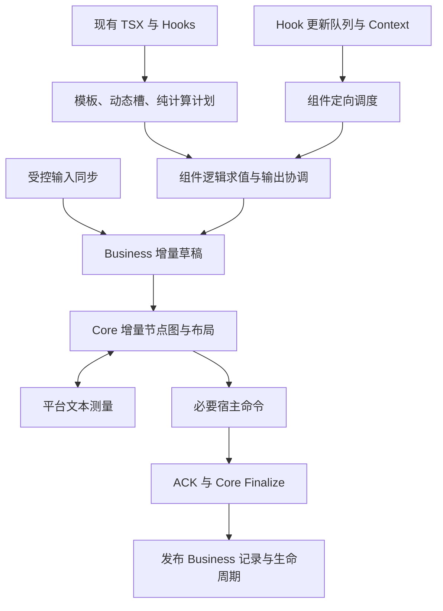
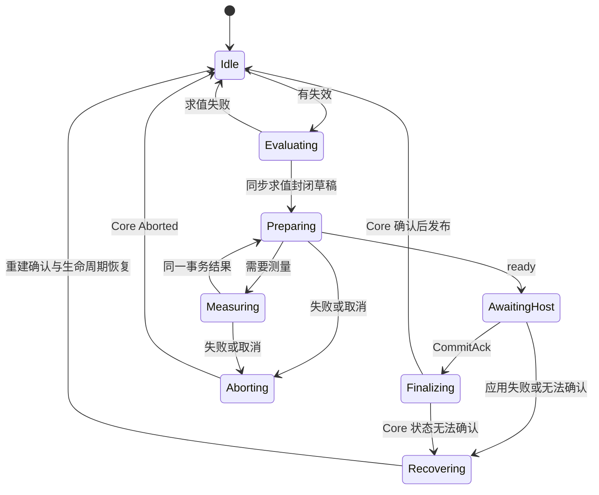

# 保持 TSX 与 Hooks 写法的细粒度更新方案

状态：实现及主要回归完成；Harmony 真实设备验收待设备可用。日期：2026-11-23。适用：UI compiler、Business Runtime、Core、Layout、五端 Renderer。实测范围见[验证记录](../verification/fine-grained-reactivity-2026-11-23.md)。

本方案以现有 TSX、Hooks 和组件实例语义为兼容基线。运行时采用组件定向调度、静态输出复用、动态字段更新、增量 Core 消息和必要宿主命令。Framework ABI 3 与宿主协议 2.0 必须匹配构建，业务源码无需迁移。本文规定内部合同，公开 API 以 docs 为准。

## 1. 目标与保证

业务继续使用 `useState/useReducer/useContext/useMemo/useCallback/useEffect/useRef/useImperativeHandle`。无需新增 signal、`.get()`、动态包装组件、手工 memo 或纯函数注解。

```tsx
function CounterPage(): UIElement {
  const [count, setCount] = useState(0);
  return <View style={{ flexDirection: "column", padding: 12 }}>
    <Text>{count}</Text>
    <Button title="增加" onClick={() => setCount(value => value + 1)} />
    <StaticPanel />
  </View>;
}
```

更新 count 时允许执行 CounterPage 的组件求值；复用稳定宿主结构；不执行或遍历干净 StaticPanel 的内部；更新 Text 内容及实际受布局影响的 frame。Button 是否求值取决于其实际 props：新建 onClick 闭包仍是变化的 prop，不能为了优化隐式缓存它。

| 层次 | 必须达到的目标 | 边界 |
| --- | --- | --- |
| 调度 | 由状态 slot 直接定位组件实例，干净子树跳过 | 父输入或 Context 变化可使其他组件失效 |
| 输出 | 编译模板保留稳定结构，只处理动态字段和受影响结构块 | 回退组件允许协调其实际输出区域 |
| 计算 | 可证明等价的纯计算按依赖跳过 | 任意 TS 和自定义 Hook 可完整执行 |
| 跨库 | 正常更新只传节点增量，无全量 tree/previous | 首屏、全局变化与损坏恢复允许全量 |
| 布局 | 绘制属性变化不触发布局；frame 候选增量收集 | 文本、flex、viewport 可以扩大布局区域 |
| 宿主 | 只执行必要字段、结构和 frame 操作 | 原生合成器自行决定实际绘制范围 |

组件的“逻辑求值一次”是语义单位，即便生成代码只执行部分纯计算，也必须产生与本次完整组件求值等价的 Hook、闭包、effect 和输出结果。组件函数执行次数下降不是唯一验收条件。

## 2. 当前实现与改动入口

| 入口 | 职责 |
| --- | --- |
| `packages/core/src/business-runtime.ts` | 组件所有者索引、脏集合、持久输出、草稿、提交日志 |
| `packages/ui-compiler/src/index.ts`、`templates.ts` | Program 符号分析、模板、动态槽、结构块及保守回退 |
| `packages/core/src/contracts.ts`、`wire.ts` | ABI 3 增量事务、测量续传及双向分片 |
| `packages/core/src/transaction-kernel.ts` | 增量节点图、布局候选、必要命令、确认/中止 |
| `packages/layout/src`、`packages/flexily/src` | dirty/cache 与实际布局/定位路径的变化收集 |
| `packages/protocol/src/index.ts`、`topology.ts` | major 2/minor 0、字段 patch、拓扑预检、批次与恢复 |
| 五个 `packages/render-*` | 增量字段应用、输入同步、幂等批次与明确恢复 |

Core、Business ACK、预检和宿主不得通过全表复制或扫描隐藏正常小更新的 O(N) 成本。动画和 ScrollView 使用活跃/触及集合。

## 3. 架构与所有权



Business 拥有组件实例、Hook slots、状态 pending queue、Context 订阅、输出描述、事件闭包、ref、服务与草稿。Core 拥有纯数据节点图、布局工作树、测量缓存、frame 和命令规划。Renderer 拥有平台对象、原生输入状态和已应用 revision。

只跨库交换版本化纯数据；函数、Hook、capture、TS 对象引用不进入 Core。布局/宿主协议更新不增加业务新 API。

## 4. 业务语义合同

### 4.1 Hooks 与事件

- `useState/useReducer` 返回普通值。dispatch 将更新入队，顺序和函数式更新语义保留。slot 增加 ownerComponentId。
- pending 更新按本次求值 watermark 读取，ACK 后只消费 watermark 以内的项。等待测量/ACK 时的后续更新进入下一事务。
- 不把 set 相同值统一改成“零求值”。当前逻辑求值可能更新闭包、运行无 deps effect 或校正输入；优化必须证明这些可观察行为均无变化。
- `useMemo/useCallback` 仍仅按显式 deps 控制。不得隐式加入状态依赖或把 memo 当作 computed。
- `useEffect` 无 deps 时，在该组件每次逻辑求值成功提交后执行；干净组件被跳过时不执行。deps 比较、cleanup/setup 次序保留。
- 事件闭包捕获该次已提交求值的普通值。`setCount(count + 1)` 不变成读取最新状态的函数；`setCount(v => v + 1)` 仍通过队列依次计算。
- 未使用 useCallback 的新函数、新对象被传给自定义组件时，保留其引用变化；不自动改变 props 浅比较结果。
- Hook 顺序、render 中禁止写状态/调用服务、卸载后 dispatch 失效、异常定位继续遵循现有规则。
- 自定义 Hook 的不透明部分按原顺序执行；不能只识别其名字就省略调用。

共享状态继续通过现有 Context、props 和业务订阅 Hook 传播。本需求不提供任意外部对象字段的自动监听；未经过现有 setter/订阅的外部变化不会自动触发更新。

### 4.2 组件身份

编译 siteId 仅用于代码定位与计划缓存。用户实例身份由现有逻辑父边界、规范化 children 位置或显式 key、组件类型决定。宿主节点还比较 kind/nativeName。整数 ID 替代路径字符串，但必须保持路径代表的身份关系。

- 自动插入的模板、branch、list、字段槽对实例身份透明。
- `flag ? <Counter label="a" /> : <Counter label="b" />` 在同一位置保留 Counter 状态；不同 key/type 则重新挂载。
- 保持当前 children 规范化、空值过滤、Fragment 和 Provider 边界规则；不得用 AST 原始索引替代规范化位置。
- 同一逻辑父列表中的 keyed item 重排保留状态。重复 key 报错，无 key 使用位置语义。
- key 不提供跨逻辑父组件的状态迁移。只改变内部代码路径、优化模式或编译 site 不得改变挂载结果。
- nodeId/componentId 在 surface/generation 内单调分配不复用，0 保留。计数溢出报错。

### 4.3 可观察对象

模板属于内部不可变数据，不能把用户可观察的 style、props、children 数组或 JSX 对象直接做全局单例。只有证明引用未逃逸、未被比较/修改的宿主局部描述，才允许消除分配。直接返回 UIElement、render prop、helper 保存 JSX 等路径使用普通语义对象或显式物化适配。

对象属性可能是 getter，类型声明不证明纯度。读取顺序、异常时序和未知函数调用必须保留。无法证明时只优化求值后的输出同步。

## 5. 编译器与输出计划

### 5.1 编译上下文

构建 staging 基于 TypeScript Program/TypeChecker 为全部业务 TS/TSX 建立同一符号上下文，解析 anseronui 导入、别名、组件与 Hook。静态 symbol 身份不能由同名函数猜测。单文件工具使用同一转换内核，证据不足时输出兼容路径。

输出包含 build 内唯一 siteId、不可变宿主模板、动态输入槽、结构协调块、可选纯计算依赖、生成代码与 TSX 源映射。编译信息纳入 Business 指纹；ABI/schema 纳入 Framework 指纹。siteId 不承诺跨构建保活。

### 5.2 稳定结构与动态槽

```tsx
<View style={{ padding: 12 }}>
  <Text>{count}</Text>
  <Text>固定说明</Text>
</View>
```

可生成内部的固定结构模板及 `Text A.text` 动态槽。组件首次挂载时实例化节点；随后只为变化槽记录 patch。固定 Text B 不需要重新构造或递归 visit。

动态槽分为三类：

| 类别 | 输入 | 动作 |
| --- | --- | --- |
| 组件输入槽 | 自定义组件 props、children、Provider value | 在子组件执行前建立最终输入，按既有浅比较与订阅规则失效 |
| 结构块 | 条件、keyed 列表、动态输出 | 在原逻辑父边界协调最终 children，保留兼容身份 |
| 宿主字段槽 | text、style 字段、普通属性、事件启用 | 相等时不生成宿主变更；闭包更新留在 Business |

component 更新可以产生多个输入槽和结构块。静态宿主子树直接复用；动态列表需要检查受影响列表。无法安全生成模板的组件，协调其普通 UIElement 输出，结果仍进入同一持久图与增量 Core 协议。

### 5.3 安全局部计算

实现采用完整组件求值与静态宿主常量提升。动态表达式保持原执行次序，输出槽按值比较复用。下面的依赖 DAG 是允许的额外优化，不是当前运行时提供的任意表达式缓存；未知调用与可观察对象继续走兼容路径。

基本正确路径始终允许完整执行组件体。编译器可对不逃逸、无副作用、无异常时序差异的 primitive 纯计算生成依赖 DAG，例如 `count * 2`、安全条件和内部宿主字段。

输入来源为 Hook slot 最终值、组件 props、Context 值和结构输入。依赖掩码是内部元数据，不改变源变量类型。输入不变时可复用该纯计算结果；不透明调用、可变 ref/global、getter、未知 coercion、复杂控制流或捕获导致无法证明时执行原代码。

每次逻辑求值仍按原语义处理 Hook、默认参数、初值表达式、memo deps、事件闭包和 effect 注册。只有证明它们均等价，才允许跳过相应生成代码。对无 deps effect 的组件，局部计算优化不能省略本次 effect 提交义务。

`useMemo(() => expensive(count), [])` 仍缓存原值；编译器不能以 count 已变为由重算它。编译器也不能把任意新建数组/对象变成引用稳定的值来减少子组件执行。

纯计算缓存属于组件实例的 committed record；本轮结果与 capture 写在 draft overlay。缓存键包括计划/site、组件输入版本及依赖值；不能仅按某个全局状态 epoch 缓存。ACK 发布、abort 丢弃，无缓存向其他组件暴露句柄。

### 5.4 输出与调试

compiler 内部生成类型明确的输入记录和顶层函数，避免 scriptc 不支持的动态泛型分派。Node/native/Wasm 均验证 record identity、闭包、Object.is 和源位置映射。

报告每个组件的 `template`/`fallback`、可跳过的纯计算及原因，例如 unknown-call、escaping-value、mutable-capture。业务不用添加注解。DevTools 分开显示逻辑组件求值数、实际计算区域数和宿主变化量。

## 6. 持久图与调度

Business 保存组件表、输出区域表、宿主节点表、父子索引、Context 消费者表及事件/ref/服务索引。正常事务使用逐记录 overlay 和变更日志，不复制整棵树或全部 Map。

组件记录至少包括：componentId、logicalParentId、type、key/position identity、committedProps、Hook slots、输出根/区域、Context bindings、depth、dirtyVersion 和后代脏摘要。输出区域可直接定位关联节点与子组件，无需从页面根寻找。

调度规则：

1. dispatch 标记 owner；Context 值变化定位实际消费者；输入同步标记对应 host。合并重复失效。
2. 向祖先更新摘要，并保存脏孩子集合/路径索引。不得仅有 dirtyCount 却逐个扫描所有兄弟寻找脏节点。
3. surface 同时最多一个在途事务。隐藏 surface 保留更新，显示时再求值。
4. 在一个同步、不可重入的 Evaluate 阶段，按父先子后建立本轮输入。父求值/结构块先确定子身份、props 和 Provider 链。
5. 子组件执行前合并自己的状态更新、父输入和 Context 失效。父真正执行过的子任务按输入版本去重；父只复用输出时不能丢掉脏子。
6. 新产生的输入/结构/Context 任务继续进入当前队列，队列为空才封闭草稿。子不得因 prop 槽执行较晚而延后一事务。
7. 宿主字段输出在依赖输入确定后归一化；同 node/field 合并为最终值。命令只在整个草稿稳定后生成。
8. 待确认期间的更新保留更大的 updateId/dirtyVersion，ACK 仅清理本轮已消费失效。

Context 消费者绑定最近 Provider 实例。值相等沿用 Object.is；Provider 祖先链变化重新绑定相关区域。旧消费者在 draft 期间有效；新绑定与组件记录同事务发布。Evaluate 同步期间不会穿插外部 Context 写入。

调度只在宿主 wake/step 边界推进，遵守现有离散事件、连续手势合批规则。预算在 surface/事务之间轮转，不在一棵树 Evaluate 中间暂停接受外部消息。将来若引入可中断求值，必须单独设计读取快照，不能直接复用本合同。

## 7. 草稿一致性与状态更新

使用现有 pending queue + watermark 和持久 committed/draft 记录，不引入公开 signal、运行时读取图或全局 MVCC 历史。

- Evaluate 在单一 BusinessRuntime owner 线程同步完成。固定本轮 updateId 上界；Hook 依次消费不超过该上界的 pending 更新。
- 每个组件以该轮最终 props/Provider 和 Hook 草稿值求值。父子输入在同一 Evaluate 内确定。
- 封闭草稿后，组件、memo、事件闭包、ref 目标、输入同步 token 和节点描述不再变动。Core 测量只计算该草稿的布局。
- 等待测量/ACK 时新事件、异步结果和 timer 可以按现有策略入队更新；不会修改封闭草稿。
- 普通事件使用已提交回调，普通值保留该闭包捕获；函数式 setter 在下一次求值按队列顺序应用。
- state、memo、reducer/capture 配置、Context 绑定及纯计算缓存均在 draft 中更新，ACK 后发布；abort 不覆盖 committed 记录。
- 新 Hook slot 的服务/effect 不在草稿阶段执行。渲染失败丢弃新增内部记录，保留已有 pending 更新；不无限自动重试。
- useRef 与用户可变对象保留原语义，不宣称事务能回滚业务在 render 中做出的任意外部副作用；此类访问不得被编译器移序或缓存。
- 跨 surface 不提供原子画面提交；状态隔离与页面生命周期沿用现有合同。

相等的最终字段可以省略宿主 patch，但存在 Hook、回调、effect、ref 或输入确认变更时，仍保留空命令 Commit 的 revision 屏障。不得仅因 native 命令为空而漏发布业务记录。

## 8. 受控输入与字段失效

### 8.1 InputChange 独立同步

受控值是业务 value 与宿主 inputRevision 的一对确认数据。处理有效 InputChange 时，即使 setter 返回原值，也把 nodeId 放入 `inputSyncDirty`。这不依赖组件状态相等判断。

1. 按 inputRevision 去重，调用已提交 onChangeText。
2. 同步回调内产生的 setter 进入正常队列；Evaluate 结束后取该节点本轮最终受控 value，配对本轮已处理的最新 inputRevision。
3. 节点仍存在时生成完整的受控值确认对。即使 value 相等，inputRevision 增加也需传输，并执行宿主 value 校正器。
4. 没有同步 setter 时，确认沿用当前受控 value，视为拒绝此次原生编辑。async 回调只处理 await 之前的同步部分；异步完成后的 setter 是另一次业务更新。需要乐观保留文本的业务沿用先同步 setValue 的写法。
5. 宿主仅接受 token 不旧于当前原生输入版本的值确认。旧事务不可覆盖较新输入；composition 中暂存配对确认，结束时再次比较版本后应用。
6. 确认本身不能再次回传为用户 InputChange。回调抛错仍以有效受控值完成同步并输出诊断；已卸载/销毁节点的同步记录直接丢弃。

输入 patch 的 value/inputRevision 作为原子字段组校验和应用，不拆成两次生效。不同事务不能把旧 value 配上新 token。此规则覆盖 `7x → 7` 的同值过滤与快速连续输入。

### 8.2 属性 schema

统一字段 schema 定义类型、默认值、删除语义、组合依赖和失效分类。UI normalization、Core 校验与宿主行为测试共同依据该 schema。

| 变化 | Core | 宿主 |
| --- | --- | --- |
| opacity、颜色、transform | 不测量、不布局 | 绘制/合成字段处理 |
| Text 内容、字体、行高、截断 | 测量/布局失效 | 文本字段处理 |
| 尺寸、padding、flex、gap | 受影响节点与约束布局 | 实际变化 frame |
| children | 局部结构同步与布局 | 必要 create/insert/move/remove |
| 事件闭包替换 | 不传闭包 | 启用集合未变则零 BindEvent |
| ref 或 effect 变更 | 业务日志 | 空命令屏障亦可提交 |
| value/inputRevision | 原子组；value 实际变更才触发相应测量 | 受控值校正器 |
| Native 不透明 props | 根据已注册能力保守处理；无固有测量能力则沿用显式布局 | 整个 nativeProps 字段替换 |

PatchProps 使用 set/unset，unset 不等于 null。删除字段恢复 schema 默认值并执行必要资源释放；spans/nativeProps 等字段不拆内部 JSON。复杂样式前后依赖一起处理，如 padding 简写与长写覆盖、深色外观回退、动画配置和目标值、输入确认对。

系统字体、方向、测量环境使用 environmentVersion 失效源。新增外部环境消息应纳入宿主 major 2 schema；不能只有缓存字段却没有宿主触发入口。

## 9. Core ABI 3 增量合同

Core ABI 当前为 2，目标为 3，两个编译产物必须匹配。共同头包含 abi、surfaceId、generation、transactionId；Runtime 实例本身提供 runtimeEpoch 隔离。

```ts
type NodeMutation =
  | { type: "Create"; nodeId: number; kind: NodeKind; nativeName?: string;
      props: RenderProps; style: Style; events: EventKind[] }
  | { type: "Patch"; nodeId: number;
      propsSet: RenderProps; propsUnset: string[];
      styleSet: Style; styleUnset: string[]; events?: EventKind[] }
  | { type: "Children"; parentId: number; children: number[] }
  | { type: "Delete"; nodeId: number };
```

| 消息 | 必需内容与结果 |
| --- | --- |
| BeginRender | baseRevision、targetRevision、可选 viewport/environment 变化、mutations |
| ContinueRender | 当前 round 和匹配 requestId/nodeId/constraintKey 的测量结果 |
| Prepared | round、ready、测量查询；ready 时给出最终 changedFrames 与命令 |
| FinalizeRender / Finalized | 宿主 ACK 后确认 targetRevision，提升 Core committed 图 |
| AbortRender / Aborted | 宿主尚未应用时丢弃草稿，恢复工作树 |
| ResetSurface / SurfaceReset | resetToken、旧事务拒绝下界，清空物理节点基线 |
| ReleaseSurface / SurfaceReleased | 按 generation 释放 committed、draft、布局和缓冲 |

规则：

- 首屏 baseRevision=0。正常 BeginRender 不带完整 tree/previous，不带全部测量缓存。
- Core 保存已提交图与一个 draft overlay；baseRevision 必须匹配。targetRevision/transactionId 单调分配，失败后不复用。
- Children 给出该父节点的最终有序 children；允许与该列表长度相关的成本。parentId=0 表示 surface 根。
- 最终节点图统一校验：合法 kind、唯一身份、每个非根节点恰有一个父节点、无环、无悬挂、叶节点无 children。kind/nativeName 改变采用新 nodeId。
- Delete 明确列出所有逻辑删除节点，不能递归误删被新父节点保留的后代。字段 set/unset 互斥，未知字段拒绝。
- 重复的相同操作幂等返回已有结果；相同事务/round 的不同内容拒绝。Finalize 与 Abort 互斥。终结记录有界，但旧事务下界保留。
- 过期测量、旧 generation、失配 round 不得修改其他事务的缓存或节点。ready 前无宿主命令。
- 同一事务最多 8 轮测量；不收敛输出诊断并 abort，不提交占位 frame。

Flexily 工作树可变，使用逆操作日志保存输入、结构和环境变更；旧删除节点先脱离，Finalize 后才释放。Abort 恢复逻辑工作树并使受影响缓存失效；若需修复布局，在下次 ready 前完成，即使下一次请求只是绘制字段也不能使用中止事务几何。不能为每轮创建完整布局树副本。

JSON 保留为跨库载体。大请求、Prepared 回复和测量批次使用同一有界分片层，收齐校验后处理。内部默认单片 1 MiB、完整消息 32 MiB，按 UTF-8 字节核算；两侧初始化核对配置。分片包含事务、消息种类/round、序号、总数及总字节，冲突、缺片、超限按协议失败处理。

## 10. 布局与多轮 frame 汇总

保留 Flexily 的 dirty、约束缓存和文本测量。LayoutEngine 增加实际访问/定位输出的 collector；从根扫描 hasNewLayout 不满足增量目标。

- 绘制属性和纯业务变更不调用 calculateLayout，不请求文本测量。
- 布局字段、文本输入、结构、viewport/environment 变化依约束传播，可影响祖先和兄弟。
- collector 覆盖实际定位写入，包括缓存命中但因父布局而移动的节点。
- Core 为整个事务维护 `transactionFrameCandidates`，所有 round 合并候选，不仅保存最后一轮。
- ready 时从最终工作树读取候选 frame，与 baseRevision 的已提交 frame 比较。新节点必须输出完整合法 frame。
- 早期轮次变了、后续命中缓存的节点不能遗漏；临时变化后回到原值的节点不发 SetFrame。
- Business 只接收 ready 的最终 changedFrames；未返回节点沿用已提交 frame。中间几何不触发 onLayout。
- frame 相对父节点。父位置改变且子相对 frame 未变时不发子 SetFrame；父约束变化仍检查子布局。
- 新增 onLayout 监听者即使 frame 未变，也按现有行为在确认后收到首次回调；该索引与 frame 变化索引合并。

Finalize/Abort 后释放候选与草稿 frame。布局异常、文本测量、滚动内容尺寸和环境失效纳入全量几何对照。修改 Flexily 前必须读取其局部 AGENTS，补 native/Wasm 和差分布局验证。

## 11. 宿主 major 2 与命令规划

宿主协议目标 major 2/minor 0。握手明确核对 major、能力、消息/事务上限；旧宿主不得忽略必需新命令继续执行。五端与 SDK/模板同步升级，业务 TSX 无需改写。

保留 CreateNode、InsertChild、MoveChild、RemoveNode、SetFrame、BindEvent。用 `PatchProps {nodeId, set, unset}` 替代完整 SetProps。新增 DetachChild 保护旧父节点删除前的幸存后代。

结构命令规划：创建新身份；必要时脱离幸存后代/祖先反转节点；删除真正离开的物理子树；按最终拓扑连接；应用字段/frame/事件。只有实际顺序或父节点变化才发 move。MoveChild index 定义为从旧位置移除后在目标序列中的插入位置。

同父 keyed 列表可用 LIS；若承诺规划 O(K log K)，模拟序列也必须使用支持高效位置操作的结构，不能用反复线性 indexOf/splice 隐藏 O(K²)。实际平台插入成本单独计量。

Commit 小于限制时一次传输；大事务用 CommitBegin/CommitChunk/CommitEnd，携带 baseRevision/targetRevision/transactionId、序号、总数、总字节与命令数。默认整事务上限 16 MiB/65536 命令，每片不超过协商消息限制与 4096 命令。

宿主收齐后预检，统一应用，只 ACK 一次；不得逐片应用或逐片 ACK。同一已应用事务重传只回 ACK。命令应用失败清空 surface 并回 CommitFailed；预检失败不修改 UI。原生视图操作不提供可回滚事务，恢复见第 13 节。

预检使用持久拓扑索引和本批 overlay；纯属性变更不复制全部节点集合。应用只遍历 touched records、受影响结构父节点、滚动锚点和待提交动画记录。活跃动画有单独集合，无关小更新不扫描全部动画。PatchProps 合并后仅调用受影响 handler 及其复合依赖，不执行全部 setter。

媒体、输入焦点、触摸和无障碍不因无关 patch 重建。命令/事件原子组和动画配置在同批解析后生效，避免字段顺序改变语义。

## 12. 正常提交与事件



正常顺序：

1. Evaluate 消费本轮更新，完成全部输入/结构任务，封闭 Business 草稿。
2. Core 接受增量事务，完成测量、布局和命令规划。
3. 宿主完整应用，更新其 revision，回 CommitAck。
4. Business 向 Core Finalize，收到 Finalized 后发布业务记录。在这段屏障内不投递该 surface 用户回调。
5. lifecycle 顺序保持现有基线：卸载组件清理，变化 effect cleanup；发布新 Hook/输出/Context/回调并消费 watermark；旧 ref 解绑及 handle 退役；新 ref 绑定；onLayout；新 effect setup。组件子先父，同组件 Hook 按顺序。整个过程禁止重入渲染。
6. lifecycle 中 setter 作为更晚更新入队。单个 cleanup/ref/effect 抛错记诊断，继续必要清理；完成后处理排队事件与下一事务。

生命周期前后的内部阶段必须由私有发布屏障保护，不能把“逐记录 overlay 提升”误当作可让用户在中途观察的状态。卸载 slot inactive、服务取消、pending 请求拒绝沿用清理合同。

输入、事件与环境：

- pending/发布期间离散事件排队。存活节点依现有 revision 兼容规则调用已提交回调；被删除节点拒绝。
- InputChange 依第 8 节保存其原生版本，不能把 pending 后的 token 写进旧草稿。
- 连续 scroll/touchMove 可合并，touchUp/touchCancel 不丢失。backPress 同步性与原有规则保持，不能静默改为普通异步事件。
- 已发送宿主 Commit 后不因新状态随意 abort；先完成确认，再提交下一次变化。
- Resize/environment 在发送宿主前可中止并重建草稿；发出之后排下一事务。
- 隐藏 surface 不开新 UI 事务，已发出的事务完成收尾；销毁优先，显式释放所有层和消息缓冲。
- 空命令 Commit 仍提升 revision，确保只改变闭包/effect/ref 时也有一致发布时点。

ACK 超时先重传相同事务或查询结果，不能假定宿主未应用。无法确认才进入 reset。重传不重复生命周期。使用已有宿主调度实现超时，不要求共享 TS 有 Node 事件循环。

## 13. 失败恢复与挂载生命周期

选择明确合同：**保留逻辑 state/ref 容器和业务更新队列；重建物理节点；重新建立全部已挂载 effect/ref 资源。** 这是 Renderer 丢失后的恢复行为，不改变正常更新时的 deps 规则。

无法静态判断普通 effect 是否持有原生资源，因此恢复时统一重建 effect 资源，避免让捕获旧 NodeHandle 的 useImperativeHandle 永久失效。

1. 进入恢复屏障，暂停该 surface 的用户事件和新 UI 事务。对已提交 effect 执行 cleanup，子先父，每项至多一次；清空直接节点 ref，退役旧 handles。失效 handle 调用明确报错，不重定向到新节点。
2. 清理通过 Hook 服务 facade 建立的活跃订阅/page listener 和旧资源等待；保留稳定 facade 身份，恢复 setup 可重新订阅。普通业务 timer 依现有规则保留或暂停，effect 拥有的 timer 由其 cleanup 取消；不承诺强制取消任意已运行异步业务。
3. Renderer 与 Core 接收 ResetSurface，携带 resetToken 和 rejectedThroughTransactionId。确认清空后，三侧物理视图基线 revision 置 0；事务/revision/nodeId 分配器继续递增，旧事务及分片拒绝。
4. 从最后已提交的逻辑输出恢复整个物理树，分配新 nodeId。首次失败且没有已提交逻辑树时，按普通首次挂载求值。未提交 Hook 更新仍留在队列，随后正常处理。
5. 重建使用 baseRevision=0 和更大的 targetRevision。宿主 ACK、Core Finalize 后绑定新直接 ref，投递初次 onLayout，按子先父/Hook 顺序执行已提交 effect setup，包含 useImperativeHandle。
6. 恢复完成后接收新事件并处理排队更新。恢复中重复 reset 不重复 cleanup；setup 仅在重建成功后执行。重复恢复失败停止自动循环并诊断，避免无限重启副作用。

恢复会重建 effect 资源，effect 应遵循已有 setup/cleanup 成对释放的用法。不能宣称网络请求等外部副作用 exactly-once；错误恢复的重试语义要在公开生命周期文档说明。库无法修复业务主动把旧 NodeHandle 永久存入外部变量的行为，旧 handle 始终失效。

同一逻辑组件 state 保留，memo 缓存沿用既有 deps；ref 对象身份保留但指向新节点。纯计算缓存可丢弃。服务与 resource 清理异常不能阻止 Core/Renderer 释放。

## 14. 复杂度、内存与观测

定义 N 为已挂载宿主节点数，D 为本轮需逻辑求值的组件数，H 为祖先高度，P 为实际执行的业务计算成本，S 为需要协调的动态/回退输出区域，L 为布局实际访问区域，F 为最终变化 frame 数。

| 场景 | 目标成本 |
| --- | --- |
| 局部状态更新调度 | 与 D·H 及实际 Context 扇出相关，不扫描所有组件或所有兄弟 |
| 组件求值/输出 | O(P + S)；静态模板内未变节点不遍历；回退允许与该组件实际输出规模相关 |
| 局部绘制字段更新 | Core/宿主与变化字段和节点数相关，零布局/测量 |
| 文本/约束更新 | O(L) 布局及 O(F) frame 输出；L 可以为 N |
| keyed 重排 | 受影响列表的协调/规划成本；不宣称 O(1) |
| 首屏、全局 Context/viewport、reset | 允许 O(N) |

若一个未优化组件每次执行都生成包含 N 个节点的动态数组，就无法保证求值与协调为 O(1)。方案保证不把这一区域成本扩大成其他干净页面区域的全树开销。性能声明必须报告组件粒度和编译模式。

组件/节点/Context 边、索引和模板实例占 O(components + N + subscriptions)，另加待提交增量、pending 更新、受限测量缓存和消息缓冲。不存在全局状态版本历史。显式释放 capture、服务、timer、handle、图记录、布局节点、媒体和分片；不依赖 GC finalizer。

正常 ACK 只访问变更/删除组件与节点日志，不重建全局 Map、livePaths 或订阅表。事件查找通过 nodeId，触摸路径通过父索引，backPress/onLayout 使用有序索引。性能统计默认关闭。

保留现有耗时指标，增加 logicalEvaluations、computeRegionsExecuted/Reused、scopeVisits、dynamicSlotsChecked、reconciledNodes、coreSyncNodes、layoutVisited、frameCandidates、frameChanged、patchFields、moveCommands、hostTouchedRecords、commitLogEntries、internal/external UTF-8 bytes、fallbackReasons、abort/reset 和峰值缓冲。

## 15. 验证与验收

### 15.1 编程模型兼容

同一源文件通过普通 lowering 和优化 lowering 执行，覆盖：

- 条件两侧同位置同类型组件保留状态；key/type 改变、Fragment/Provider、空值规范化、keyed 重排一致。
- Hook 顺序、函数式队列、相同值 dispatch、memo/callback deps、无 deps effect、事件闭包捕获一致。
- 自定义 Hook/HOC/render prop/JSX 对象逃逸、getter/异常顺序、局部可变值回退一致。
- 父子同脏、仅动态 prop 改变、Context Provider 链、多级输入传播在一次事务得到最终结果。
- 草稿失败不发布 memo/cache/capture；后续输入和 pending 更新不丢。
- 受控输入拒绝/过滤为原值、无同步 setter、快速输入、IME、异步更新、旧 token 不覆盖新输入。

### 15.2 两类正确性基准

几何/宿主基准：消费同一份逻辑输出，使用完整描述树和全量布局/diff，对比最终节点身份、顺序、props、frame、事件启用和输入值。支持随机结构/状态操作与固定 seed。

生命周期/调度基准：以现有组件失效规则和明确事件时序建立状态机断言，验证求值、闭包、effect/ref、资源和 ACK 行为。普通 lowering 的参考执行保留组件跳过规则；不强制所有组件重跑后比较 effect 日志。

只在无生命周期与可观察对象副作用的纯 fixture 中使用强制全量求值比较输出。新编译路径测试必须执行真实 lowering 结果，不能由测试工具自己的 JSX 转换代替。

### 15.3 故障与布局

- A 第一轮 frame 变化、B 后续测量；A 临时变化后恢复原值；最终 frame/onLayout 精确一致。
- 延迟/重复 ACK、旧 generation、错序测量、冲突分片、超限、Finalize/Abort 重传。
- 应用部分命令后失败，reset 旧消息拒绝，保留 state 并重建 effect/ref；捕获 handle 的 imperative handle 恢复可用。
- 网络/订阅/timer 清理异常、隐藏/销毁期间回包、受控输入和手势终止。
- 五端真实输入、媒体、无障碍、动画、原生扩展、移动顺序与默认值恢复。

### 15.4 性能硬断言

fixture A：100、1000、10000 个已挂载独立分支，其中一个固定大小叶组件通过现有 useState 改 opacity。预热后：

- owner 逻辑求值，干净祖先/兄弟不求值也不递归遍历其内部。
- Core 一项节点 patch，宿主一项 PatchProps；零 MoveChild、SetFrame、布局和测量。
- scope/core/host/ACK 访问量及消息大小不随无关 N 增长；祖先高度 H 单独报告。

fixture B：页面组件持有状态，内部包含大量可证明安全的静态宿主模板和一个动态字段。页面仍可逻辑求值，但动态槽和节点协调量不随静态节点数增长。组件传递新对象/闭包的可观察变化必须保留，不用该 fixture 掩盖它们。

fixture C：含未知调用、动态列表、refs/effects 的组件，验证回退语义与真实成本；不要求其计算 O(1)。另测文本布局扩散、key 重排、首屏、全局 Context、viewport 和恢复。

虚拟列表必须分别报告数据行数与真实挂载节点数。相同值 setter 可以产生逻辑求值/生命周期屏障，但不得产生无用宿主结构命令；受控输入校正除外。

报告冷启动、预热 p50/p95、执行与访问计数、消息字节和峰值内存。结构性断言为硬条件；绝对延迟/内存预算在同设备同构建的基线上建立，不预设未经测量的加速倍数。

## 16. 实施依赖与交付

全部工作包属于同一最终方案，按依赖实施；编译回退是同一运行时内的正确性路径。

| 工作包 | 内容 | 门槛 |
| --- | --- | --- |
| A：兼容基线与 AOT | 身份/Hook/输入/生命周期 fixtures，typed record/capture 与 Object.is 探针 | Reference/native/Wasm 语义一致 |
| B：持久运行时 | owner 索引、Context、脏路径、output graph、overlay/commit 日志 | 无无关整树扫描，父子输入闭合 |
| C：compiler | Program、模板/动态槽/结构块、安全计算缓存、报告/source map | 现有 TSX 原样编译，优化/回退兼容 |
| D：Core ABI 3 | 增量节点图、测量 round、事务、幂等、分片 | 正常无全树消息，abort/finalize 正确 |
| E：布局与命令 | collector、跨 round 候选、schema、结构计划 | frame 与全量基准一致，绘制变化零布局 |
| F：宿主 major 2 | 五端 patch、输入确认、分片/ACK/reset、资源恢复 | 真实控件/媒体/无障碍验证 |
| G：整体验收 | benchmark、DevTools、构建指纹/SDK/模板/文档 | 性能计数、跨端与错误定位全部通过 |

文件入口见第 2 节。还需更新 `scripts/stage-core.mjs`、构建输入/SDK 打包、native bridge/transport、Wasm adapter、harness、benchmark 和 DevTools。`packages/ui/src/index.ts` 仅适配内部 dispatcher/编译运行时合同，现有业务 API 保留。

执行框架 typecheck/framework/tooling/build、layout/native/Wasm、Core native/Wasm 检查与五端真实 Renderer 验收。类型检查和 JS 参考通过不能证明 AOT 或跨端行为。协议升级必须同步构建 Framework Core、Business Bundle 和宿主；禁止新旧版本混用。

## 17. 审查问题处置与验证边界

| 审查项 | 最终设计处理 | 实施验收 |
| --- | --- | --- |
| R1 受控输入同值漏回写 | inputSyncDirty 与原子 value/inputRevision 组，第 8 节 | 过滤/拒绝/IME/旧 token |
| R2 call site 改变身份 | 编译边界透明，逻辑位置/key/type 身份，第 4.2 节 | 条件同类型保留 state 与 effect |
| R3 prop binding 调度不闭合 | 输入先于子求值，队列处理至稳定，第 6 节 | 多级 prop/Context 单事务 |
| R4 computed 配置泄漏 | 移除公开 computed/读取图；内部缓存 committed/draft 隔离，第 5.3、7 节 | props-only 变化、abort 不泄漏 |
| R5 多轮 frame 遗漏 | transactionFrameCandidates 最终比较，第 10 节 | 早期变化、临时回退 |
| R6 reset 资源失效 | state 保留、effect/ref 资源重新建立，第 13 节 | imperative handle 与原生资源 |
| R7 生命周期 oracle 不成立 | 几何与调度/生命周期分别验证，第 15.2 节 | 干净父 effect 不重跑 |

历史反例见[审查记录](fine-grained-reactivity-review.md)。R1–R7 的对应回归与平台边界见[验证记录](../verification/fine-grained-reactivity-2026-11-23.md)。

验收边界：Harmony 已通过 API 21 Core/C++/ArkTS/HAP 构建和适配测试，缺少连接设备，不能代替原生控件验收。当前性能硬门槛针对结构工作量与消息大小；不提供 RSS、GPU/FPS 或任意 TS 表达式 O(1) 保证。编译器对证据不足的表达式保留兼容求值，并报告实际回退。
