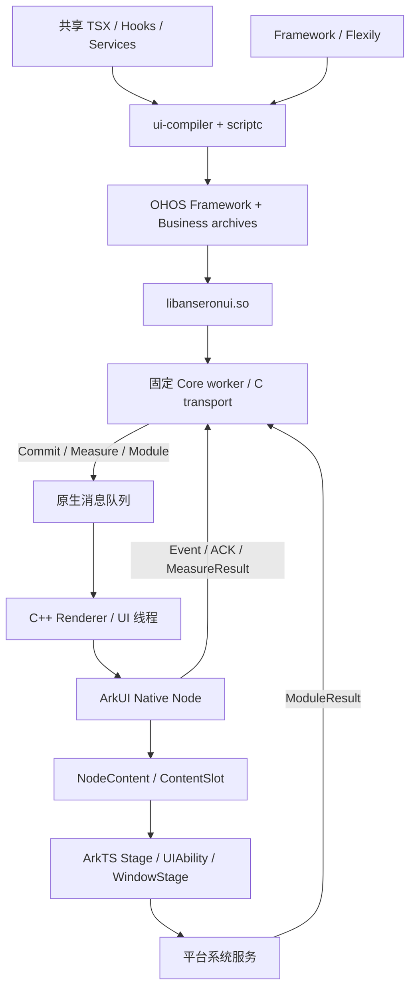

# AnseronUI 原生鸿蒙支持调研与技术设计

- 调研日期：2026-11-14（Asia/Shanghai）。
- 状态：初版原生 Stage/HAP/CLI/Renderer 已实现；API 21 模拟器端到端 smoke 通过。能力矩阵、真机签名与长周期服务仍需继续验收。
- 项目：TSNative 仓库中的 AnseronUI，当前 package 版本 `0.0.8`。
- 代码基线：`67ac8419` 加调研时工作区已有修改。协议、路由保活、虚拟列表等按实际源码核对，不能把该提交号视为工作区完整快照。
- 目标：共享 TS/TSX 开发原生 HarmonyOS 应用；不以 Android APK 兼容或 WebView 包装作为验收。
- 关系：本文细化并更新 [macOS 与鸿蒙支持方案](macos-harmony-support.md) 的鸿蒙部分；旧文的 macOS 实施记录继续有效。

阅读导航：1–4 节给出结论、范围和选型；5–9 节说明架构、工具链与渲染实现；10–13 节覆盖生命周期、服务、插件和交付；14–17 节用于实施排期与验收；18 节提供来源和本地证据。

## 1. 调研结论

**建议进入原生鸿蒙适配验证，主路线：共享 TSX → scriptc AOT → 鸿蒙 ABI 的 Framework/Business 静态库 → C++ Host/Renderer → ArkUI Native Node；ArkTS Stage 外壳负责应用、窗口和系统能力。**

本项目已经将业务、布局与平台控件分开，具备新增平台的架构基础。官方资料确认 C/C++ 原生模块、ArkUI Native Node，以及 `NodeContent` / `ContentSlot` 挂载原生节点的路径。[S1][S2][S3] 官方资料支持这条路线；本项目另以 API 21 模拟器实验验证 runtime/Core 原生执行，具体结果和限制见 [验证报告](../verification/harmony-api21-report.md)。

优先解决四项工程问题：

1. **编译与 runtime**：scriptc 没有 OHOS target，driver 也不接受任意 SDK Clang。工具链、ELF 链接和设备执行是首个 Go/No-Go 门槛。
2. **布局接管**：Flexily 继续计算布局；ArkUI 在合法测量/布局周期应用结果，不能随时把 SetFrame 翻译为 layoutNode。[S4]
3. **线程与寿命**：固定 Core worker、UI 线程、ArkTS 环境各有边界；返回键、销毁和迟到回调不能形成同步等待环。
4. **完成度**：计数器只是探针。输入法、路由参数、页面保活、虚拟列表、系统服务、独立 npm 应用与签名安装分别验收。

可复用 TSX、Hooks、布局、协议与业务语义；必须新增鸿蒙工具链、runtime 适配、Native Renderer、Stage 宿主、服务映射及构建分发链。复用比例与工期应在 P0 后估算，不在调研阶段给出无依据承诺。

### 1.1 证据等级与验证边界

| 等级 | 含义 | 边界 |
| --- | --- | --- |
| 代码事实 | 已读取本地实际源码 | 不是跨平台运行结果 |
| 官方资料 | 华为文档或 OpenHarmony 官方仓库 | SDK 头文件与设备仍需验证 |
| 方案建议 | 本项目拟采用的工程决策 | 尚非已发布 API |
| 待验证 | 需要 SDK/设备/实验 | 不计入已支持能力 |

本次已执行 API 21 原生交叉编译和模拟器设备测试，但尚未执行 HAP 签名、安装和 ArkUI/Native Node 渲染测试。`hdc` 通过 DevEco SDK 的绝对路径使用；当前 shell 的 PATH 未发现这些命令，这仅说明命令未配置，不能断言机器没有安装 SDK。可复现实验记录见 [`internal/experiments/harmony-runtime/`](../experiments/harmony-runtime) 和 [`internal/verification/harmony-api21-report.md`](../verification/harmony-api21-report.md)。

## 2. 平台与版本策略

### 2.1 原生鸿蒙的范围

使用 HarmonyOS SDK、Stage、ArkUI 和原生 C/C++ 工具链。安装验收产物为签名 HAP，发布阶段另行构建 App Pack：HAP 是安装/运行单元，`.app` App Pack 是发布容器，与 macOS `.app` 目录不同。[S11]

| 对象 | 本次定位 |
| --- | --- |
| 原生 HarmonyOS 手机、arm64 真机 | 首要目标 |
| 平板/折叠屏 | 基础能力稳定后验证窗口与形态变化 |
| 模拟器 | 按实际镜像 ABI 独立建立目标，不能按开发机架构推断 |
| OpenHarmony | 公共接口可参考；发行版、能力、SDK 与系统服务单独验证 |
| 旧鸿蒙 Android APK 兼容模式 | 不属于交付 |
| ArkWeb/WebView + Web Renderer | 不能替代本次原生 Renderer 验收 |
| 手表、车机、PC、多窗口、分布式流转 | 后续专题，首期不承诺 |

工具和头文件中的 OHOS 名称不表示 OpenHarmony 与商业 HarmonyOS 的 SDK、签名及服务可以任意混用。

### 2.2 调研确认的版本组合

以下同时列出官方版本参考与本次实际环境；只有 API 21 行具有本地模拟器验证证据，其他行仍是候选。[S12][S13]

| 开发套件 | 官方记录 | 项目用途 |
| --- | --- | --- |
| HarmonyOS SDK 26.0.0 Release | 2026-08-29；DevEco Studio `26.0.0.821`；基于 `Ohos_sdk_public 26.0.0.105` | P0 优先候选，安装后核对 manifest |
| HarmonyOS SDK 6.1.1 / API 24 | 2026-05-26；SDK `6.1.1.125`；DevEco 有后续补丁 | 另一组兼容性验证组合 |
| HarmonyOS 6.0.1 / API 21 | 本机 DevEco Studio 6.0.1.251；SDK 6.0.1.112；模拟器 HarmonyOS 6.0.1(21) | **当前最低兼容基线；已完成原生 runtime/Core 模拟器验证** |

不宣称这里列出了所有后续版本，也不将 SDK 名称直接等同于用户设备系统版本。API 分布数据有自己的统计日期，不据此承诺最低版本。

必须区分 compile SDK（真实工具及 build）、target SDK（系统行为）、compatible SDK（最低可运行版本）和每个接口的 Since/API。P0 锁定完整组合；本项目最低兼容基线按用户要求锁定为 HarmonyOS 6.0.1 / API 21，低于该基线的系统不在承诺范围内。

ContentSlot 基础 API 从 API 12 提供，但不能据此承诺整个框架支持 API 12。[S2] API 21 以下不在本项目最低兼容承诺内；API 21 之后引入的接口仍需要旧版实现、受支持的运行时能力检测/加载路径，或明确提高最低版本。仅增加运行时 if，未必能避免新符号导致装载失败。

## 3. 项目现状审计

路径均相对仓库根目录，按调研工作区实际源码核对。

| 入口 | 当前事实 | 鸿蒙工作 |
| --- | --- | --- |
| `packages/ui`、`packages/ui-compiler` | TSX、Hooks、组件和 lowering | 复用公共语义 |
| `packages/core`、`packages/layout`、`packages/flexily` | 业务、布局、差分 | 为 OHOS 重编，保留布局计算权 |
| `packages/protocol/src/index.ts` | protocol 1.5 | C++ 解析/校验，实现当前消息而非旧版子集 |
| `packages/core/native/split_bridge.c` | Framework/Business 独立 runtime，ABI 2 | 目标编译、符号隔离与字节所有权验证 |
| `packages/core/native/transport.c` | TLS、pthread owner、setjmp/longjmp、bounded async step | 固定线程和故障关闭适配 |
| `scripts/build-core.mjs` | native/macOS/iOS/Android/Wasm，无 harmony | target、Clang、合包、manifest 和缓存 |
| scriptc `packages/compiler/src/backend/targets.ts` | 无 OHOS target/platform | 新目标和平台穷举分支审查 |
| scriptc `packages/compiler/src/backend/native/driver.ts` | 只认 clang/zigcc；显式 target + clang 被拒绝 | 新增 SDK driver |
| scriptc `packages/runtime/src/scr_async.c` | fiber、TLS、mmap 栈；AArch64 有 fast context | 寄存器、栈、ABI、异步关闭验证 |
| `scripts/native-plugins.mjs` | schema 1/2；2 包含 macos；未知字段拒绝 | 建议 schema 3 增加 harmony |
| `scripts/anseronui.mjs`、`scripts/standalone-app.mjs` | 四平台 CLI/独立应用 | create/check/build/run 和模板 |
| `scripts/sdk-files.mjs`、`scripts/pack-sdk.mjs` | npm SDK 打包 | 包含鸿蒙源码、模板、补丁和文档 |

scriptc 路径前缀为 `internal/toolchain/scriptc/`。vendor 固定 `0.4.8`，revision `3d1888ae5e82a01434edd49f59bff5fab7c5a9c7`，带 `async-embedding.patch`；上游将来的能力不代表此固定版本已有。

旧方案必须更新的事实：

- 插件已经支持 schema 2/macOS，不能继续以“仅 schema 1”为基线。
- 当前协议有 SurfaceVisibility、InspectRuntime、RuntimeStats、CommitFailed、滚动补偿。
- 当前工作区路由有 JSON 参数和页面保活，VirtualList 已由共享 UI 实现。
- 旧方案的 `scripts/platform-targets.mjs` 仍是提案，实际文件不存在。
- `build-core.mjs` 按“主机 Darwin 且目标非 Android”选择 Apple libtool；增加 OHOS 必须改成按目标对象格式分流。

## 4. 技术路线比较

| 路线 | 优点/代价 | 结论 |
| --- | --- | --- |
| AOT Core + C++ + ArkUI Native Node | 符合现有命令式协议；需移植工具链/runtime/Renderer | **推荐** |
| AOT Core + ArkTS 节点适配 | 可保留 Core；增加跨语言映射与状态/布局协调 | 特定组件的局部备选 |
| 全部转换为 ArkTS/ArkUI DSL | 要重新处理 TSX、动态语义、Hooks 与布局 | 暂不采用 |
| ArkWeb + Web/Wasm | Web Renderer 复用较多 | 不满足原生渲染验收 |
| XComponent 自绘 | 需额外实现绘制、输入、命中与无障碍 | 仅特殊图形/媒体候选 |
| 通过另一跨端框架嵌入 | 增加第二套运行、构建及插件体系 | 当前无足够收益支持 |

ArkTS 有独立的类型/对象约束，现有 TSX 不能直接改扩展名后假定可编译。[S14] 保持业务经 scriptc，ArkTS 编写明确的小型外壳和服务适配。

HarmonyOS Node-API 是 ArkTS/JS 与 C/C++ 的交互机制，不要求随应用打包 Node.js/libnode。[S3] 准确表述为“共享业务采用 AOT 原生 Core”；ArkTS 外壳仍使用系统运行环境。

## 5. 总体架构



| 层 | 责任 | 边界 |
| --- | --- | --- |
| Business | 页面、Hook、闭包、服务调用 | 不持有 native handle/napi_env |
| Framework | 布局、差分、协议语义 | 不操作 UI 和系统弹窗 |
| C++ Host | 调度、身份校验、路由实例、资源寿命 | 不从任意线程重入 Core |
| C++ Renderer | 节点、属性、测量、布局应用、事件 | 不二次执行 Flex 布局 |
| ArkTS 外壳 | 应用/窗口、NodeContent、系统服务 | 不随业务变化重建完整 ArkTS UI 树 |
| 工具链 | 编译、打包、签名引用、安装 | 不复用 Android/iOS runtime 二进制 |

首期建议一个 Entry UIAbility + 一个 ArkTS 容器页，内部 AnseronUI PageStack 管共享页面；避免同时维护两套重复导航栈。嵌入现有原生应用时明确导航拥有者。

建议新增目录（均未实现）：

```text
packages/render-harmony/
  CMakeLists.txt
  include/            # Host、Renderer、扩展合同
  src/                # NAPI、worker、协议、节点、测量、动画
  ets/                # 容器、生命周期、系统服务
  tests/
examples/native/harmony/
scripts/templates/app/platforms/harmony/
scripts/harmony-toolchain.mjs
scripts/build-harmony.mjs
scripts/test-harmony.mjs
internal/toolchain/harmony-support.patch
```

示例和模板应引用同一实现，由 staging 复制；不维护两份 Renderer。生成产物进入 `.verification/` 或应用构建目录。

## 6. 编译器与 runtime 移植

### 6.1 目标描述

建议 CLI 名 `harmony`、Core ID `harmony-arm64`、SDK ABI `arm64-v8a`。官方 NDK target 形式为 `{arch}-linux-ohos`，arm64 候选 `aarch64-linux-ohos`，最终由 SDK Clang 实际输出固定。[S6][S7]

记录主机 OS/架构、目标 ABI、triple、data layout、ELF/PIC、SDK/API、STL、linker、runtime revision。Android 也有 `arm64-v8a` 命名，不代表其二进制兼容鸿蒙。

### 6.2 改造顺序

1. **Target**：扩展目标名称、解析、library-mode 限制、平台穷举。OHOS 应显式处理，共用 ELF/AArch64 逻辑不能继承 glibc/Android 假设。
2. **LLVM helper**：确认锁定 helper 能识别 OHOS triple/layout/重定位。若不行，更新/重建 host helper 或接入 SDK 兼容代码生成；只改字符串不足以适配。
3. **SDK driver**：新增受控模式（如拟议 `sdk-clang`），结构化提供 compiler/sysroot/target/API/archiver/linker。现有 `SCRIPTC_CC=/path/clang` 会失败，不能当可用命令。
4. **runtime closure**：识别 OHOS 条件编译、runtime objects、vendor 依赖和 system libraries；只编译实际 Core 所需闭包，不默认引入 Node islands/libnode。
5. **符号隔离**：Framework/Business 的独立 runtime 继续隔离；检查 prefix/localization/TLS 和真实链接目标，隐藏动态导出不等于内部隔离。
6. **C facade**：SDK 编译 split_bridge/transport；按目标 ELF 使用合适的 archive/relocatable-link。修复 Darwin 主机误用 Apple libtool。
7. **共享库**：SDK CMake 链接 `.so`，检查 PIC、依赖、缺失符号、重复 runtime 和导出表。
8. **交付**：补丁、vendor 文件清单、fingerprint、SDK 打包测试同步修改；独立 npm App 不得依赖开发机 checkout。

### 6.3 runtime 重点实验

| 项目 | 当前事实 | P0 要验证 |
| --- | --- | --- |
| TLS/pthread | owner、TLS、锁、条件变量 | 同线程重建、双线程隔离、动态库加载与退出 |
| fiber | AArch64 POSIX 条件启用 `SCR_FAST_CTX` | 保存寄存器、16 字节栈对齐、保留寄存器、异常/await |
| ucontext | 源码仍 include 相关头；arm64 主路径为 fast context | 预处理与头文件；不能直接断言必须补 swapcontext |
| mmap/原子/时间 | fiber 栈和调度依赖 | 目标符号、页大小、栈压力和回收 |
| setjmp/longjmp | C panic 边界，context 会 poisoned | 不跨需析构的 C++ 帧；异常隔离和故障释放 |
| async shutdown | 有限推进后仍可能失败 | 未决 Promise、取消和 close 失败不能伪报释放 |
| 可选 POSIX/Node 模块 | runtime 有大量兼容实现 | 不把它们全部作为移动 Core 必需依赖 |

不通过删除 owner 检查、禁用 async 检查、复用不匹配 runtime pack 来掩盖问题。AArch64 ABI 相近不代表 fiber 汇编和 sanitizer 已适配。

### 6.4 构建形态与缓存

下面是 SDK CMake **示意，当前仓库不可直接执行**；P0 替换实际路径并锁定工具：[S7]

```sh
cmake -S <harmony-native-source> -B <build-directory> \
  -DCMAKE_TOOLCHAIN_FILE=<sdk-native>/build/cmake/ohos.toolchain.cmake \
  -DOHOS_ARCH=arm64-v8a \
  -DOHOS_PLATFORM=OHOS \
  -DOHOS_STL=c++_shared
```

官方 Native Node/NAPI 例子分别使用 `libace_ndk.z.so`、`libace_napi.z.so`。[S1][S3] STL 方案应在 App 和插件间统一，避免多 `.so` 混入不兼容 runtime；公共插件 ABI 不直接传 C++ 异常/容器对象。

用 SDK `llvm-readelf`/`llvm-nm` 检查 ELF 和动态依赖。动态库可以引用已声明系统库的符号；检查意外缺失，不能要求 `nm -u` 为空。

```text
artifactKey = hash(kind, sourceFingerprint, targetId, abi, triple, dataLayout,
  sdkBuild, compatibleApi, targetApi, compilerVersion, linkerVersion,
  normalizedFlags, runtimeRevision, patchDigest, coreAbiVersion)
```

变更 SDK/API/patch/flags/ABI 必须失效缓存；仅改业务可复用仍匹配的 Framework。校验 buildId、archive hash 与 manifest，错目标提前失败。分发 manifest 不包含开发机绝对路径。

## 7. Host、线程与协议

### 7.1 固定线程模型

首期使用 `std::thread`/pthread 固定 worker；open/post/step/pending/close 全部在同一 owner 线程。不能分散到 `napi_async_work` 或 ArkTS TaskPool。若每个保活页面独占 Core context，则需要独立 worker；现有 transport 不允许同一线程打开多个 context。页面保活同时占用原生线程、runtime 和 fiber 资源。

普通节点操作、挂载、测量与布局均放 UI 线程。官方 API 22 起引入特定多线程 Native Node 集合，但有 free/attached 状态与 API 限制；测量/布局仍不能任意并发。[S5] 首期不以此优化为依赖。

Core → UI 使用有界 C++ 队列。候选唤醒方式是在 UI/ArkTS 线程创建 `napi_threadsafe_function`，其回调在创建线程执行。[S8] 回调直接消费原生队列，避免 Commit 反复转换为 ArkTS 对象。

- `napi_env`/`napi_value` 受所属环境和 handle scope 限制，不跨线程缓存操作；需保活对象采用正确引用并在有效环境释放。[S8]
- Core 不调用 ArkUI；UI 不持锁等待 worker，worker 不持锁等待 UI。
- 显式处理队列满、环境退出、TSFN abort；Commit/ACK 不可丢失。连续滚动可合并，点击、输入、取消/结束事件保序。
- `anseronui_step()` 返回字节由调用方用 `anseronui_free()` 释放；延迟回调不能持有已释放的借用指针。
- worker 分批推进 pending work，避免忙等；不依赖 UI 周期轮询。

### 7.2 协议基线与解码

当前 wire 为 **1.5**，Core ABI 为 **2**，分别管理。新增平台本身无需升级 wire，但必须实现当前合同：

| 类别 | 内容 |
| --- | --- |
| 身份 | protocolMajor/minor、bundleBuildId、runtimeEpoch、surfaceId/generation、sequence、ackSequence |
| 初始化/窗口 | Handshake/Ready、CreateSurface、Resize、SurfaceVisibility、DestroySurface/SurfaceDisposed |
| 渲染 | CreateNode/InsertChild/MoveChild/RemoveNode/SetProps/SetFrame/BindEvent；CommitAck/CommitFailed |
| 交互 | Tap、InputChange/inputRevision、NativeEvent、BackPress/BackPressResult |
| 测量/服务 | MeasureRequest/Result、InvokeModule/ModuleResult/CancelRequest |
| 观测 | InspectRuntime/RuntimeStats/Diagnostic |

外部 envelope 上限 1 MiB，单 Commit 最多 4096 command。模块参数/结果仍受字符串校验限制，不传大型文件内容。注意 MAX_MESSAGE_BYTES 是 UTF-8 字节数，TS `validString` 使用字符串长度；C++ 应匹配 UTF-16 长度语义及 Unicode 边界，不能混为所有限制都按 UTF-8 计数。

更改节点前验证 envelope、u32、有限数值、节点/属性白名单和命令结构。C++ JSON 依赖固定版本并保留许可。复用 TS 测试向量验证超限、中文/emoji、错序和过期代际。

Ready 只声明真实支持的 NodeKind。Module/方法可用性沿用 capabilities 服务，不把节点名单当作完整平台能力声明。

### 7.3 Commit 与 ACK

推荐：完整校验 → 预检工厂/节点依赖 → 更新原生节点与目标几何快照 → 标记布局 → ACK。ACK 表示 revision 被宿主成功接受并应用到节点状态，不表示已显示一帧；布局/首帧分别观测。

MoveChild 尽量保留节点身份，避免输入光标/IME/手势被重建打断。SetProps 跳过未变化值；删除属性使用明确 reset/default。失败不发送成功 ACK，返回 CommitFailed 并隔离 surface。ArkUI 不自动提供本协议事务回滚，不能宣称任意部分执行可原子撤销。

### 7.4 销毁与失败路径

拟议状态：`Created → Attaching → Ready → Hidden/Visible → Closing → Closed`，任意阶段可 Faulted。销毁幂等：

1. 失效 generation 与新输入入口，拒绝新业务任务。
2. UI 注销事件、停止动画/媒体/订阅；迟到回调只能丢弃结果。
3. owner 发送 DestroySurface 并推进取消、调用 close；关闭完成前保留必要完成通道。
4. UI 移除根节点并释放 handle，NAPI 引用配对释放。
5. worker 退出后异步回收，UI 回调不无限 join。

当前 poisoned context 会被 enter 拒绝，普通 close 不保证成功。P0 必须验证故障释放；不能直接 free context 假装 runtime 已清空。未决 Promise、TSFN 关闭中消息、重复 destroy、panic 和回调竞态都列入门槛。

## 8. ArkUI Renderer 与布局

### 8.1 组件映射

下表是候选设计；枚举/属性/Since 按实际 SDK 核验，存在控件不等于语义已对齐。[S1][S15]

| AnseronUI | 鸿蒙候选 | 重点 | 阶段 |
| --- | --- | --- | --- |
| View | Native Custom 或验证后的定位容器 | frame、裁剪、阴影、命中、层叠 | P1 |
| Text | Native Text | 字体、换行、截断、行数 | P1 |
| Button | Native Button | 默认 padding/最小尺寸、disabled | P1 |
| TextInput | Native TextInput | inputRevision、组合输入、选区、键盘 | P1/P2 |
| ScrollView | Native Scroll + 单内容容器 | 内容范围、offset、结束、锚点 | P2 |
| Image | Native Image | 资源、fit、占位、取消、失败 | P2 |
| RichText | Text/Span 或 styled string | span 测量/点击、Unicode 范围 | P3 |
| Video | 原生媒体组件，或 XComponent + 播放器 | 首帧、状态、进度、释放 | P3 |
| Native | Harmony 工厂节点 | props/event/invoke/ref、所有权 | P3 |
| VirtualList | 共享 UI + ScrollView | 不增加 NodeKind；布局反馈与锚点 | P2 |

### 8.2 SetFrame 与原生布局周期

`measureNode/layoutNode/setMeasuredSize/setLayoutPosition` 只能在对应自定义测量/布局事件使用。[S4] 推荐：

1. Commit 只更新 NodeRecord 的 targetFrame/props/revision，一次性 mark dirty。
2. ON_MEASURE 用 Core 尺寸形成精确约束并测量子节点；不再执行平台 Flex 分配。
3. ON_LAYOUT 应用缓存位置，集中完成单位转换。
4. 合法布局完成后回传 layout，携带本地保存的 revision/generation 以拒绝旧结果。

NODE_POSITION + width/height 可作对比探针，但须验证嵌套、滚动范围、裁剪和命中。不要让 ArkUI Flex 与 Flexily 同时决定同一棵树的几何。

### 8.3 单位和窗口

建议共享逻辑单位对应 vp；需要 px 的接口集中转换。建立接口单位表：尺寸、字体、触摸、scroll offset、窗口回调逐项确认 vp/fp/px。fontSize 是否随系统字体放大遵守共享语义，测量与绘制只能使用一份 fontScale 策略。

监听实际容器尺寸、方向、分屏、折叠、安全区、键盘及字体变化；不能以屏幕全尺寸代替 viewport。保留布局浮点值，仅原生边界舍入，并统一相邻边缘舍入规则。

### 8.4 文字测量

评估两条路径：原生节点在合法测量周期测量（控件一致性强，但异步周期需设计）；Native Drawing Typography 测量 Text/RichText（官方提供尺寸/行信息/baseline，仍须与 ArkUI 样式对照）。[S9]

Button/TextInput 不能仅用纯文字尺寸代替；明确 padding/最小尺寸。Core 发 MeasureRequest 后继续异步，禁止同步等 UI。缓存包含 text/spans/font/maxWidth/行数/fontScale/locale/样式，环境变化失效。

验证中文、拉丁、emoji/组合字符、RTL、多行/截断、粗斜体、空串、超大字体和窄宽度。误差阈值用真实字体探针校准，不拿另一平台的像素结果硬套。

## 9. 输入、虚拟列表、动画与媒体

### 9.1 输入与手势

- change 转 InputChange，比较 inputRevision，避免迟到受控值覆盖新输入。
- 组合输入时保留候选、选区、光标；无关 Commit 不重设文本。验证 SDK 可观测的 composition 能力。
- maxLength、密码、键盘、submit、自动更正、focus/blur 分别测试。
- 原生触摸转为局部/页面逻辑坐标，维护 pointerId、touches、cancel 和变换后命中。
- Core 捕获/冒泡保持不变；stopPropagation 不自动取消系统滚动，按 touchAction 实现竞争策略。

### 9.2 ScrollView 与 VirtualList

原生 Scroll 包含一个有显式尺寸的内容容器。scroll/scrollEnd/layout/ref.scrollTo 保持协议单位。累计 scrollAnchorOffset 与行 frame 同次更新，基于当时最新 offset 补偿，不能排队设置过期绝对 offset。回传 scrollAdjustment，避免将补偿误当滚动速度。

只合并相邻同 surface/节点的连续 scroll；点击/输入/结束事件形成保序边界。测试拖拽、惯性、回弹、反向甩动、头部插入、动态行高和深处定位。Android 的惯性/锚点专门逻辑不能直接作为鸿蒙已兼容的证据。

### 9.3 动画、媒体、无障碍

动画在宿主本地推进，复用 duration/delay/easing/iterations/autoreverse 和 ref 覆盖语义，不逐帧跨 Bridge。验证取消、覆盖、隐藏冻结、恢复与节点删除。选择实际 SDK 验证过的动画/帧时钟，未验证前不编造具体接口签名。

视频进度沿用当前毫秒语义，页面隐藏暂停并记录恢复状态。图片/视频的失败、取消、首帧、资源释放都需真实回传；资源路径不能指向开发机。基础 accessibilityLabel、角色、焦点、disabled 纳入适配；读屏顺序、动态列表、媒体控制需人工验收，不能因使用原生控件就宣称无障碍完整。

## 10. 生命周期、路由与返回键

### 10.1 Stage 生命周期映射

UIAbility 有创建、前后台、销毁及 WindowStage 相关回调。[S10] 本项目应建立独立的可见性合成状态：

```text
effectiveVisible = appVisible && windowVisible && containerVisible && routeIsTop
```

| 系统/宿主事件 | 建议行为 |
| --- | --- |
| WindowStage/容器准备 | 创建 NodeContent、取得尺寸，初始化 Host，attach 后启用事件 |
| 前后台/窗口可见变化 | 更新合成状态，向 owner 排队 SurfaceVisibility |
| 共享页面 push | 保留旧实例并隐藏，新条目创建或挂载 |
| pop/replace | 销毁移除条目，恢复仍保活的前一条目 |
| 内存压力 | trimMemory 回收隐藏实例，保留路由名称/参数 |
| WindowStage 销毁/明确容器 destroy | 注销窗口监听并进入 Closing；不再访问失效窗口 |

临时 detach 不等于最终 destroy。隐藏期间暂停新渲染/UI 输入，但已经开始的事务应完成；不能因为页面隐藏而丢 ACK。现有 useEffect 仍按挂载/卸载，usePageEffect 按可见性重启；框架 timer 保留剩余时长，HTTP/普通 Promise 按当前合同继续，卸载才取消关联请求。参见仓库 [页面生命周期](../../docs/guides/page-lifecycle.md)。

保活容量计入当前页。建议首期示例显式设置小容量（如 3，仅为演示策略），不擅自改变所有平台默认值；记入每页 worker/线程栈开销。回收后返回会重建 Hook state，保留路由参数快照，不序列化任意闭包。

### 10.2 返回键的异步仲裁

官方 @Entry 页 onBackPress 返回 boolean/void；返回 true 表示由页面接管。[S16] Core 的 BackPress 需要 owner worker，UI 同步阻塞等待可能与待处理 UI 任务死锁。建议独立容器采用：

1. UI 收到返回事件时立即接管，创建带本地 token/generation 的返回事务。
2. worker 处理 BackPress；在同一宿主上最多一个事务 in-flight（协议结果本身没有 requestId）。
3. consumed=true：结束；false：宿主检查内部栈，可 pop 则 pop。
4. 根页未消费：调用外层提供的 onUnhandledBack，执行经真机验证的系统返回/后台策略；不能再次注入同一回调形成循环。
5. 页面变更/销毁失效事务；连续返回串行处理或明确合并。

超时要有日志和明确策略：首期建议保持当前页面并结束/报错该事务，避免未获 Core 结果就退出丢失输入。具体预算由交互实验确定，不复制其他端的 750ms UI 阻塞等待。若使用 Navigation/NavDestination 或嵌入原生导航，另行验证其拦截回调和手势动画语义；此段只确定框架仲裁方向。

## 11. 标准服务与权限

保持 `useServices()`、InvokeModule/ModuleResult/CancelRequest 合同。C++ 维护 requestId/代际/取消状态，ArkTS 适配系统能力；结果只能经队列回 owner。订阅继续复用 events.next/events.close，关闭时注销系统监听。下表为实施候选，除有来源的通路外，具体 API、权限与 Since 需按 SDK 登记。

| 服务组 | 适配候选 | 验收重点 | 阶段 |
| --- | --- | --- | --- |
| http | Network Kit HTTP [S17] | status/headers/body、超时、取消、非 2xx、TLS、长度限制 | P1 |
| timer | Host 单调时钟/系统调度 | 剩余时长、隐藏恢复、销毁取消 | P1 |
| storage | ArkData Preferences [S18] | 字符串、namespace、flush 与清理范围 | P2 |
| app/device/locale | 系统应用/设备/国际化能力 | 返回形状、时区、不引入永久设备 ID | P2 |
| window/appearance/appState/network/keyboard | 窗口/环境事件 | 单位、可见性、去重、订阅清理 | P2 |
| clipboard/dialogs/linking/share/haptics | 对应系统 Kit/ArkUI 服务 | 用户触发限制、取消语义、返回状态 | P2/P3 |
| permissions/location | 权限和定位 Kit | 已拒绝/受限/不支持、取消、监听释放 | P3 |
| media/files/transfers | 系统选择器、临时文件、HTTP stream | 引用所有权、进度、取消、超限 | P3 |
| secureStorage | 优先评估 Asset Store [S19] | 短敏感数据限制、namespace、keys/clear、锁屏与身份 | P3 |
| push/background/BLE/NFC | 独立系统服务适配 | 设备能力、权限、后台限制、业务账号配置 | 后续专题 |

HTTP 应保持既有正文约 48000 字节和桥接长度约束，大文件使用文件引用/传输服务。官方 HTTP 的 request 与流式接口适用范围不同，应按数据规模选择。[S17] 不默认关闭 TLS 校验。

secureStorage 不能降级成普通 Preferences。Asset Store 面向短敏感数据，其容量/访问条件不等同通用字符串仓库；需要逐项映射、限制输入或返回明确错误。[S19] 不承诺所有现有 secureStorage 操作天然一一对应。

文件返回框架已有 `{id,name,size,mimeType}`，由宿主管理临时引用，不暴露任意系统路径。权限来自 module.json5 的实际声明和运行时请求；缺权限/硬件/API 时 capabilities 与错误响应准确反映，不用空串/假成功掩盖缺失。

## 12. 插件与应用配置

### 12.1 插件 schema 演进

建议新增 schema 3 的 harmony 字段，保留 1/2 向后解析。**以下是设计草案，当前 parser 会拒绝，不能复制即用。**

```json
{
  "anseronui": {
    "schemaVersion": 3,
    "typescript": "src/index.ts",
    "harmony": {
      "cppSources": ["harmony/cpp"],
      "etsSources": ["harmony/ets"],
      "nativeFactory": "CreateExampleHarmonyExtensions",
      "arktsFactory": "createExampleHarmonyServices"
    }
  }
}
```

P3 再固定字段名和依赖/权限 schema。要求：包内相对路径不得逃逸；工厂显式导出；重复/保留模块名拒绝；声明式生成 CMake/ArkTS 注册表，不执行 npm 元数据中的任意 shell；插件缺 harmony 支持时构建明确失败。

C++ 原生组件负责创建/props/event/invoke/dispose；ArkTS 工厂注册系统服务，彼此通过宿主受控接口协作。若插件涉及 ArkTS Native 混合节点，需要单独确定 attach/detach 与所有权，不把任意 ArkTS 对象塞进 wire。

### 12.2 应用配置

建议在应用配置中新增 harmony 节，承载 bundleName、入口模块/Ability、ABI、compile/target/compatible SDK、权限与资源映射。签名引用使用本机/CI 配置，证书、私钥、密码不进入公共配置或 npm 包。

不要混淆三个版本：现有 App 配置 schema、插件 schema、wire protocol。支持 harmony 的应用配置校验需显式迁移；不能只往严格 schema 插入未知字段。SDK 路径与主机配置留在开发环境，仓库只锁定可复现版本身份。

## 13. CLI、打包与分发

### 13.1 拟议开发命令

下面是目标体验，**当前未实现**：

```sh
npx anseronui create MyApp
npm run setup
npm run check
npm run build:harmony
npm run harmony -- --device <hdc-device-id>
```

内部 build 流程：配置校验 → 工具探测 → Core 分别编译 → C++ `.so` → ArkTS/资源 → Hvigor HAP → manifest 校验。run 再执行签名检查、设备/ABI/API 检查、安装、启动和日志采集。

支持 --dry-run、--no-build、显式 device；多设备时不任意选设备。构建默认不卸载现有 App/清空数据，更新安装失败应给原因。旧产物复用要校验目标、源码与 SDK fingerprint。

官方命令行工具使用 Hvigor 构建、hdc 安装。[S20] 以下为工程建成后的参考形态，不是本次执行结果：

```sh
hvigorw assembleHap --mode module -p product=default -p buildMode=debug --no-daemon
hdc list targets
hdc -t <device-id> install <signed-hap-path>
```

具体 hdc 参数和启动命令由锁定版本帮助输出验证后写入脚本。不能把 archive 构建成功当作 HAP 可装，也不能把 unsigned HAP 当作真机已跑通。

### 13.2 两套宿主 Node 工具链

根 package 要求 Node >=24；DevEco/Hvigor 使用其匹配的宿主工具版本。P0 应验证能否共用，不强制覆盖 DevEco 内置 Node。脚本以绝对工具路径或隔离 PATH 启动子构建，记录版本并避免 npm/pnpm 与 ohpm 互相替代。

### 13.3 资源、包与发布

- App 图标、启动资源、字符串和业务媒体进入鸿蒙资源结构；相对 src 映射到可访问的 rawfile/资源 URI。
- `.so` 与需要的 STL 按 ABI 打包；模拟器另产物/另缓存。
- 首期源码/CMake + ArkTS 模板交付，验证稳定后再评估 HAR 封装和 ohpm 发布。
- npm SDK 包含必要鸿蒙源码、编译器补丁与来源许可；不包含开发机 SDK、签名材料或绝对路径。
- debug 签名 HAP 是设备验收；release 构建、正式签名与 App Pack 是后续发布流水线，分别验证。[S11]
- 对照现有 LICENSE/THIRD_PARTY_NOTICES，新增 JSON/运行时依赖逐项记录；不随包复制无权再分发的 SDK。

## 14. 实施阶段与通过门槛

调研之后建议先单独实施 P0。以下是实施分解，不表示本次已开始修改运行时代码。

| 阶段 | 主要工作 | 交付/通过条件 | 依赖 |
| --- | --- | --- | --- |
| P0 可行性 | 锁 SDK/真机；工具链、runtime、布局探针 | 两个 archive + facade 在签名 HAP 内运行；原生测量/事件与固定线程验证；输出兼容矩阵 | 环境/设备 |
| P1 纵向闭环 | Host/协议；View/Text/Button/Input；HTTP/timer | 共享 counter/async-form 在真机完成点击、输入、异步、resize、销毁 | P0 通过 |
| P2 常用应用 | 路由/参数/保活/返回、Scroll/Image/VirtualList、基础服务 | 保活/回收与 5000 行场景通过，输入法和可见性专项通过 | P1 |
| P3 能力补齐 | RichText/Video/动画/ref/Native 插件、更多服务 | 对齐能力表，新增平台插件例子，缺失能力有明确错误 | P2 |
| P4 工程交付 | CLI、独立 npm App、签名、缓存、CI、文档 | 干净目录安装打包 SDK 后，可构建安装运行；现有平台回归 | P1 起增量建设，完整验收在 P3 后 |

P0 失败时输出问题清单和继续成本，不先承诺全量迁移；P1 通过只可标记实验性支持，P4 和约定能力验收通过后才更新公共支持矩阵。

### 14.1 P0 具体实验单

| ID | 实验 | 必须保存的证据 | 阻塞条件 |
| --- | --- | --- | --- |
| H00 | 官方 Stage Native 空工程编译、签名安装、NAPI 调用 | 工具版本、设备 API/ABI、安装日志 | 基础环境不可运行 |
| H01 | SDK C/C++ POD、pthread/TLS、malloc、时钟、mmap 探针 | 编译命令、ELF 检查、线程日志 | 必需 ABI/系统调用不匹配 |
| H02 | scriptc 最小静态库进入同一 HAP | target/layout/helper/runtime 清单、返回值 | codegen/链接或装载失败 |
| H03 | Framework + Business + split_bridge + transport | handshake/commit/ACK、两个 runtime 隔离 | ABI/符号冲突、事件链路错误 |
| H04 | 多次 await、reject、timer、取消、嵌套 fiber | 状态结果、错误路径、栈/内存检查 | await 错误、寄存器破坏、无法关闭 |
| H05 | 重复创建/关闭、双 worker、panic、未决 Promise | handle/线程计数、关闭结果、泄漏趋势 | 不能完成释放或相互污染 |
| H06 | ContentSlot 挂载 + 精确 frame/自定义测量布局 | SDK 接口清单、截图、几何/命中结果 | 无法实现共享布局语义 |
| H07 | 中文/emoji 文本、Button/Input 测量 | 原生结果与渲染对照、单位表 | 不可接受差异且无可行适配 |
| H08 | UI/worker 队列与返回键原型 | 非阻塞返回、代际丢弃、关闭中回调 | 死锁/悬空引用/误退出 |

H00/H01 和 H06 的静态节点探针可独立推进；完整业务链必须等待 H02/H03。所有结果写入版本化测试报告，至少包含 SDK、DevEco、Clang、ABI、设备系统构建号、协议、Core ABI、scriptc patch hash、日期和已知限制。

### 14.2 SDK/API 证据矩阵模板

```text
接口/符号 | 头文件 | 编译 SDK build | Since/API | SystemCapability
用途/单位 | 调用线程/阶段 | 所有权/释放函数 | 最低版本替代路径
编译结果 | 真机结果 | 关联测试 | 备注
```

优先登记：NodeContent 创建/挂载/销毁、节点树操作、custom measure/layout、TSFN、文本测量、输入/选区、scroll offset、事件数据、窗口/返回/生命周期。新版本文档中的属性不能未经矩阵检查就写进最低 API 实现。OpenHarmony 官方属性资料可辅助比较 API 演进，例如 Image 属性有不同 Since 值；它不替代商业 SDK 验证。[S21]

## 15. 测试与性能验收

### 15.1 功能和故障矩阵

| 领域 | 场景 | 结果要求 |
| --- | --- | --- |
| 工具链 | clean build/cache hit、SDK/API/patch 变化、错误 ABI | 可复现；变化失效；错目标拒绝 |
| Core | counter、async-form、timer、异常、重复销毁 | 状态正确、线程固定、资源可释放 |
| 协议 | 错 build/epoch/generation、乱序、超限、非法 Unicode/props | 更改节点前拒绝，无崩溃 |
| Commit | create/move/remove、失败、快速连续更新 | revision 一致，无假 ACK/悬空事件 |
| 布局 | 嵌套、尺寸变化、裁剪/阴影/变换、字体缩放 | 几何/命中一致，无双重布局 |
| 输入 | 中文候选、emoji、选区、密码、submit、更新重排 | 不吞字、不复位光标、不覆盖新输入 |
| 路由 | push/pop/replace/back、参数、隐藏回调、连续返回 | 一致栈顺序，未消费根返回正确 |
| 保活 | maxRetainedPages、trimMemory、后台/恢复 | 状态保留/重建符合合同；隐藏资源暂停 |
| 列表 | 5000 可变高度行、插入/展开/深定位/反向甩动 | 窗口化、锚点正确、无不可接受空白 |
| 服务 | 失败/超时/取消、权限拒绝、订阅关闭、销毁迟到 | 错误可区分，不访问已释放对象 |
| 媒体/动画 | 加载失败、首帧、隐藏恢复、取消、卸载 | 不残留播放器/帧回调/音频 |
| npm/插件 | 干净 App、包内编译器、带/不带鸿蒙插件 | 不依赖仓库；插件不支持时准确报错 |
| 发布 | debug HAP、release HAP、App Pack、资源路径 | 产物身份一致，签名/安装单独验证 |

移动端真机必测，不以 IDE Previewer 或模拟器代替 IME、媒体、权限和生命周期验收。最低兼容系统与目标系统各至少有可追溯运行记录；没有该系统设备时明确“未测”，不提升为支持承诺。

### 15.2 性能指标与方法

复用 [性能方案](../../docs/diagnostics/performance.md)，另为鸿蒙建立基准。记录：

- 冷启动至 Core Ready、首 Commit、首屏布局与实际首帧。
- 输入事件 → Core → Commit → apply 的 p50/p95/p99，以及 JSON/队列/测量耗时。
- 活跃/保活页面数、线程数、节点数、队列深度、测量缓存命中率、runtime/进程内存趋势。
- 长列表帧耗时、掉帧/空白、锚点偏移、节点创建/复用；不能只报告 Core 微基准。
- 隐藏后 timer/动画/视频行为和 CPU/耗电趋势。

建议性能目标是主线程单帧工作适配刷新率预算（60Hz 约 16.7ms，120Hz 约 8.3ms），这只是时间预算，不是已测吞吐。具体阈值在固定设备、release 构建、稳定温度/电量条件下建立；与同机原生控件参考页比较，并记录样本量与异常样本，不宣称零开销。

建议创建/销毁至少 100 次作为早期压力用例；资源计数应回到基线，RSS 可受 allocator 缓存影响，判断稳定趋势而不是强求每次完全相等。此数量是建议测试策略，非已运行结果。

### 15.3 CI 与现有平台回归

纯 C++ 协议/队列/状态机可在开发机测试；OHOS 编译与真机集成分开。CI 提供获许可 SDK 和安全签名配置，保存构建清单、符号与崩溃映射；不能将本机 SDK 下载缓存直接提交仓库。

修改共享代码后按影响运行现有 `typecheck:framework`、`test:framework`、`test:build`、`test:tooling`、`test:layout` 和相关四端回归。修改打包时加 `test:package` 与干净 npm 应用验证。本次仅文档交付，不冒称已执行这些平台测试。

## 16. 风险、替代方案与范围控制

| 风险 | 严重性 | 处理/停止条件 |
| --- | --- | --- |
| LLVM/helper 无法产生正确 OHOS 对象 | 高 | P0 重建/升级 helper 的成本评估；失败则停止全量 Renderer 投入 |
| runtime fiber/TLS/关闭不正确 | 高 | 先证明最小闭包与故障释放，不用 demo 成功替代压力结果 |
| ArkUI 布局与 Core 语义冲突 | 高 | 自定义容器探针；必要时局部 ArkTS 适配，重新验证协议 |
| IME/scroll 锚点不能一致 | 高 | 限制能力并公开；未通过不能宣称常用应用可用 |
| 返回键或关闭形成等待环 | 高 | UI 异步接管、单事务、无持锁跨线程等待 |
| 新 SDK 符号泄漏到低 API | 高 | 符号和 Since 矩阵；最低版本设备装载测试 |
| 系统服务/权限不等价 | 中高 | 能力查询、明确错误、按业务场景验证 |
| 保活线程与内存增长 | 中高 | 小容量示例、内存压力回收、资源计数 |
| npm SDK 漏带补丁/模板 | 中 | 干净工程构建，不依赖开发机仓库 |
| 版本升级维护成本 | 中 | SDK/helper/runtime/协议分别锁定，增量升级与回归 |

若 AOT runtime 路线不通过，应写单独 ADR 比较修复/升级 scriptc、变更后端或另建业务执行层；这会改变原始架构和范围。不能静默退回 WebView 或 Android APK 并标为原生鸿蒙完成。

首期不包含自动 TS→ArkTS 通用转换、热更新、全部 Node API、多窗口/跨设备流转、后台常驻、全部硬件服务和商店自动提交。明确范围有利于判断 P0 是否值得继续。

## 17. 后续开发任务清单

1. 选定设备/API 和完整 DevEco SDK 组合，完成 H00/H01，填写环境清单。
2. 新增 harmony target/SDK driver/runtime 闭包与 vendor 补丁，完成 H02–H05。
3. 独立验证 NodeContent/自定义布局/文字测量与输入，完成 H06/H07。
4. 接上协议/队列/返回和关闭状态机，完成 H08，给出 P0 Go/No-Go 报告。
5. 再实施 P1–P4，依据测试逐项更新能力矩阵，不一次声明全量支持。

估算工作量时按工具链/runtime、Renderer/输入布局、服务/生命周期、CLI/发布验证四条工作流分别估算；P0 之后以实际阻塞更新人力和日历时间。设备/SDK 安装、签名身份、最低版本覆盖和是否要求媒体/插件首发，是后续排期的关键输入。

## 18. 资料来源与核验记录

全部外部资料检索日期为 **2026-11-14**。下列为一手资料；正文 [S编号] 对应此处。网页可能更新，实施时以锁定 SDK 头文件、版本说明和真机结果共同核验。历史版本页面只用于它能支持的事实，不推导当前完整支持面。

| 编号 | 一手资料 | 本文使用范围 |
| --- | --- | --- |
| S1 | 华为《Integrating with ArkTS Pages》；`https://developer.huawei.com/consumer/en/doc/harmonyos-guides/ndk-access-the-arkts-page/` | Native Node、挂载、模块接口及链接 |
| S2 | 华为《ContentSlot》；`https://developer.huawei.com/consumer/en/doc/harmonyos-references-V14/ts-components-contentslot-V14/` | NodeContent/ContentSlot 关系，基础 API 12 |
| S3 | 华为《Node-API Overview》及参考；`https://developer.huawei.com/consumer/en/doc/harmonyos-guides/napi-introduction/`；`https://developer.huawei.com/consumer/en/doc/harmonyos-references/napi/` | ArkTS/C++ 互操作、libace_napi |
| S4 | 华为《Building Custom Components》；`https://developer.huawei.com/consumer/en/doc/harmonyos-guides/ndk-build-custom-components/` | 自定义 measure/layout 的调用阶段 |
| S5 | 华为《Parallelizing UI Page Building Using Multi-threaded NDK APIs》；`https://developer.huawei.com/consumer/en/doc/harmonyos-guides/ndk-build-on-multi-thread/` | API 22、多线程接口及 attached/free 限制 |
| S6 | 华为《ABI》与 NDK 构建说明；`https://developer.huawei.com/consumer/en/doc/harmonyos-guides/ohos-abi/`；`https://developer.huawei.com/consumer/en/doc/harmonyos-guides-V13/build-with-ndk-overview-V13/` | ABI 名称、OHOS target 形态 |
| S7 | 华为《Building with CMake》；`https://developer.huawei.com/consumer/en/doc/harmonyos-guides/build-with-ndk-cmake/` | ohos.toolchain.cmake、OHOS_ARCH/STL |
| S8 | 华为《Node-API Data Types》与线程安全指南；`https://developer.huawei.com/consumer/en/doc/harmonyos-guides/napi-data-types-interfaces/`；`https://developer.huawei.com/consumer/en/doc/harmonyos-guides/use-napi-thread-safety/` | napi_env、value scope、TSFN 调度 |
| S9 | 华为《drawing_text_typography.h》；`https://developer.huawei.com/consumer/en/doc/harmonyos-references/capi-drawing-text-typography-h/` | Typography 测量、行信息、baseline 候选 |
| S10 | 华为《UIAbility Lifecycle》；`https://developer.huawei.com/consumer/en/doc/harmonyos-guides/uiability-lifecycle/` | 生命周期与 WindowStage 资源边界 |
| S11 | 华为《Application Package Glossary》与《HAP》；`https://developer.huawei.com/consumer/en/doc/harmonyos-guides/application-package-glossary/`；`https://developer.huawei.com/consumer/en/doc/harmonyos-guides/hap-package/` | HAP 与 App Pack、单 Ability 多页面 |
| S12 | 华为《26.0.0 Version Overview》；`https://developer.huawei.com/consumer/en/doc/harmonyos-releases/overview-2600/` | 2026-08-29 Release 组合 |
| S13 | 华为《6.1.1/6.0.0 Version Overview》；`https://developer.huawei.com/consumer/en/doc/harmonyos-releases/overview-611/`；`https://developer.huawei.com/consumer/en/doc/harmonyos-releases/overview-600/` | API/SDK 对应关系 |
| S14 | 华为《TypeScript to ArkTS Cookbook》；`https://developer.huawei.com/consumer/en/doc/harmonyos-guides/typescript-to-arkts-migration-guide/` | TS/ArkTS 约束区别 |
| S15 | 华为《ArkUI NativeModule》API 14 参考；`https://developer.huawei.com/consumer/en/doc/harmonyos-references-V14/_ark_u_i___native_module-V14/` | 节点属性/类型候选，非完整兼容证明 |
| S16 | 华为《Custom Component Lifecycle》；`https://developer.huawei.com/consumer/en/doc/harmonyos-references/ts-custom-component-lifecycle/` | @Entry 页 onBackPress 的同步返回合同 |
| S17 | 华为《Using HTTP for Network Access》；`https://developer.huawei.com/consumer/en/doc/harmonyos-guides/http-request/` | Network Kit HTTP/stream、取消与生命周期适配依据 |
| S18 | 华为《ArkData Glossary》《Application Sandbox Directory》；`https://developer.huawei.com/consumer/en/doc/harmonyos-guides/data-terminology/`；`https://developer.huawei.com/consumer/en/doc/harmonyos-guides/app-sandbox-directory/` | Preferences 和应用存储范围 |
| S19 | 华为《Asset Store Kit》与 ASSET API；`https://developer.huawei.com/consumer/en/doc/harmonyos-guides/asset-store-kit-overview/`；`https://developer.huawei.com/consumer/en/doc/harmonyos-references/js-apis-asset/` | 短敏感数据存储候选与限制 |
| S20 | 华为《Command Line Building》与 UI Test；`https://developer.huawei.com/consumer/en/doc/harmonyos-guides/ide-command-line-building-app/`；`https://developer.huawei.com/consumer/en/doc/harmonyos-guides/ide-ui-test/` | Hvigor、hdc 构建安装形态 |
| S21 | OpenHarmony 官方 docs：Native Image 属性；`https://github.com/openharmony/docs/blob/master/en/application-dev/reference/apis-arkui/capi-native-node-h-nodeattributetype-image.md` | Image 属性/Since 分项示例，非商业系统支持承诺 |

### 18.1 本地审计入口

- [旧平台方案](macos-harmony-support.md)：历史选型与 macOS 状态。
- [协议源码](../../packages/protocol/src/index.ts)：1.5、节点、载荷、限制与校验。
- [C transport](../../packages/core/native/transport.c) 与 [头文件](../../packages/core/native/include/anseronui_transport.h)：owner、TLS、内存/错误合同。
- [split facade](../../packages/core/native/split_bridge.c)：双 runtime、ABI 2。
- [Core 构建](../../scripts/build-core.mjs)：真实 target、archive 合并、缓存、manifest。
- [插件解析](../../scripts/native-plugins.mjs)：schema 1/2 与平台校验。
- [独立应用](../../scripts/standalone-app.mjs) 与 [CLI](../../scripts/anseronui.mjs)：用户构建/运行路径。
- [生命周期](../../docs/guides/page-lifecycle.md)、[虚拟列表](../../docs/guides/virtual-list.md)、[系统服务](../../docs/guides/native-services.md)：当前工作区必须保留的语义。
- scriptc 固定源码：`internal/toolchain/scriptc/packages/compiler/src/backend/targets.ts`、`backend/native/driver.ts`、`packages/runtime/src/scr_async.c`；来源清单 `internal/toolchain/scriptc.vendor.json`。

### 18.2 本次交付状态

## 实施更新（2026-11-14）

当前仓库已增加正式 `harmony` Core target、独立 OHOS 编译器后端、Stage HAP 模板/CLI、C++ ArkUI Native Node renderer 与 ArkTS host。API 21 HAP 在 Mate 70 Pro 模拟器 `127.0.0.1:5557` 编译、调试签名、安装和运行通过。`scripts/test-harmony.mjs` 记录五组 UI smoke：Button→Core→Native commit、受控 TextInput、timer/preferences/device services、router 参数及 pop 状态保留。复现证据位于 `.verification/harmony/acceptance/`；更底层 runtime/Core 协议测试位于 `internal/verification/harmony-api21-report.md`。

实施工作跨越 `scripts/harmony-library.mjs`、`scripts/harmony-app.mjs`、`packages/render-harmony/`、Stage 模板、SDK 文件清单和原生插件 schema 3。Native Node 提供基础 View/Text/Span/Button/TextInput/ScrollView/Image、ArkTS BuilderNode 视频容器、UI 属性、帧时钟动画、refs、事件和 retained page routes。标准服务包含 HTTP、计时器、普通 preferences、剪贴板、dialogs、app/device/locale、网络状态、键盘关闭、权限检查/请求、linking intent 和环境订阅；不完整的文件/媒体/位置/后台任务/推送/BLE/NFC/安全存储明确为 unsupported。

打包 scriptc helper 仍不直接支持 OHOS triple；后端使用主机 LLVM 23 发射 OHOS IR 对象、API 21 SDK Clang 15 构建 runtime 和链接。App 的 Activity 生命周期维持 Stage 默认回调；不在 `onCreate` 读取 `UIAbility.context.config`，否则模拟器会停留白屏。release HAP 必须开发者签名，并仍需 HarmonyOS 真机验收。长按、完整无障碍、media/files、跨进程恢复、滚动嵌套手势和真实视频源为未完成能力。

## 2026-11-14 能力对齐更新（取代前述实施缺失项）

已实现 notifications/background/BLE/NFC、安全存储、linking.subscribe、环境订阅、保活容量/内存回收、AVPlayer 真实首帧及毫秒进度、触摸滚动交接、焦点、DemoSwitch 插件与完整宿主性能计时。UIAbility 构造阶段无 Want 调用必须跳过；正常 onCreate 仍转发配置和初始链接。先前“全部未实现”和“禁止正常 onCreate 读取 config”的描述已不适用。

API 21 模拟器完整烟测 14 组通过，代理提醒 1700002 受使用资格/额度阻塞，未计作调度通过。后台只验收接收/查询/取消，BLE/NFC 等硬件需真机。详细状态、限制、复跑方式见 `docs/platforms/harmonyos.md`。
