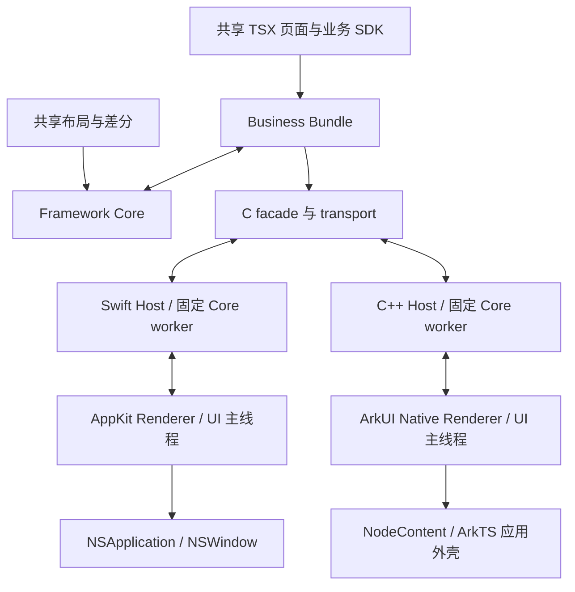

# macOS 与鸿蒙平台支持技术方案

- 日期：2026-11-09
- 状态：macOS AppKit 首期已实现并验证；鸿蒙仍为待实施方案。下文保留原始设计与分阶段验收，当前实现以 `packages/render-macos/README.md` 为准。
- 适用项目：AnseronUI，当前共享 TSX → scriptc AOT Core → 平台原生 Renderer 架构。
- 当前交付：macOS Renderer、Core 构建/打包/运行 CLI、独立应用模板及 AppKit 插件接口；鸿蒙交付为技术路径和验收设计。

macOS 已验证 Apple Silicon 上的真实 AppKit 应用、AOT Core 计数/输入/路由/计时器/扩展/滚动及销毁，独立应用与插件构建通过。构建机要求 macOS 15+；产物声明最低 macOS 14，实测 macOS 27.2 / Xcode 27.2。后续缺陷修复已通过 IME field editor、媒体、RichText 点击/像素、拖动与动画专项回归；macOS 14、Intel、真实输入法候选界面、完整无障碍及桌面滚动仲裁仍待验收。鸿蒙无运行结果。

## 1. 目标与范围

让同一个 AnseronUI 应用工程使用共享 TSX 页面，分别构建 macOS 应用和原生鸿蒙应用。保持组件、Hooks、Flexily 布局、事件、路由和服务调用的公共语义；平台宿主负责真实控件、文字测量和系统能力。

推荐首期范围：

| 项目 | 首期目标 | 后续扩展 |
| --- | --- | --- |
| macOS | AppKit 原生 Renderer、Apple Silicon arm64、单窗口、可运行 `.app` | Intel / Universal、更多桌面能力与多窗口 |
| 鸿蒙 | 原生 HarmonyOS 应用、arm64 真机、Stage 模型宿主、可安装调试 HAP | 经独立验证的模拟器架构、更多设备形态 |
| 共享能力 | 相同页面源码、基础组件、路由、HTTP、计时器、生命周期 | 补齐媒体、动画、原生扩展及能力清单 |
| 开发工具 | 构建、运行、配置校验、产物身份校验、独立 npm 工程 | 完整发布签名与商店流水线 |

鸿蒙范围以原生鸿蒙 SDK 为准，不把 Android APK 兼容模式当作新平台支持；OpenHarmony 的发行版差异另行验证。macOS 最低部署版本、鸿蒙最低/目标 API 版本在阶段 P0 按已验证 SDK 组合锁定，不能仅按 API 文档出现的版本承诺兼容。

本方案不新增 React 兼容层，不自动把任意 TypeScript 转换为 ArkTS，不改变现有 TS/TSX 支持范围。WebView 封装、完整无障碍、多窗口及商店自动发布不作为首期交付条件。

## 2. 当前实现与差距

以下为实施前方案基线；macOS 后续实现入口和验证状态见本文开头及 Renderer README：

| 位置 | 当前实现 | 对新增平台的影响 |
| --- | --- | --- |
| `packages/ui`、`packages/ui-compiler` | 共享组件、Hooks、TSX lowering | 可复用；平台差异通过宿主能力表达 |
| `packages/core`、`packages/layout` | 独立 Framework Core 与 Business Bundle；共享布局和差分 | 两个 archive 都需按新目标重新编译 |
| `packages/protocol` | 带身份、序号、ACK 的 JSON 通信 | 优先复用现有协议，不因新增平台提升协议版本 |
| `packages/core/native/transport.c` | pthread owner 校验、线程局部 context、C transport | 需验证新目标的 TLS、pthread、错误恢复与 async 清理 |
| `packages/render-ios` | UIKit Renderer、固定 Core worker、Swift/C binding | 可参考 transport、调度和服务逻辑；原生视图部分需要 AppKit 实现 |
| `scripts/build-core.mjs` | `native`、`ios-simulator`、`ios-device`、`android`、`wasm` | `native` 只构建本机 Core/探针，未提供桌面应用宿主 |
| scriptc `backend/targets.ts` | 已有 macOS arm64/x64 等目标，无鸿蒙目标 | macOS 利用已有后端，补应用构建；鸿蒙需要新增编译目标和 runtime 适配 |
| scriptc `backend/native/driver.ts` | 当前交叉编译走 `zigcc`；显式 target 配 `clang` 会拒绝 | 不能仅设置 `SCRIPTC_CC` 为 SDK Clang 路径完成适配 |
| `scripts/native-plugins.mjs` | 清单只接受 schema 1 和 `ios/android/web`，严格拒绝未知字段 | 新增平台需要插件协议升级与显式兼容策略 |
| `scripts/standalone-app.mjs`、`scripts/sdk-files.mjs` | 独立应用创建、SDK 拷贝、既有平台构建 | 仓库示例成功还不代表 npm 用户可用，必须同步扩展 |

现有 Core 接口不是可随意跨线程调用的通用句柄：一个固定 OS 线程只允许一个打开的 transport context。新宿主必须保留这一约束，不能在普通线程池任务之间迁移 Core。

## 3. 技术选择

### 3.1 macOS：AppKit 原生 Renderer

按用户“不用 Catalyst”的方向，macOS 主方案改为 Swift + AppKit。新增 `packages/render-macos`，由 `NSApplication` / `NSWindow` 承载窗口，`NSView` 及 AppKit 控件消费现有 Commit 协议。

| 候选 | 优点 | 代价 | 本方案定位 |
| --- | --- | --- | --- |
| AppKit Renderer | 原生桌面控件、响应链和窗口能力；可利用已有 macOS 编译目标 | 需要实现节点、文本测量、输入和动画等平台层 | 当前主路线 |
| SwiftUI Renderer | 可方便描述 macOS 界面和应用外壳 | 需要把命令式节点树映射为 SwiftUI 状态，还要协调两套布局/更新模型 | 后续可用作外壳，不作为首期 Renderer |
| Mac Catalyst + UIKit | 复用现有 UIKit 平台代码 | 新增 Catalyst 目标与桌面适配 | 本次不采用 |
| WKWebView + Web/Wasm | 可复用 Web Renderer | Web 容器体验，需要额外能力桥接 | 非当前原生路线 |

AppKit 可直接操作视图树和 frame，与现有 CreateNode/SetProps/SetFrame 模型相符。SwiftUI 可在未来通过 NSViewRepresentable 嵌入容器，但首期不额外引入 SwiftUI 渲染层。

共享 TSX、Framework Core、Business Bundle、协议和 Flexily 继续复用。iOS 宿主中的 Foundation 网络、固定线程调度、序列校验和 C binding 可作为复用基础；`UIView`、UIKit 文本/输入控件和依赖 UIKit 的扩展类型需要新的 AppKit 实现。只有确认公共边界后才提取 Apple 共用代码，不强行让 AppKit 依赖 `render-ios`。

### 3.2 鸿蒙：ArkTS 外壳 + C++ Host + ArkUI Native Node

采用 Stage 模型的 ArkTS 应用外壳承接窗口、页面与系统生命周期；通过 Native 模块创建宿主。C++ Renderer 消费 Commit，使用 ArkUI Native Node API 创建真实节点，通过 `NodeContent` / `ContentSlot` 接入 ArkTS 页面。

ArkUI 提供原生节点创建、销毁、树操作、属性和事件 API，适合现有命令式渲染协议。具体节点属性、文本测量接口及最低 API 版本仍需在选定 SDK 上验证；本方案不把“存在 Native Node API”等同于全部组件已可直接映射。

业务 TSX 仍由 scriptc 编译；ArkTS 只承担宿主和必要的平台适配。表述边界为“共享业务 Core 不依赖嵌入 JS 引擎”，不宣称整个鸿蒙进程没有 ArkTS/Ark 运行环境。Node-API 在这里是鸿蒙 Native 模块接口，不要求随应用嵌入 Node.js/libnode。

## 4. 总体架构与协议约束



图中的两端分别链接各自目标的 Core 二进制，不共享同一个运行实例。共享边界如下：

- Framework Core 继续负责布局和差分，Business Bundle 继续负责页面、Hooks 和事件闭包。
- 宿主沿用 Handshake、CreateSurface、Commit、CommitAck、MeasureRequest/Result、ModuleResult 等已有语义。
- 接收消息时校验 build、epoch、surface、generation 和 sequence；退出页面的迟到回调必须丢弃。
- UI 主线程完成节点更新后返回 CommitAck。节点挂载失败不发送成功 ACK；错误进入宿主故障清理流程。
- 文本测量使用目标平台字体引擎，不能把另一端测量值或浏览器测量值当作真实结果。
- 继续遵守外部 envelope 1 MiB、模块参数建议 64 KiB 的现有限制；本次不扩大消息上限。
- 首期只映射已有事件。未来若加入新的键盘、hover 等共享事件，单独设计协议版本与向后兼容，不借平台接入隐式修改语义。

## 5. 构建目标、runtime 与缓存

### 5.1 统一解析构建目标

拟新增 `scripts/platform-targets.mjs`，让仓库构建、独立应用构建和运行命令共同解析目标，避免继续散落平台判断：

| CLI 平台 | 内部 target ID（拟议） | 架构 | Core 产物 | 应用产物 |
| --- | --- | --- | --- | --- |
| `macos` | `macos-arm64` | arm64 | 两个 archive + facade | `.app` |
| `harmony` | `harmony-arm64` | arm64 | 两个 archive + facade，链接入 Native `.so` | HAP |

目标描述包含平台、ABI、编译 triple、SDK 标识、部署/API 版本、C/C++ 编译器、链接器、archiver 和 runtime 标识。macOS 对接 scriptc 已有原生 macOS 目标，当前 arm64 triple 为 `arm64-apple-macosx14.0.0`；鸿蒙使用选定 SDK 实际提供的 OHOS 目标。部署版本和编译参数由 P0 验证固化，不把 Linux musl 或 Android triple 当作鸿蒙替代值。

当前 scriptc 原生对象生成的宿主检查要求 macOS 15 或更新，目标 triple 的部署版本为 macOS 14；构建机器要求与应用最低运行版本必须分别记录。需要降低部署版本时，重新审查 runtime 与 SDK API，并在对应系统验证，不能只修改 Info.plist。

现有 `native` 继续用于本机探针；其含义不随新增 `macos` 命令变化。

### 5.2 scriptc 接入与鸿蒙扩展

macOS 首期沿用已有后端与匹配的 Darwin runtime，不再新增 Catalyst/macabi 目标。以 arm64 Mac 本机构建验证可用链路，再由显式 `macos-arm64` 构建描述固定架构、SDK、部署版本和缓存身份；错误宿主架构要提前拒绝，不能把 `native` 当作任意架构通用构建。

两端检查以下环节，其中目标新增和 runtime 移植主要针对鸿蒙：

1. target 识别、LLVM triple、数据布局、平台分类与 library-mode 限制。
2. compiler driver：macOS 优先复用已验证的本机构建路径，显式 target 路径需验证现有 driver 或定向适配；鸿蒙新增 SDK Clang/sysroot 接入。当前设置非空 `SCRIPTC_TARGET` 同时使用 `SCRIPTC_CC=clang` 会失败，不能只改环境变量或最终链接器。
3. runtime 源码选择、平台条件编译、TLS、线程、内存、时间、随机数等所需系统符号。按照真实链接依赖补 shim，保持业务侧宿主服务边界。
4. 生成对象和 runtime 对象统一 target、PIC、最低版本与 ABI；鸿蒙最终产物检查未解析符号和依赖库。
5. Framework/Business runtime 的符号隔离及 facade 链接；macOS 可以利用匹配其架构与部署要求的 Darwin runtime，鸿蒙必须使用目标 SDK 构建的 runtime，不能复用桌面、iOS 或 Android 二进制。
6. 缓存和 SDK 分发。若新目标暂用源码构建 runtime，要把相应源码与补丁一起放入 SDK，不引用开发机目录。

扩展基于锁定 scriptc 版本进行，修改随项目 vendor 源码及可追溯补丁/清单交付。`prepare:compiler` 当前编译 bundled 源码；新适配不得依赖一次性手工修改或未纳入 npm 包的本机 checkout。

### 5.3 缓存身份

保留 Framework 与 Business 独立源码指纹，在其外叠加目标工具链身份：

```text
artifactKey = hash(
  kind + sourceFingerprint + targetId + arch + triple
  + sdkVersion/build + deploymentVersion/apiLevel
  + compilerVersion + normalizedCompileAndLinkFlags
  + runtimeRevision + patchDigest + internalAbiVersion
)
```

SDK 绝对路径只用于查找，不单独作为工具链兼容性的依据。有效配置和工具链版本必须参与失效判断，避免升级 SDK 后复用旧 archive。应用宿主与插件有单独输入指纹；仅修改 Swift/C++ 宿主不应无条件重编共享 TSX。

产物按 target/arch 隔离；manifest 同时记录新目标身份、源码指纹和 artifact hash。运行已有产物时检查配置、协议和目标匹配。新增编译目标不必改变通信协议 major，但需要升级相应构建 manifest 的读取与校验逻辑。

## 6. macOS 宿主实现

### 6.1 Core 与应用构建

先利用现有 macOS 编译链构建 Core，并在最小 AppKit 应用内运行握手、计数器事件、async 和销毁探针。新增 macOS 工程生成器与模板，生成原生 macOS application target/scheme，配置 `SDKROOT=macosx`、`MACOSX_DEPLOYMENT_TARGET`、AppKit/AVFoundation/AVKit 等实际依赖及 Core 链接。

检查输出 Mach-O 为 macOS 平台；应用、两个 archive、facade 和 runtime 的架构与部署要求一致。可复用的现有 `native` 构建逻辑需接入明确目标身份和产物目录，不能无校验地复制旧探针 archive。首期只承诺 arm64；scriptc 已有 x64 目标也不代表应用已通过 Intel 验证，Universal 需分别构建、验证并合并对应架构。

### 6.2 Renderer 与宿主划分

```text
packages/render-macos/
├── Package.swift
├── Sources/AnseronUIRenderMacOS/
│   ├── AnseronUIRenderView.swift # 可嵌入 NSView 容器
│   ├── MacOSHost.swift          # 固定 worker、协议、服务与路由
│   ├── NativeCore.swift         # C transport binding
│   ├── Renderer.swift           # AppKit 节点、属性、事件和测量
│   ├── Animation.swift          # 宿主侧动画与帧调度
│   └── Extensions.swift         # AppKit 原生组件/Module 工厂
└── README.md

scripts/templates/app/platforms/macos/
├── App.swift                   # NSApplication / NSWindow 入口
├── Info.plist
└── Assets.xcassets/
```

容器提供与现有端相近的 `load/push/replace/pop/destroy` 生命周期语义，名称相同的 `AnseronUIRenderView` 由独立 Swift 模块区分。AppKit 操作限定在 MainActor；Core 操作限定在固定 OS worker。Swift Package 描述源码依赖，不自动解决 Core 编译与链接，CLI/宿主工程负责链接匹配 archive。

### 6.3 原生组件映射

| 共享组件 | AppKit 实现方向 | 主要适配点 |
| --- | --- | --- |
| View | 自定义 NSView，按需启用 layer | frame、子树、背景、边框、圆角、裁剪、命中测试 |
| Text | NSTextField 标签或基于 TextKit 的文本视图 | 换行、截断、字体与约束测量一致性 |
| Button | NSButton 或保持按钮语义的定制控件 | target/action、禁用、键盘激活、原生内边距与样式 |
| TextInput | 单行 NSTextField，多行按共享 API 映射 NSTextView | field editor、marked text、选区、受控值与焦点 |
| ScrollView | NSScrollView + 自定义 documentView | 内容尺寸、滚动偏移、触控板与嵌套滚动 |
| Image | NSImageView 或图层绘制适配 | 缩放、裁剪、加载取消和错误 |
| RichText | NSAttributedString + TextKit/文本视图 | span 样式、点击范围与测量 |
| Video | AVPlayer + AVPlayerView/AVPlayerLayer | 播放、暂停、首帧、进度和释放 |

具体使用哪种文本视图、按钮外观或媒体容器，以共享属性语义和目标最低版本为约束。原生控件的 intrinsic size、bezel 和默认 inset 必须显式处理；不承诺把 UIView 类名机械替换为 NSView 后即可工作。

### 6.4 坐标、输入、动画与生命周期

- **坐标与布局：**Core 使用左上原点、向下的逻辑坐标。自定义根容器和子容器使用 `isFlipped = true`；NSScrollView 的 documentView 同样采用一致坐标。原生子控件、layer 和变换的边界分别校验，不假定 flipped 自动统一所有坐标。用 point 表达布局，Retina 只在需要物理像素的边界转换。
- **布局所有权：**Core 管理的节点按 SetFrame 定位，不再让 Auto Layout 重排同一节点树；外部宿主可以用 Auto Layout 约束整个 AnseronUIRenderView。容器尺寸变化触发 Resize，不能把整屏尺寸当作内容区域。
- **文本测量：**测量和显示使用相同字体、段落、约束、inset 和缩放设置，验证长文本、中文、换行及混合字体。保留 TextKit 实现选择空间，避免测量和实际控件使用不同排版规则。
- **输入与焦点：**对接 first responder 和原生编辑响应链，验证 Tab、Cmd+C/V/A、选区和中文组合输入。受控值更新不能在 marked text 阶段反复覆盖编辑器；程序更新不应再次生成用户输入事件。
- **滚动与事件：**把窗口/视图事件坐标转换到协议定义的坐标系；验证滚动偏移符号、触控板惯性、嵌套滚动及变换后的命中测试。hover/新键盘事件作为后续公共 API 扩展。
- **动画：**优先评估 Core Animation，对需逐帧计算的属性使用最低系统版本支持的帧调度机制；UI 状态在主线程更新。不能直接复制 UIKit CADisplayLink 用法或无条件启用隐式 layer 动画；销毁时取消动画与调度。
- **返回与菜单：**通过 NSMenu/快捷键连接现有页面返回流程，尊重文本编辑器对按键的处理，避免全局拦截破坏编辑操作。
- **生命周期：**窗口关闭、应用退出时释放页面、worker、网络、计时器、媒体和观察者；临时从父视图移除不自动等同于 destroy。关闭最后窗口是否退出由应用外壳定义。

首期提供单窗口和必要菜单。多窗口需要验证并行宿主下的 TLS/runtime 隔离、焦点和资源所有权，不根据“不同线程独立”的接口注释直接承诺支持。

### 6.5 签名边界

本地构建与发布导出分开。生成可本机启动的调试 `.app`，按 Xcode/主机要求使用开发或 ad-hoc 签名；不能把 `CODE_SIGNING_ALLOWED=NO` 当作所有 macOS 场景的可运行保证。Developer ID、Hardened Runtime、公证、商店签名留到发布阶段处理。

## 7. 鸿蒙宿主实现

### 7.1 拟议模块划分

```text
packages/render-harmony/
├── cpp/
│   ├── HarmonyHost.*          # worker、消息调度、身份校验和服务路由
│   ├── HarmonyRenderer.*      # 原生节点、属性、事件和文字测量
│   ├── HarmonyCoreTransport.* # 现有 C transport 的 C++ 封装
│   └── NativeModule.*         # ArkTS/Native 接入与 UI 调度桥
├── ets/                      # 容器、生命周期和系统服务适配
├── CMakeLists.txt
└── README.md

scripts/templates/app/platforms/harmony/
├── AppScope/
├── entry/src/main/           # UIAbility、页面、资源、模块配置和 Native 接入
├── build-profile.json5
├── oh-package.json5
└── hvigorfile.ts
```

这是职责划分，不承诺上述类型已经存在。模板中的依赖和构建配置按 P0 锁定的 DevEco/SDK 版本生成。

### 7.2 固定线程与生命周期

- 每个活动宿主拥有一个固定的原生 OS worker 线程，在线程内打开、驱动和关闭 Core。
- ArkTS/Node-API 回调将消息复制并排队到 worker；不在任意回调线程直接调用 Core。
- worker 输出通过经验证的主线程调度桥交给 UI；Node-API 对象、环境和引用遵守其线程/生命周期规则，不直接跨线程传递使用。
- UI 主线程操作 ArkUI 节点，并回传 ACK、测量与交互结果。等待 UI 结果时 worker 必须能返回事件循环，避免双向同步等待。
- Native 缓冲区以 C transport 的所有权约定释放；异步跨线程投递前复制内容，避免使用 Core reset 后失效的内存。
- 销毁先标记 generation 失效、取消服务和事件来源，再清理节点并请求 owner worker 关闭 Core。失败进入可诊断的终止路径，不把未关闭 context 重新分配给其他页面。
- 现有 transport 在 poisoned 或未完成 async 情况下可能关闭失败；P0 必须验证并记录资源回收行为，必要时修复公共 transport，而不是在 C++ 外层强行 free Core 内部状态。

### 7.3 节点与布局映射

| 共享组件 | 鸿蒙实现方向 | 关键验收 |
| --- | --- | --- |
| View | Native 容器/自定义布局节点 | 子节点顺序、绝对 frame、背景、边框、裁剪 |
| Text | Native 文本节点与平台文本测量 | 换行、字体缩放、宽高约束与测量结果一致 |
| Button | 原生按钮或具备完整按钮语义的组合节点 | 点击、禁用、焦点、标题测量 |
| TextInput | Native 输入节点 | 编辑、组合输入、选区、焦点、受控值回写 |
| ScrollView | Native 滚动节点及显式内容容器 | 内容尺寸、偏移单位、嵌套滚动与事件 |
| Image | 原生图片加载与显示 | 本地/网络资源、缩放模式、取消与错误 |
| RichText | 原生 span 或混合组件适配 | 分段样式、点击范围与测量 |
| Video | 原生媒体组件/必要的 ArkTS 组件桥 | 首帧、暂停、进度、裁剪和释放 |

Core 已计算 Flex frame。Renderer 必须有可控的原生定位和测量机制，不能让 ArkUI 再按另一套 Flex 规则重排同一棵树。P1 验证绝对定位、内容容器和文本测量；Native Node 接口无法满足时，评估官方自定义节点/布局接口或局部 ArkTS 组件桥。

鸿蒙宿主将 Core 逻辑单位映射到 vp；遇到使用 px 的接口显式做密度转换。文字缩放与 fp 由统一测量/渲染策略处理。不可对所有属性机械套用同一比例，尤其需要验证滚动偏移、触点坐标和字体缩放。

### 7.4 服务、返回与扩展

HTTP、timer、router 和原生 Module 继续使用现有服务协议。鸿蒙系统服务可由 ArkTS 适配后回传结果；完成、超时和取消都带 requestId 与页面身份，页面销毁后不再更新 Core。

系统返回保持“页面处理 → 路由 pop → 系统默认”的顺序。P1 必须验证 Stage 返回回调的同步消费契约与固定 worker 间的协调。使用有界请求/回复时，worker 处理 BackPress 不能等待 UI ACK/测量；超时执行已定义回退并丢弃迟到消费结果，不能无限阻塞 UI。若该方式在目标 SDK 上不成立，需要调整返回适配设计后再宣布支持。

动画在 UI 宿主侧推进，不逐帧跨线程调用 TSX。首期协议握手只声明实际完成的节点与能力；未支持组件在检查阶段或明确的宿主错误中报告，禁止静默渲染空白。

### 7.5 HAP 构建与运行

通过鸿蒙 SDK 工具链/CMake 生成 Native `.so`，由 Hvigor 构建宿主并打入 HAP。包内包含匹配的 Core manifest、资源、必要 Native 依赖及权限声明。检查 `.so` 的 ELF 架构、PIC、系统依赖和未解析符号，避免误打包 Android 库。

运行命令通过 SDK 的设备工具选择目标设备，检查连接和架构，安装并启动 Ability。调试签名由应用在 DevEco/本地配置；缺少签名时可以完成允许的构建步骤，但不能声称已得到可安装 HAP。模拟器须按真实 ABI 和 SDK 支持单独接入，不复用真机产物作兼容承诺。

## 8. CLI、配置和插件

### 8.1 拟议命令与配置

新增命令，沿用现有 CLI 的构建与运行分工：

```sh
anseronui build macos
anseronui run macos
anseronui build harmony
anseronui run harmony --device <device-id>
```

生成应用增加对应 `build:macos`、`macos`、`build:harmony`、`harmony` npm scripts。`--dry-run`、`--no-build` 按现有 run 命令约定实现；`--no-build` 仍校验产物身份和有效性。

配置拟新增可选 `macos` 与 `harmony` 区块，声明平台宿主路径、架构、部署/API 版本、应用标识覆盖和入口。平台标识默认来自现有 `app.applicationId`。本机 SDK 路径和签名材料通过环境或平台本地配置提供，不写入公共工程模板。具体字段在 P0 SDK 组合确定后固化并添加严格校验。

新 SDK 对旧应用配置保持原有默认行为，新增区块未出现时不要求安装新平台 SDK。已有应用可按现有 integrate 流程补充平台宿主；避免要求重新 create 或覆盖用户修改过的宿主文件。旧 SDK 不承诺读取新平台配置，文档明确最低 AnseronUI 版本。

### 8.2 插件清单升级

建议新增插件 schema 2，新 SDK 同时读取 schema 1/2：

- schema 1 保持既有 `ios/android/web` 含义。
- schema 2 增加 `macos`、`harmony` 平台声明，插件发布者通过框架 peer 依赖约束最低 SDK 版本。
- macOS 声明 AppKit 平台源码与独立工厂，拟返回 `MacOSPlatformExtensions`。纯 Foundation 服务可抽取共享实现；UIKit 自定义组件和 `IOSPlatformExtensions` 工厂不能直接当作 macOS 适配。
- 鸿蒙声明 ArkTS/C++ 源码、注册工厂、受约束的构建依赖和权限元数据；具体工厂 ABI 在宿主探针后确定。
- 保留包内路径校验、生产依赖扫描、重复名称检查和保留模块名保护；构建配置由 SDK 从结构化元数据生成。
- 当前目标缺少插件适配时，在编译前报出插件名、目标和解决方式；不悄悄跳过插件。

旧 SDK 会拒绝 schema 2，这是明确的版本边界。新 SDK 支持旧插件在原有三端继续工作，但不会自动给旧插件补出新平台能力。

## 9. 代码改造清单

| 位置 | 拟议改造 |
| --- | --- |
| `internal/toolchain/scriptc/packages/compiler/src/backend/targets.ts`、`backend/native/driver.ts`、相关 runtime/toolchain 模块 | 利用已有 macOS 目标；新增鸿蒙目标、SDK driver 与 runtime 适配，验证产物 |
| `scripts/prepare-compiler.mjs`、vendor 清单/补丁 | 固化目标适配，支持干净环境重建 |
| `scripts/platform-targets.mjs`（新增） | 统一平台、ABI、SDK 与工具链描述 |
| `scripts/build-core.mjs`、`scripts/core-inputs.mjs` | 新平台编译、链接、manifest 与工具链缓存身份 |
| `scripts/build-app.mjs`、`scripts/standalone-app.mjs`、`scripts/anseronui.mjs` | 仓库/独立工程构建、设备运行与错误提示 |
| `scripts/generate-macos-project.py`（新增）及对应模板生成器 | 生成 AppKit macOS 工程、scheme、Core 链接与资源配置 |
| `packages/render-macos`（新增） | AppKit Renderer、Host、NSView 容器、文本测量、动画及平台扩展 |
| `packages/render-ios` | 作为 worker、C binding、服务及协议实现参考；提取公共逻辑时验证 iOS 回归 |
| `packages/render-harmony`（新增） | 鸿蒙 Host、Renderer、transport binding 和容器 |
| `scripts/templates/app/platforms/macos`、`platforms/harmony`（新增） | 新建应用及接入用宿主模板 |
| `scripts/native-plugins.mjs` | 双版本清单解析、新平台注册和依赖/权限生成 |
| `scripts/sdk-files.mjs`、`scripts/pack-sdk.mjs` | SDK 分发、源码完整性与 npm tarball 验证 |
| `examples/native/macos`、`examples/native/harmony`（新增） | 真实 Core 示例与平台集成验证 |
| `docs/capabilities.md`、`docs/tooling.md`、根 README | 达到对应验收后更新公开支持范围 |

共享 Core、协议和 UI API 原则上复用；只有探针发现真实兼容缺口时才定向修改，并补上现有平台回归。

## 10. 阶段、验收与停止条件

### P0：工具链与 runtime 可行性

交付两端编译目标、最小宿主/探针、可复现命令和 SDK/设备版本记录。

- macOS：使用已有 macOS 后端，在最小 AppKit 应用内链接并运行两个 archive + facade；验证握手、事件更新和销毁。本机命令行探针作为前置检查，不能替代 NSApplication 事件循环内的集成验证。
- 鸿蒙：在目标设备可运行的 Native 探针或最小应用里执行真实 Core；暂不依赖完整渲染器。
- 两端验证 async/Promise、timer/service 完成与取消、重复创建/销毁、错误路径以及输出内存所有权。
- 检查目标平台、ABI、runtime 符号和产物依赖；记录工具链补丁和不可用的系统符号。

**通过条件：**共享页面能产生正确 Commit，输入改变状态，正常生命周期能完成关闭；已知失败路径有可复现记录与处理策略。

**停止条件：**runtime 关键依赖无法移植、目标代码生成无法成立或生命周期有不可接受风险时，暂停该平台的 UI 扩展，给出证据与替代方案。不得用空壳 `.app`/HAP 代替 Core 验证。

### P1：最小原生应用闭环

同一份计数器、表单和路由页面在两端运行，覆盖 View、Text、Button、TextInput、ScrollView、基础 Image、HTTP、timer、返回与销毁。

验收包含窗口/容器尺寸变化、中文组合输入、字体缩放、长文本、滚动坐标、连续导航、异步完成前退出、后台/前台、网络失败。鸿蒙明确验证 Core frame 与 ArkUI 布局协作；macOS 明确验证鼠标、触控板和键盘路径。

### P2：与现有基础能力对齐

补充 RichText、Video、动画、原生组件、ref、插件模块及资源处理。用同一能力清单标注已通过、受限和不支持，不要求不同系统字体/控件逐像素一致，但要求布局、事件和生命周期语义一致。

失败注入包含错误 Commit、过期消息、组件创建失败、播放器退出、网络取消和 transport 关闭失败。长时间运行记录线程/资源数量、内存趋势和响应性，确认无持续增长；性能阈值在 P1 获取基线后设定，不提前编造耗时或体积目标。

### P3：独立应用与 SDK 交付

从 npm tarball 在框架目录外创建应用，完成 setup、check、typecheck、两端 build/run，并安装示例插件。移动应用目录后可重建，清空缓存后可重建，SDK 版本变化会失效缓存。

运行现有 `typecheck:framework`、`test:framework`、`test:build`、`test:tooling`、`test:package`，以及被修改公共逻辑影响的 iOS、Android、Web 平台集成验证。若环境缺少设备/SDK，应明确记录未执行项，不能以工具链单测代替设备验证。

完成条件分别报告“能编译”“能安装启动”“已验证的组件/服务”“可独立 npm 使用”；签名发布另列。两端按各自验收进度交付，不把一个平台成功当作另一平台也已支持。

## 11. 风险与待定项

| 风险/待定项 | 应对及决策节点 |
| --- | --- |
| macOS 原生 Core 与 AppKit 宿主集成 | P0 利用已有 macOS 后端验证 archive、平台标识、部署版本与事件循环；主要新增工作是 Renderer 和应用工具链 |
| AppKit 坐标、文本编辑和控件默认行为 | P1 验证 flipped 容器、滚动 documentView、文本测量、IME/field editor、first responder 与默认内边距 |
| 鸿蒙 libc/TLS/系统调用不兼容 | 按真实 runtime 链接依赖逐项探针，使用目标 SDK 重编，不借用 Android/Linux 二进制 |
| ArkUI 节点布局、测量或组件 API 覆盖不足 | P1 验证绝对布局和文本测量；局部自定义节点/ArkTS 桥；明确最低 API 与限制 |
| UI ↔ worker 死锁和迟到消息 | 单向排队、身份校验、ACK 时序及销毁测试；返回键同步路径单独验证 |
| 桌面输入与移动端语义差异 | AppKit 组合输入、焦点、快捷键专项；保留原生编辑响应链，需要新共享事件时另行版本化 |
| 插件跨平台误声明 | schema 2、显式声明支持、编译前验证与示例插件测试 |
| 构建成功但无法安装/分发 | 分开记录 archive、应用包、本机运行、签名导出与商店发布的验收状态 |
| SDK/工具链版本尚未锁定 | P0 记录 Xcode、DevEco、SDK/API、设备系统、宿主架构与编译参数 |

当前推荐先完成两端 P0，再实现 AppKit 基础节点与宿主，同时按鸿蒙探针结果细化 Renderer。macOS 可利用已有编译后端，但需要完整新增 Renderer，不再按复用 UIKit 估计工作量。此处是实施顺序建议，不代表已开始平台代码开发。

## 12. 依据与验证边界

仓库依据：`docs/architecture.md`、`docs/core-bundles.md`、两端 Renderer README、`scripts/build-core.mjs`、`scripts/standalone-app.mjs`、`scripts/native-plugins.mjs`、C transport 与锁定 scriptc 源码。当前源码优先于可能滞后的历史设计描述。

2026-11-09 检索的官方接口依据：

- [Apple：AppKit](https://developer.apple.com/documentation/AppKit)
- [Apple：NSView 坐标方向 isFlipped](https://developer.apple.com/documentation/appkit/nsview/isflipped)
- [Apple：NSScrollView](https://developer.apple.com/documentation/appkit/nsscrollview?language=objc)
- [华为：ArkUI NativeModule](https://developer.huawei.com/consumer/en/doc/harmonyos-references/capi-arkui-nativemodule/)
- [华为：Native Node 接入 ArkTS 页面](https://developer.huawei.com/consumer/en/doc/harmonyos-guides/ndk-access-the-arkts-page/)
- [华为：NodeContent](https://developer.huawei.com/consumer/en/doc/harmonyos-references/js-apis-arkui-nodecontent/)
- [华为：ContentSlot](https://developer.huawei.com/consumer/en/doc/harmonyos-references/ts-components-contentslot/)

这些依据支持技术方向和接口存在性，不替代目标 SDK 下的编译、API 可用性检查和真机验证。本次仅编写方案与功能记忆，未安装 SDK、修改运行时代码或执行新平台构建。
